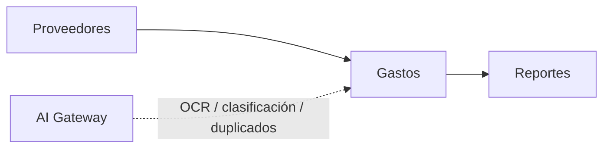

# Módulo Gastos

## Objetivo

Preservar el registro y reporte de gastos, trasladándolo de `gastos.json` a MySQL y conectándolo opcionalmente con Proveedores sin romper la capacidad de registrar proveedores libres.

## Funcionalidad legacy a conservar

- listado paginado;
- crear;
- editar;
- eliminar mediante soft-delete;
- filtros;
- número de factura/documento del gasto;
- fecha;
- proveedor;
- moneda;
- monto gravado;
- monto exento;
- ISV 15%;
- total calculado.

Fórmula legacy:

```text
isv_15 = taxable_amount × 0.15
total = taxable_amount + exempt_amount + isv_15
```

## Debilidades legacy a eliminar

- persistencia en JSON;
- read-modify-write sin transacción;
- proveedor solo texto;
- reportes sumando monedas distintas;
- cálculo duplicado entre frontend/backend.

## Modelo objetivo

```text
expenses
```

Campos:

```text
id
invoice_number nullable
expense_date
supplier_id nullable
supplier_name_snapshot
currency
taxable_amount
exempt_amount
tax_rate
tax_amount
total
notes nullable
created_by
updated_by
created_at
updated_at
deleted_at
```

La tasa inicial equivalente al legacy es 15%.

## Moneda

Mantener `currency`.

Regla obligatoria:

> No sumar montos de monedas diferentes en un total único salvo que exista conversión explícita, tasa y fecha de tipo de cambio.

Mientras no exista módulo FX, Reportes agrupa por moneda.

## API objetivo

```http
GET    /api/v1/expenses
POST   /api/v1/expenses
GET    /api/v1/expenses/{id}
PATCH  /api/v1/expenses/{id}
DELETE /api/v1/expenses/{id}
```

Filtros:

```text
search
supplier_id
date_from
date_to
currency
page
per_page
```

## Conexiones



El número de factura del gasto se mantiene como referencia documental y no modifica Facturas de venta salvo relación explícita futura.

## Seguridad

```text
gastos.view
gastos.create
gastos.update
gastos.delete
```

## Integración de IA

Tools:

```text
get_expense()
classify_expense()
suggest_supplier_match()
detect_duplicate_expense()
extract_expense_document()
explain_expense_anomaly()
```

### OCR / extracción documental

Si el usuario sube una factura, recibo o comprobante:

```text
documento -> S3 privado -> Document Service -> AI extraction -> propuesta
```

La IA puede sugerir:

```text
invoice_number
expense_date
supplier_name
currency
taxable_amount
exempt_amount
tax_amount
total
```

pero **no registra automáticamente el gasto**. El usuario revisa y confirma, o una futura regla explícita de automatización deberá imponer validaciones y umbrales.

### Matching de proveedor

`suggest_supplier_match()` puede relacionar el nombre extraído con `suppliers`, pero no modifica el proveedor maestro ni crea uno automáticamente.

### Duplicados

`detect_duplicate_expense()` puede usar señales como:

```text
invoice_number
supplier
amount
date
currency
sha256 del documento
```

para advertir posibles duplicados. La decisión final permanece en la aplicación/usuario.

### Cálculos

La IA no determina el impuesto ni el total persistido. El cálculo canónico permanece en Go:

```text
ExpenseCalculator
```

### Privacidad y seguridad

Documentos de gasto son contenido externo no confiable. Instrucciones encontradas dentro del archivo no habilitan tools ni cambian permisos.

## Criterios de aceptación

- La fórmula legacy 15% produce los mismos resultados.
- No se usa JSON como base de datos.
- Proveedor libre sigue siendo válido y puede tener FK opcional.
- Reportes no mezclan monedas sin conversión.
- Soft-delete se conserva.
- IA puede extraer/proponer campos pero el registro final se valida en Go.
- Posibles duplicados se advierten sin eliminar ni fusionar automáticamente.
- Gastos funciona aunque la IA esté deshabilitada.


Las capacidades OCR/extracción descritas requieren ejecutor externo por definir; no se ejecutan en Lightsail.
