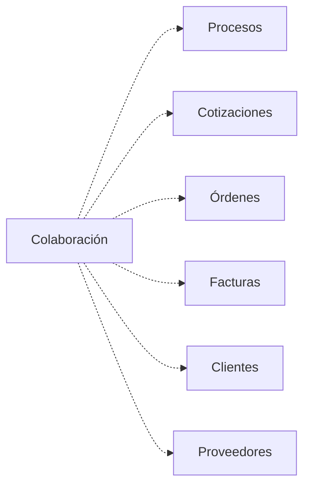

# Módulo Colaboración

## Objetivo

Preservar la biblioteca por empresa/persona, con subida, preview, descarga, filtros y borrado lógico, migrando bytes a S3, metadata a MySQL y agregando autorización real.

## Funcionalidad legacy a conservar

- carpeta de empresa;
- carpetas por persona;
- conteo de archivos;
- filtros/búsqueda;
- subida;
- título/notas/metadata;
- preview;
- descarga;
- tamaño visible;
- borrado lógico;
- identificación visual del scope.

## Debilidades legacy a eliminar

- “carpeta persona” solo visual;
- acceso por ID sin ownership/policy suficiente;
- manifest JSON;
- binarios en filesystem backend;
- MIME/extensiones demasiado permisivos;
- preview inline de contenido activo;
- read-modify-write sin transacción.

## Modelo objetivo

```text
documents
document_links
collaboration_entries
```

### collaboration_entries

```text
id
document_id
scope        // company | person
person_id nullable
title
notes nullable
uploaded_by
created_at
updated_at
deleted_at
```

Bytes en S3.

## Upload seguro

```text
Angular
 -> Laravel validation
 -> S3 privado
 -> checksum
 -> metadata MySQL
 -> opcional malware scan
 -> available
```

Allowlist inicial configurable:

```text
pdf
doc/docx
xls/xlsx
csv
txt
jpg/jpeg/png
```

Contenido activo riesgoso no se sirve inline.

## Preview y descarga

- endpoint autorizado o URL firmada corta;
- `Content-Disposition` seguro;
- HTML/SVG y otros activos se aíslan o descargan;
- nunca exponer `storage_key` directamente.

## Autorización

Scope empresa:

```text
colaboracion.view
```

Scope persona:

- admin autorizado; o
- persona propietaria; o
- permiso explícito.

Conocer el ID no otorga acceso.

## API objetivo

```http
GET    /api/v1/collaboration
POST   /api/v1/collaboration
GET    /api/v1/collaboration/{id}
DELETE /api/v1/collaboration/{id}

GET    /api/v1/collaboration/{id}/preview
GET    /api/v1/collaboration/{id}/download
```

Filtros:

```text
scope
person_id
search
page
per_page
```

## Conexión documental



La infraestructura documental es común, pero los permisos de cada módulo se mantienen separados.

## IA

Tools:

```text
list_authorized_documents
get_document_metadata
summarize_document
extract_document_fields
```

La IA solo recibe documentos autorizados para el solicitante. Todo contenido es no confiable frente a prompt injection.

## Seguridad

```text
colaboracion.view
colaboracion.upload
colaboracion.download
colaboracion.delete
```

Descargas sensibles pueden auditarse.

## Criterios de aceptación

- Carpetas empresa/persona siguen en UX.
- Upload/preview/download continúan.
- Borrado sigue siendo lógico.
- Metadata deja JSON.
- Bytes dejan webroot.
- Scope persona pasa de visual a autorización real.
