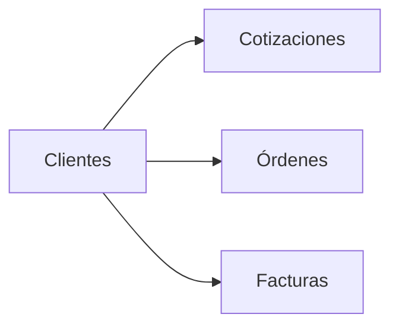

# Módulo Clientes

## Objetivo

Mantener el catálogo de clientes utilizado por cotizaciones, órdenes y facturas, preservando la posibilidad de trabajar con cliente manual cuando corresponda.

## Funcionalidad legacy a conservar

- listado;
- búsqueda;
- creación;
- edición;
- nombre;
- RTN;
- contacto;
- teléfono;
- correo;
- dirección;
- uso como catálogo;
- RTN vacío permitido;
- deduplicación lógica por nombre/RTN;
- cliente manual en documentos.

## Debilidades legacy a eliminar

- deduplicación solo visual;
- carreras entre buscar/insertar;
- falta de restricción canónica;
- documentos históricos que pueden mostrar datos actuales del cliente.

## Modelo objetivo

```text
clients
```

Campos recomendados:

```text
id
name
canonical_name
rtn
canonical_rtn
contact_name
phone
email
address
is_active
created_by
updated_by
created_at
updated_at
deleted_at
```

No fusionar duplicados automáticamente si tienen referencias históricas.

## Snapshots documentales

Cotizaciones, órdenes y facturas conservan:

```text
client_id nullable
client_name_snapshot
client_rtn_snapshot
client_contact_snapshot
client_email_snapshot
client_address_snapshot
```

Editar el maestro no altera documentos históricos.

## API objetivo

```http
GET    /api/v1/clients
POST   /api/v1/clients
GET    /api/v1/clients/{id}
PATCH  /api/v1/clients/{id}
```

Filtros: `search`, `rtn`, `is_active`, `page`, `per_page`.

## Conexiones



## Seguridad

```text
clientes.view
clientes.create
clientes.update
```

## IA

Tools:

```text
search_clients
get_client
suggest_client_match
```

La IA puede sugerir duplicados; no fusionarlos automáticamente.

## Criterios de aceptación

- CRUD legacy preservado.
- RTN vacío sigue siendo válido.
- No se crean duplicados concurrentes equivalentes.
- Documentos históricos mantienen snapshot.
- Cotizaciones, órdenes y facturas enlazan al cliente sin depender de él para reconstruir historia.
