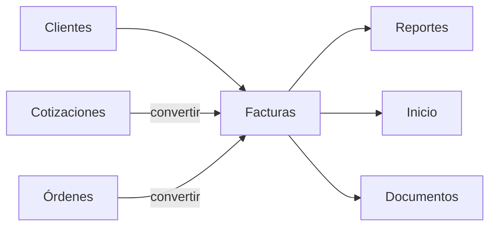

# Módulo Facturas

## Objetivo

Preservar funcionalidad fiscal y comercial de facturas, pagos, conversiones, PDF, nota de entrega y recibo, migrando de JSON a MySQL.

## Funcionalidad legacy a conservar

### Listado/acciones
- listado;
- estados;
- crear;
- editar;
- clonar;
- registrar pago;
- anular/cancelar según regla fiscal;
- convertir desde cotización;
- convertir desde orden.

### Documento
- correlativo fiscal;
- fecha;
- cliente registrado o manual;
- items;
- descuentos;
- ISV 15/18;
- exento;
- exoneración;
- notas públicas;
- costos/inversión;
- gastos adicionales;
- utilidad;
- snapshot SAR.

### Condiciones de pago

```text
contado
credito
credit_days
payments[]
paid_total
balance
```

Métodos legacy:

```text
Siafi
Cheque
Transferencia
Efectivo
```

### Derivados
- factura imprimible/PDF;
- nota de entrega;
- recibo.

## Debilidades legacy a eliminar

- `invoices.json` como almacén;
- pagos embebidos en JSON;
- contador fiscal repartido;
- falta de atomicidad entre factura/settings/origen;
- acciones inconsistentes sobre anuladas;
- recibo basado en total y no en pago real;
- validaciones fiscales solo UI;
- utilidad distinta entre módulos;
- clonación con referencias de origen ambiguas.

## Modelo objetivo

```text
invoices
invoice_items
invoice_payments
invoice_expenses
invoice_counter
invoice_status_history
documents
document_links
```

### invoices

```text
id
invoice_number
client_id nullable
client_*_snapshot
invoice_date
payment_term_type
credit_days nullable
status
subtotal
discount_total
tax_15
tax_18
exempt_total
exonerated_total
tax_total
total
paid_total
balance
products_investment
other_expenses
investment_total
profit
source_quote_id nullable
source_order_id nullable
sar_snapshot_json
idempotency_key
created_by
updated_by
created_at
updated_at
cancelled_at
deleted_at
```

### invoice_payments

```text
id
invoice_id
date
method
amount
reference
receipt_number nullable
created_by
created_at
voided_at nullable
```

## Correlativo fiscal

Una sola fuente transaccional. Preservar formato/prefijo configurado y snapshot SAR. No retroceder contador en el nuevo diseño sin una política fiscal explícita y tests.

## SAR snapshot

Al emitir, copiar datos SAR relevantes a la factura. Modificar Configuración después no cambia facturas emitidas.

## Pagos

Registrar pago:

1. lock/transacción;
2. calcular saldo en backend;
3. impedir sobrepago;
4. insertar pago;
5. recalcular pagado/saldo;
6. derivar estado;
7. auditar y emitir evento.

## Anulación

Una factura anulada no puede editarse, cobrar, clonar ni cambiar estado salvo acción administrativa explícita. Listados, Inicio y Reportes comparten el mismo scope.

## Conversiones

```http
POST /api/v1/quotes/{id}/convert-to-invoice
POST /api/v1/orders/{id}/convert-to-invoice
```

Idempotentes, trazables y atómicas.

## API objetivo

```http
GET    /api/v1/invoices
POST   /api/v1/invoices
GET    /api/v1/invoices/{id}
PATCH  /api/v1/invoices/{id}

POST   /api/v1/invoices/{id}/clone
POST   /api/v1/invoices/{id}/payments
POST   /api/v1/invoices/{id}/cancel

GET    /api/v1/invoices/{id}/pdf
GET    /api/v1/invoices/{id}/delivery-note
GET    /api/v1/invoices/{id}/payments/{payment}/receipt
```

## Recibos

El nuevo recibo debe poder referenciar un pago real:

```text
invoice_payment_id
amount
date
method
reference
```

## Conexiones



## Seguridad

```text
facturas.view
facturas.create
facturas.update
facturas.cancel
facturas.payment
```

Emisión, cancelación y pagos siempre auditados.

## IA

Puede preparar borradores, detectar inconsistencias y comparar documentos. No puede cambiar correlativo, registrar pago real, anular ni alterar snapshot SAR sin tool/policy explícita.

## Criterios de aceptación

- Sin dependencia de `invoices.json`.
- Pagos como filas auditables.
- Definición uniforme de anulada/pagada.
- Conversiones sin duplicados.
- Snapshot SAR histórico.
- Nota de entrega y recibo disponibles.
- Tests de contado, crédito, abonos, sobrepago, anulación, clonación y correlativo.
