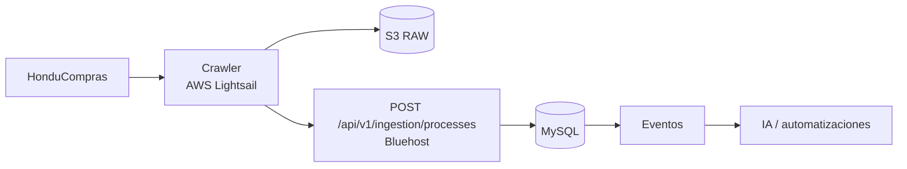

# Módulo Procesos

## Objetivo

Convertir Procesos en el punto de entrada de oportunidades de HonduCompras, preservando filtros, marcas, notas y exportación legacy, con ingestión API, versionado, trazabilidad y conexión nativa hacia Cotizaciones.

## Runtime aprobado

**El crawler de HonduCompras se ejecuta en AWS Lightsail.**

GitHub conserva código, documentación y CI/CD, pero no es el runtime del crawler.



El crawler reporta `crawler_run_id` y nunca escribe directo a MySQL.

## Funcionalidad legacy a conservar

### Visualización y filtros

- tarjetas/bloques visuales;
- entidad;
- keyword;
- búsqueda sobre especificaciones y expediente;
- orden asc/desc por fecha;
- vigencia;
- solo marcados;
- ocultar municipalidades;
- resumen de solicitud con fallback a especificaciones;
- fecha de recepción;
- expediente;
- especificaciones.

### Usuario

- marcar/desmarcar interés;
- nota personal;
- conservar marca/nota al actualizar la fuente.

### Administración

- estado de fuente/ingestión;
- actualizar/refrescar;
- exportar CSV;
- resumen de leídas/nuevas/actualizadas/inactivas/errores;
- administración/depuración restringida.

## Debilidades legacy a eliminar

- crawler sin contrato formal de ingestión;
- FTPS + CSV como acoplamiento principal;
- importación manual como flujo diario;
- identidad hash ambigua;
- ausencia de historial durable por ejecución;
- `active` confundido con vigencia;
- filtros/paginación en memoria;
- frontend limitado por primera página grande;
- shapes inconsistentes de marks/notas;
- purge físico destructivo;
- formula injection en CSV.

## Ingestión y tolerancia a fallos

Flujo:

```text
HonduCompras
  -> crawler Lightsail
  -> snapshot raw S3
  -> Laravel ingestion API
  -> MySQL
```

Reglas:

- cada ejecución tiene `crawler_run_id`;
- la misma entrada puede reintentarse sin duplicar;
- una ejecución parcial/fallida no puede inactivar procesos por ausencia;
- el backend decide normalización, deduplicación/upsert y reglas de negocio;
- S3 conserva evidencia raw;
- CSV queda como exportación o mecanismo de recuperación manual.

## Modelo objetivo

```text
crawler_runs
processes
process_versions
process_documents
process_user_marks
process_user_notes
```

### crawler_runs

```text
id
source
started_at
finished_at
status
is_complete
records_found
new_records
updated_records
unchanged_records
errors_count
raw_snapshot_key
```

### processes

```text
id
source
external_id
expediente
entity
title
received_at
closing_at
is_source_active
first_seen_at
last_seen_at
last_changed_at
current_version_id
created_at
updated_at
```

Identidad:

```text
UNIQUE(source, external_id)
```

Si la fuente no entrega ID confiable, la estrategia sustituta debe ser explícita y versionada.

### process_versions

```text
id
process_id
crawler_run_id
content_hash
normalized_data
raw_data
created_at
```

Solo se crea una versión nueva cuando cambia contenido significativo.

## Active vs vigencia

```text
is_source_active = observado correctamente en la fuente
is_current       = closing_at >= ahora según reglas de negocio
```

No son equivalentes.

## Marcas y notas

Contrato uniforme:

```json
{
  "is_interesting": true,
  "note": "..."
}
```

Son por usuario y sobreviven a nuevas versiones.

---

## Conversión Proceso -> Cotización

### Regla funcional

Un proceso puede crear una **cotización borrador** transfiriendo exclusivamente:

```text
cliente / entidad
expediente
```

y conserva:

```text
process.id -> quotes.source_process_id
```

La acción no consume, reemplaza ni modifica el proceso.

Cardinalidad:

```text
processes 1 ---- N quotes
```

### Datos transferidos

| Proceso | Cotización |
|---|---|
| `entity` | `client_id` si existe match + `client_name_snapshot` |
| `expediente` | `process_reference_snapshot` |
| `id` | `source_process_id` |

No se transfieren automáticamente:

```text
especificaciones
fechas
documentos
notas personales
marks
score IA
raw crawler
items
precios
cantidades
```

La cotización queda en borrador con items vacíos.

### Resolución del cliente

```text
process.entity
    |
    v
ClientResolver
    |
    +-- match exacto/canónico -> client_id + snapshot
    |
    +-- sin match -> client_id = null + client_name_snapshot
```

Reglas:

- no crear clientes automáticamente desde el crawler;
- no bloquear la cotización por falta de match;
- permitir `Vincular cliente` o `Crear cliente` posteriormente;
- editar el cliente maestro no altera el snapshot histórico.

### API

```http
POST /api/v1/processes/{process}/create-quote
```

La Action debe:

1. autenticar;
2. autorizar acceso al proceso;
3. exigir `cotizaciones.create`;
4. cargar proceso;
5. resolver cliente;
6. copiar expediente;
7. llamar a la Action pública de Quotes;
8. persistir `source_process_id`;
9. auditar;
10. publicar `process.quote_created`;
11. devolver la cotización para abrir el editor.

Debe admitir protección idempotente frente a doble clic/retry sin impedir que una nueva intención explícita cree otra cotización para el mismo proceso.

### UX

Proceso:

```text
[Crear cotización]

Cotizaciones relacionadas
COT-001247  Borrador
COT-001251  Enviada
```

Cotización:

```text
Proceso de origen
ENEE-CM-...
[Ver proceso]
```

---

## API objetivo

```http
GET   /api/v1/processes
GET   /api/v1/processes/{id}
GET   /api/v1/processes/{id}/versions
PATCH /api/v1/processes/{id}/interest
PATCH /api/v1/processes/{id}/note

POST  /api/v1/processes/{id}/create-quote

GET   /api/v1/processes/status
POST  /api/v1/processes/export

POST  /api/v1/ingestion/processes
POST  /api/v1/ingestion/runs
```

Filtros:

```text
search
entity
interesting
source_active
current
hide_municipalities
direction
date_from
date_to
page
per_page
```

## Importar/Actualizar en UI

- `Actualizar` refresca datos y estado de la última ingestión;
- admin puede solicitar reprocesamiento;
- puede existir importador CSV de emergencia;
- mostrar última ejecución, última exitosa, encontrados, nuevos, cambiados y errores.

## Export CSV

- server-side;
- UTF-8;
- respeta filtros;
- neutraliza `=`, `+`, `-`, `@`;
- autorización obligatoria.

## IA

Jobs posibles:

```text
classify_process
summarize_process
extract_requirements
calculate_relevance
match_internal_history
search_suppliers
suggest_bid_or_no_bid
```

Los resultados IA se guardan por versión e `input_hash`.

La creación básica de cotización no depende de IA. Una acción posterior puede proponer items desde especificaciones.

## Seguridad

```text
procesos.view
procesos.mark
procesos.note
procesos.export
procesos.ingest
procesos.admin
```

Crear cotización:

```text
procesos.view
cotizaciones.create
```

Ingestión utiliza identidad machine-to-machine del crawler Lightsail.

## Criterios de aceptación

- El crawler sigue ejecutándose en Lightsail.
- Filtros, marcas, notas y export continúan.
- No hay tope silencioso de filas.
- Reintentos no duplican procesos.
- Runs parciales/fallidos no inactivan por ausencia.
- Cambios generan versiones.
- Marks/notas sobreviven.
- `active` y `vigente` permanecen separados.
- CSV no es integración primaria.
- Un proceso crea una cotización borrador con cliente y expediente.
- No se copian items/precios/especificaciones automáticamente.
- Un proceso puede relacionarse con varias cotizaciones.
- Cliente desconocido no bloquea la creación.
- Doble clic/retry no crea duplicados involuntarios.
