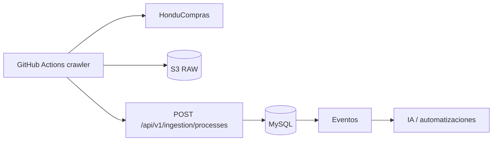
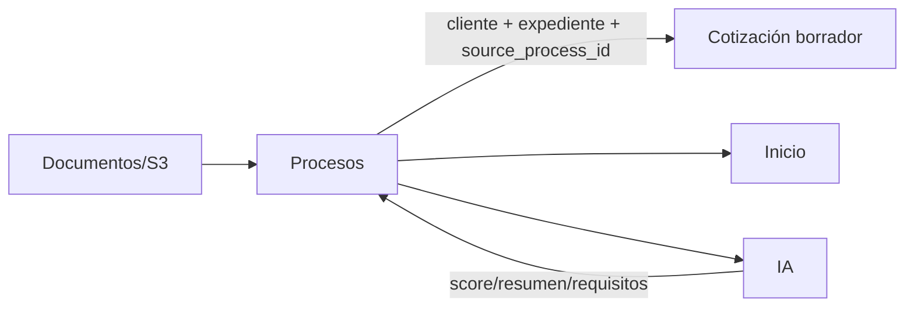

# Módulo Procesos

## Objetivo

Convertir Procesos en el punto de entrada de oportunidades de HonduCompras, preservando filtros, marcas, notas y exportación legacy, pero sustituyendo CSV/FTPS/manual por ingestión API, versionado y automatización.

## Funcionalidad legacy a conservar

### Visualización y filtros

- tarjetas/bloques visuales de 10;
- entidad;
- keyword;
- búsqueda sobre especificaciones y expediente;
- orden asc/desc por fecha;
- vigencia;
- solo marcados;
- ocultar municipalidades;
- resumen de solicitud con fallback a especificaciones;
- fecha de recepción;
- expediente;
- especificaciones.

### Usuario

- marcar/desmarcar interés;
- nota personal;
- conservar marca/nota al actualizar la fuente.

### Administración

- status de fuente/importación;
- actualizar/importar;
- exportar CSV;
- resumen de leídas/nuevas/actualizadas/inactivas/errores;
- administración/depuración restringida.

## Debilidades legacy a eliminar

- crawler fuera de integración formal;
- FTPS + CSV como acoplamiento principal;
- importación manual;
- identidad hash ambigua;
- sin historial durable por ejecución;
- `active` confundido con vigencia;
- filtros/paginación en memoria;
- frontend limitado por primera página grande;
- shapes inconsistentes de marks/notas;
- purge físico destructivo;
- formula injection en CSV.

## Nueva ingestión



El crawler reporta `crawler_run_id` y nunca escribe directo a MySQL.

## Modelo objetivo

```text
crawler_runs
processes
process_versions
process_documents
process_user_marks
process_user_notes
```

### crawler_runs

```text
id
source
started_at
finished_at
status
records_found
new_records
updated_records
unchanged_records
errors_count
raw_snapshot_key
```

### processes

```text
id
source
external_id
expediente
entity
title
received_at
closing_at
is_source_active
first_seen_at
last_seen_at
last_changed_at
current_version_id
created_at
updated_at
```

Restricción:

```text
UNIQUE(source, external_id)
```

Si la fuente no entrega ID confiable, la estrategia de identidad debe ser explícita y versionada.

### process_versions

```text
id
process_id
crawler_run_id
content_hash
normalized_data
raw_data
created_at
```

Solo se crea versión cuando cambia contenido significativo.

## Active vs vigencia

```text
is_source_active = apareció en la fuente esperada
is_current       = closing_at >= ahora según reglas de negocio
```

No son equivalentes.

## Marcas y notas

Contrato uniforme:

```json
{
  "is_interesting": true,
  "note": "..."
}
```

Son por usuario y sobreviven a nuevas versiones.

## Conversión Proceso -> Cotización

### Regla funcional

Un proceso puede crear una **cotización borrador** arrastrando exclusivamente los dos datos comerciales que el proceso garantiza para esta operación:

```text
cliente / entidad
expediente
```

Además se conserva la relación técnica:

```text
process.id -> quotes.source_process_id
```

La conversión **no consume, reemplaza ni modifica** el proceso. El proceso continúa existiendo y puede tener varias cotizaciones relacionadas.

Cardinalidad objetivo:

```text
processes 1 ---- N quotes
```

Esto permite crear alternativas, revisiones u ofertas diferentes para un mismo expediente.

### Datos transferidos

| Proceso | Cotización |
|---|---|
| `entity` / cliente de fuente | `client_id` si existe match y `client_name_snapshot` |
| `expediente` | `process_reference_snapshot` / expediente visible |
| `id` | `source_process_id` |

No se copian automáticamente:

```text
especificaciones
fechas
documentos
notas personales
marks
score IA
raw crawler
items
precios
cantidades
```

La cotización se crea con items vacíos y estado de borrador.

### Resolución del cliente

El valor de entidad proveniente del proceso se resuelve mediante un servicio de dominio, por ejemplo:

```text
ClientResolver
```

Flujo:

```text
process.entity
    |
    v
ClientResolver
    |
    +-- match exacto/canónico -> client_id + snapshot
    |
    +-- sin match -> client_id = null + client_name_snapshot
```

Reglas:

- no crear clientes automáticamente desde el crawler;
- no bloquear la creación de cotización si el cliente no existe en catálogo;
- cuando no hay match, la cotización conserva el nombre como snapshot manual;
- la UI debe permitir luego `Vincular cliente` o `Crear cliente` de forma explícita;
- actualizar el cliente maestro en el futuro no altera el snapshot de la cotización.

### API de conversión

```http
POST /api/v1/processes/{process}/create-quote
```

La acción debe:

1. autenticar al usuario;
2. exigir acceso al proceso y permiso `cotizaciones.create`;
3. cargar el proceso en backend;
4. resolver cliente;
5. copiar expediente;
6. crear la cotización borrador mediante la Action pública del módulo Quotes;
7. guardar `source_process_id`;
8. registrar auditoría;
9. publicar `process.quote_created`;
10. devolver la cotización creada para que Angular navegue al editor.

Respuesta conceptual:

```json
{
  "quote_id": 1247,
  "quote_number": "COT-001247",
  "status": "draft",
  "source_process_id": 918
}
```

La operación puede aceptar `Idempotency-Key` para impedir duplicados causados por doble clic o retry. Una nueva intención explícita con otra llave puede crear otra cotización para el mismo proceso.

### UX

Cada proceso debe ofrecer:

```text
[Crear cotización]
```

Después de crearla, el proceso muestra una sección:

```text
Cotizaciones relacionadas
COT-001247   Borrador
COT-001251   Enviada
```

Cada registro enlaza al editor/detalle de la cotización.

La cotización, a su vez, muestra `Proceso de origen` y un enlace de regreso al expediente.

## API objetivo

```http
GET   /api/v1/processes
GET   /api/v1/processes/{id}
GET   /api/v1/processes/{id}/versions
PATCH /api/v1/processes/{id}/interest
PATCH /api/v1/processes/{id}/note

POST  /api/v1/processes/{id}/create-quote

GET   /api/v1/processes/status
POST  /api/v1/processes/export

POST  /api/v1/ingestion/processes
POST  /api/v1/ingestion/runs
```

Filtros server-side:

```text
search
entity
interesting
source_active
current
hide_municipalities
direction
date_from
date_to
page
per_page
```

## Importar/Actualizar en UI

Para conservar la funcionalidad percibida:

- `Actualizar` refresca datos y estado;
- admin puede solicitar reingestión/reprocesamiento;
- puede existir importador CSV de emergencia separado;
- UI muestra última ejecución, éxito, encontrados, nuevos, cambiados y errores.

## Export CSV

Se conserva y debe:

- aplicar filtros server-side;
- exportar UTF-8;
- incluir metadata;
- neutralizar celdas que inicien con `=`, `+`, `-`, `@`;
- exigir autorización.

## Conexiones



La relación `source_process_id` es persistente y permite navegar en ambos sentidos.

## IA

Jobs:

```text
classify_process
summarize_process
extract_requirements
calculate_relevance
match_internal_history
search_suppliers
suggest_bid_or_no_bid
```

Resultados IA se guardan por versión e `input_hash`. Nunca modifican el raw original.

La creación básica de una cotización **no depende de IA**. Una acción posterior y separada puede proponer items desde las especificaciones del proceso.

## Seguridad

```text
procesos.view
procesos.mark
procesos.note
procesos.export
procesos.ingest
procesos.admin
```

Crear una cotización desde un proceso requiere como mínimo:

```text
procesos.view
cotizaciones.create
```

Ingestión usa identidad machine-to-machine del crawler.

## Criterios de aceptación

- Filtros, marcas, notas y export continúan.
- Sin tope de 1000 filas en frontend.
- Reintentos no duplican procesos.
- Cambios generan versiones.
- Marks/notas sobreviven.
- `active` y `vigente` separados.
- CSV deja de ser mecanismo principal.
- Un proceso puede crear una cotización borrador con cliente y expediente en una sola acción.
- La conversión no copia items, precios ni especificaciones automáticamente.
- Un proceso puede relacionarse con varias cotizaciones.
- El cliente desconocido no bloquea la creación y queda como snapshot manual.
- Doble clic/retry no crea duplicados involuntarios.
