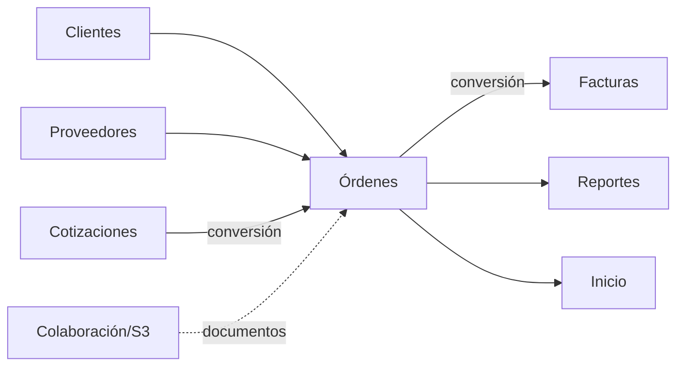

# Módulo Órdenes de Compra

## Objetivo

Preservar el ciclo completo legacy de órdenes: listado, filtros, edición, items, costos, gastos, documentos, estados, entrega, clonación y conversiones; implementándolo con atomicidad y trazabilidad.

## Funcionalidad legacy a conservar

### Listado

- búsqueda por número, factura, cliente, descripción de item y comentario;
- filtros por estado;
- filtro por cliente;
- mínimo/máximo de total;
- paginación;
- acciones desde menú de comportamiento.

### Orden

- crear;
- editar;
- eliminar según política;
- número;
- cliente registrado o manual;
- destino;
- fecha;
- comentarios;
- gastos adicionales;
- clonar;
- marcar entregada;
- número de factura asociado.

### Items

- descripción;
- cantidad;
- precio de venta;
- costo/inversión;
- proveedor;
- estado;
- tracking/comentarios;
- adjuntar/visualizar/descargar/eliminar documento;
- cambiar estado.

### Estados

```text
Orden:
Pendiente
Listo
Entregado
Convertido cuando aplique

Item:
Pendiente
Comprado
```

Regla legacy:

- sin items o con items pendientes -> Pendiente;
- todos comprados -> Listo;
- con número de factura/entrega -> Entregado.

### Acciones

- cotización -> orden;
- orden -> factura;
- clonar;
- marcar entrega.

## Mapping legacy obligatorio

En legacy:

```text
purchase_price = precio de venta unitario
sale_price     = costo/inversión unitario
shipping_cost  = inversión total
shipped_cost   = gastos adicionales
```

El nuevo dominio usa nombres claros:

```text
unit_sale_price
unit_cost
products_investment
additional_expenses
investment_total
```

La migración debe documentar el mapping.

## Cálculos a preservar

```text
subtotal_venta = Σ(cantidad × precio_venta)
inversion_productos = Σ(cantidad × costo)
inversion_total = inversion_productos + gastos_adicionales
ISV = base_gravada × tasa
total_venta = subtotal + impuestos
```

La utilidad debe quedar definida una sola vez y compartida con Reportes, Inicio y Facturas.

## Debilidades legacy a eliminar

- cabecera y detalles sin transacción;
- órdenes vacías accidentales al convertir;
- pérdida de descuentos/ISV 18/trazabilidad;
- `source_quote_id` temporal;
- gastos/comentarios fuera de SQL;
- documentos en filesystem publicable;
- estados por IDs hardcodeados;
- borrados de binarios no reconciliables.

## Modelo objetivo

```text
orders
order_items
order_expenses
order_status_history
documents
document_links
```

### orders

```text
id
order_number
client_id nullable
client_*_snapshot
destination_id nullable
destination_snapshot
order_date
status
comments
source_quote_id nullable
invoice_id nullable
invoice_number_snapshot nullable
subtotal
tax_total
total
products_investment
additional_expenses
investment_total
profit
created_by
updated_by
created_at
updated_at
deleted_at
```

### order_items

```text
id
order_id
description
quantity
unit_sale_price
unit_cost
tax_type
supplier_id nullable
supplier_name_snapshot
status
tracking
comments
created_at
updated_at
```

## Conversión Cotización -> Orden

```http
POST /api/v1/quotes/{quote}/convert-to-order
```

Debe:

1. validar permisos;
2. comprobar idempotencia;
3. leer la cotización en backend;
4. mapear cliente/items/impuestos;
5. crear orden e items en transacción;
6. guardar `source_quote_id`;
7. cambiar estado de cotización después del commit;
8. publicar evento.

Puede crear borrador si faltan destino/número, pero el borrador debe existir íntegro en backend.

## Conversión Orden -> Factura

```http
POST /api/v1/orders/{order}/convert-to-invoice
```

Idempotente y con `invoice_id` persistente.

## API objetivo

```http
GET    /api/v1/orders
POST   /api/v1/orders
GET    /api/v1/orders/{id}
PATCH  /api/v1/orders/{id}
DELETE /api/v1/orders/{id}

POST   /api/v1/orders/{id}/clone
PATCH  /api/v1/orders/{id}/deliver
PATCH  /api/v1/orders/{id}/status

POST   /api/v1/orders/{id}/items
PATCH  /api/v1/orders/{id}/items/{item}
PATCH  /api/v1/orders/{id}/items/{item}/status

POST   /api/v1/orders/{id}/documents
GET    /api/v1/orders/{id}/documents
```

## Documentos

Bytes en S3; metadata en MySQL. Preview/descarga mediante streaming autorizado o URL firmada corta.

## Conexiones



## Seguridad

```text
ordenes.view
ordenes.create
ordenes.update
ordenes.delete
ordenes.deliver
ordenes.convert
```

Entrega, eliminación y conversión requieren auditoría.

## IA

Tools:

```text
get_order
get_order_items
suggest_supplier
suggest_purchase_cost
calculate_order_margin
draft_order_comments
```

La IA no marca `Comprado`, `Entregado` ni factura sin policy/autorización.

## Criterios de aceptación

- No existe orden parcial por fallo entre cabecera/items.
- Conversión conserva trazabilidad.
- No se guarda orden vacía salvo borrador explícito.
- Estados legacy siguen disponibles.
- Clonar reinicia entrega y factura.
- Documentos fuera de webroot.
- Reportes/Inicio usan las mismas fórmulas.
