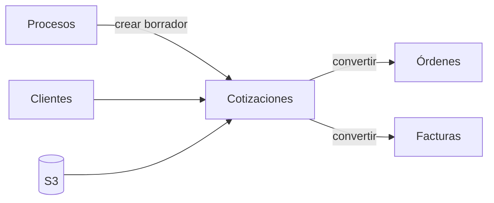

# Módulo Cotizaciones

## Objetivo

Mantener creación, cálculo, listado, búsqueda, estados, PDF, adjuntos, correo, clonación y conversiones, centralizando cálculos en backend y conectando IA de forma segura.

## Funcionalidad legacy a conservar

### Listado
- búsqueda por número, orden, cliente e items/descripciones;
- paginación;
- filtros persistidos en URL;
- selección múltiple;
- acciones bulk;
- estados.

### Documento
- crear/editar;
- número automático `COT-...`;
- cliente registrado o manual;
- proceso/orden de referencia;
- fecha;
- días de validez;
- items;
- notas privadas;
- términos públicos;
- contacto del autor;
- clonar con nuevo correlativo.

### Cálculo
- cantidad;
- precio unitario;
- descuento por item en valor o porcentaje;
- descuento general;
- ISV 15%;
- ISV 18%;
- exento;
- exoneración;
- totales y redondeo.

La semántica legacy del descuento absoluto por item se conserva: **es por unidad**, no por línea.

### Adjuntos
- listar;
- subir;
- preview;
- descargar;
- soft-delete.

### PDF
- plantilla imprimible;
- logo;
- contacto;
- sello;
- total en letras;
- etiquetas de impuesto.

### Correo

Conservar:

```text
to
cc
bcc
subject
message
scheduled_at
PDF
adjuntos
```

Envío inmediato o programado por SMTP Bluehost.

### Conversiones
- cotización -> orden;
- cotización -> factura;
- equivalentes bulk.

## Debilidades legacy a eliminar

- cálculo duplicado PHP/TS;
- conversión a orden en navegador;
- pérdida de descuentos/impuestos;
- hard-delete sin papelera;
- PDF browser/base64 como dependencia;
- jobs JSON sin claim/lock;
- SMTP por sockets propios;
- adjuntos fuera de SQL;
- bulk como requests independientes sin lote trazable.

## Cálculo canónico

Crear:

```text
QuoteCalculator
```

Debe resolver:

```text
descuento_unitario
subtotal_linea
descuento_general proporcional
base 15
base 18
exento
exonerado
ISV 15
ISV 18
total
```

Laravel persiste el resultado. Angular solo hace preview.

## Modelo objetivo

```text
quotes
quote_items
quote_counter
email_messages
documents
document_links
```

`quotes` puede incluir `source_process_id`.

## Numeración

El correlativo `COT-000001...` sigue siendo server-side con transacción, lock de contador y `UNIQUE quote_number`.

## API objetivo

```http
GET    /api/v1/quotes
POST   /api/v1/quotes
GET    /api/v1/quotes/{id}
PATCH  /api/v1/quotes/{id}
DELETE /api/v1/quotes/{id}

POST   /api/v1/quotes/{id}/clone
PATCH  /api/v1/quotes/{id}/status

POST   /api/v1/quotes/{id}/documents
GET    /api/v1/quotes/{id}/documents

POST   /api/v1/quotes/{id}/send
POST   /api/v1/quotes/{id}/schedule-send

POST   /api/v1/quotes/{id}/convert-to-order
POST   /api/v1/quotes/{id}/convert-to-invoice
```

Bulk:

```http
POST /api/v1/quotes/bulk/status
POST /api/v1/quotes/bulk/clone
POST /api/v1/quotes/bulk/export
```

Cada lote devuelve `batch_id` y resultado por item.

## Email Bluehost

```text
Quote
 -> snapshot PDF
 -> queued email
 -> Laravel Mail
 -> Bluehost SMTP
 -> sent/failed ledger
```

No guardar passwords SMTP por usuario en JSON. Programación mediante Scheduler/queue, nunca cron público.

## PDF

Objetivo:

```text
quote -> render -> PDF -> S3 -> document record -> email
```

El PDF enviado es el mismo snapshot registrado para ese envío.

## Conexiones



## Seguridad

```text
cotizaciones.view
cotizaciones.create
cotizaciones.update
cotizaciones.delete
cotizaciones.send
cotizaciones.convert
```

## IA

Tools:

```text
get_quote
create_quote_draft
suggest_quote_items
compare_quote_with_process
calculate_margin
draft_quote_email
```

La IA crea borradores; enviar requiere policy/approval.

## Criterios de aceptación

- Tests de regresión para descuentos/impuestos.
- Correlativo único.
- PDF, adjuntos y correo siguen funcionando.
- Programación no duplica envíos.
- Conversiones son server-side, idempotentes y trazables.
- Notas privadas no se imprimen.
- `terms` sigue siendo público.
