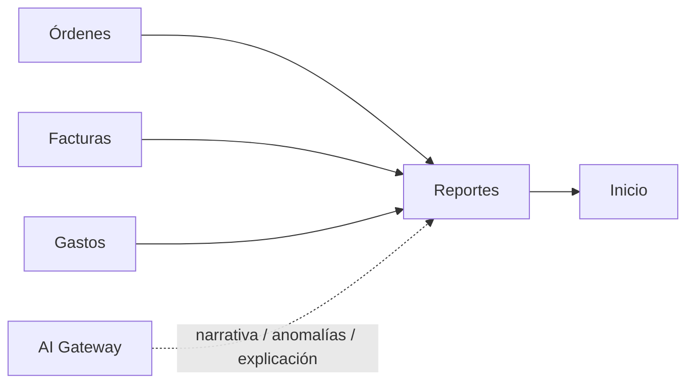

# Módulo Reportes

## Objetivo

Preservar los reportes de **Facturas, Órdenes de Compra y Gastos**, sus filtros, totales y exportación Excel, garantizando consistencia con Inicio y los módulos fuente.

## Funcionalidad legacy a conservar

Tres reportes:

```text
Facturas
Órdenes
Gastos
```

Funciones:

- selección de reporte;
- fecha inicio/fin;
- estado cuando aplique;
- paginación;
- totales;
- campos específicos por tipo;
- Excel de órdenes;
- inversión/utilidad de orden;
- balance de factura;
- exclusión de facturas anuladas/eliminadas.

### Orden

Mostrar al menos:

- subtotal;
- ISV;
- inversión de productos;
- gastos;
- inversión total;
- utilidad;
- estado;
- cliente/destino.

### Factura

- total;
- pagos;
- saldo;
- estado;
- cliente;
- fechas.

### Gastos

- gravado/exento;
- impuesto;
- total;
- proveedor;
- moneda.

## Debilidades legacy a eliminar

- Facturas/Gastos desde JSON y Órdenes desde SQL;
- fechas distintas respecto a Inicio;
- Excel por enlace sin Authorization;
- totales de monedas heterogéneas;
- fórmula de utilidad distinta;
- agregación en memoria.

## Arquitectura objetivo

```http
GET /api/v1/reports/invoices
GET /api/v1/reports/orders
GET /api/v1/reports/expenses
```

Filtros:

```text
date_from
date_to
status
page
per_page
```

Fechas canónicas:

```text
Facturas -> invoice_date
Órdenes  -> order_date
Gastos   -> expense_date
```

Inicio debe usar las mismas.

## Exportaciones

```http
POST /api/v1/reports/orders/export
```

Devuelve stream autenticado o job/documento con expiración.

Excel conserva headings, formatos, fórmulas/totales, hoja, filtros y fecha de generación.

## Consistencia de cálculos

Servicios compartidos:

```text
OrderFinancials
InvoiceFinancials
ExpenseCalculator
```

Reportes no reimplementa las fórmulas.

## Conexiones



## Seguridad

```text
reportes.view
reportes.export
```

Exports privados y expirables.

## Integración de IA

La IA trabaja **sobre métricas calculadas por Reportes**, no sobre cálculos financieros improvisados en el modelo.

Tools:

```text
get_report_metrics()
get_report_rows()
explain_report()
detect_report_anomalies()
compare_periods()
draft_management_summary()
```

### Casos de uso

- generar resumen ejecutivo del período;
- explicar variaciones en facturación, inversión, utilidad o gastos;
- comparar períodos;
- señalar datos atípicos que merecen revisión;
- responder preguntas de lenguaje natural sobre métricas autorizadas;
- preparar narrativa para gerencia.

### Fuente de verdad

Flujo obligatorio:

```text
MySQL
  -> Report Service
  -> métricas canónicas
  -> AI Gateway
  -> explicación/narrativa
```

No:

```text
MySQL raw -> modelo -> modelo calcula totales
```

### Anomalías

Una anomalía generada por IA es una señal, no un hallazgo contable definitivo. Debe mostrar qué datos/metadatos sustentan la observación y permitir navegar al módulo fuente.

### Permisos

La IA solo puede analizar los conjuntos de datos que el usuario tenga permiso de ver. Un resumen no puede filtrar datos de Facturas o Gastos a un usuario que carezca de acceso a esos módulos.

### Exportaciones y IA

La generación de Excel permanece determinista. IA puede sugerir una interpretación o portada/resumen adicional, pero no modifica silenciosamente los valores exportados.

## Criterios de aceptación

- Reportes e Inicio coinciden para mismo período.
- Facturas anuladas se excluyen igual en todo el sistema.
- Excel requiere autorización.
- Gastos se agrupan por moneda si no hay FX.
- No hay límites silenciosos del frontend.
- IA explica métricas calculadas por backend y no redefine fórmulas.
- Toda observación IA puede relacionarse con datos autorizados de origen.
- Reportes funciona sin IA.
