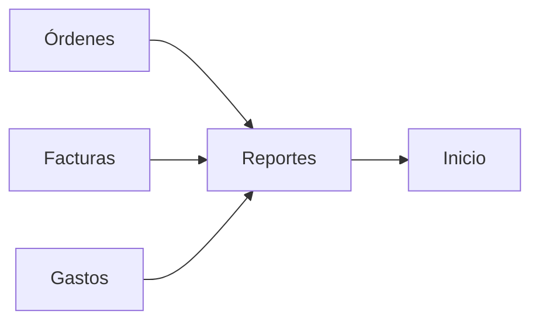

# Módulo Reportes

## Objetivo

Preservar los reportes de **Facturas, Órdenes de Compra y Gastos**, sus filtros, totales y exportación Excel, garantizando consistencia con Inicio y los módulos fuente.

## Funcionalidad legacy a conservar

Tres reportes:

```text
Facturas
Órdenes
Gastos
```

Funciones:

- selección de reporte;
- fecha inicio/fin;
- estado cuando aplique;
- paginación;
- totales;
- campos específicos por tipo;
- Excel de órdenes;
- inversión/utilidad de orden;
- balance de factura;
- exclusión de facturas anuladas/eliminadas.

### Orden

Mostrar al menos:

- subtotal;
- ISV;
- inversión de productos;
- gastos;
- inversión total;
- utilidad;
- estado;
- cliente/destino.

### Factura

- total;
- pagos;
- saldo;
- estado;
- cliente;
- fechas.

### Gastos

- gravado/exento;
- impuesto;
- total;
- proveedor;
- moneda.

## Debilidades legacy a eliminar

- Facturas/Gastos desde JSON y Órdenes desde SQL;
- fechas distintas respecto a Inicio;
- Excel por enlace sin Authorization;
- totales de monedas heterogéneas;
- fórmula de utilidad distinta;
- agregación en memoria.

## Arquitectura objetivo

```http
GET /api/v1/reports/invoices
GET /api/v1/reports/orders
GET /api/v1/reports/expenses
```

Filtros:

```text
date_from
date_to
status
page
per_page
```

Fechas canónicas:

```text
Facturas -> invoice_date
Órdenes  -> order_date
Gastos   -> expense_date
```

Inicio debe usar las mismas.

## Exportaciones

```http
POST /api/v1/reports/orders/export
```

Devuelve stream autenticado o job/documento con expiración.

Excel conserva headings, formatos, fórmulas/totales, hoja, filtros y fecha de generación.

## Consistencia de cálculos

Servicios compartidos:

```text
OrderFinancials
InvoiceFinancials
ExpenseCalculator
```

Reportes no reimplementa las fórmulas.

## Conexiones



## Seguridad

```text
reportes.view
reportes.export
```

Exports privados y expirables.

## IA

Puede generar resumen financiero, anomalías y explicaciones textuales usando datos ya calculados por Reportes.

## Criterios de aceptación

- Reportes e Inicio coinciden para mismo período.
- Facturas anuladas se excluyen igual en todo el sistema.
- Excel requiere autorización.
- Gastos se agrupan por moneda si no hay FX.
- No hay límites silenciosos del frontend.
