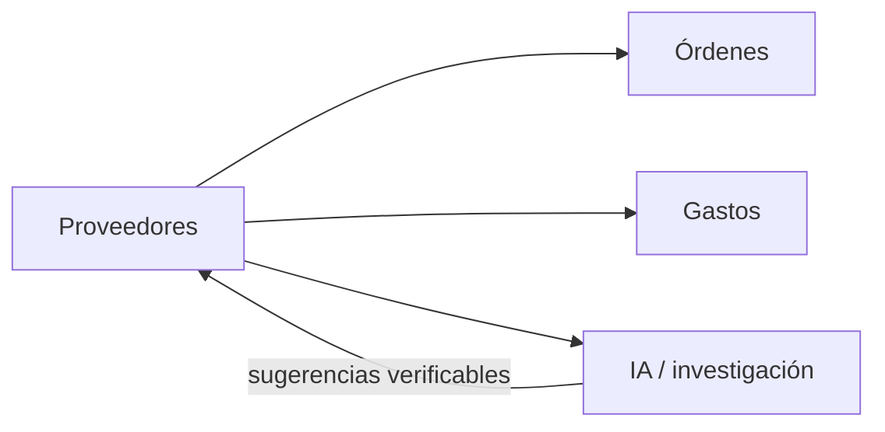

# Módulo Proveedores

## Objetivo

Mantener el catálogo de proveedores y convertirlo en una pieza reutilizable para compras, costos, gastos e investigación asistida por IA.

## Funcionalidad legacy a conservar

- listado;
- creación;
- edición;
- uso como catálogo;
- selección de proveedor en detalles de órdenes;
- compatibilidad con datos históricos donde el proveedor existe solo como texto.

## Debilidades legacy a eliminar

- catálogo demasiado mínimo;
- gastos con proveedor solo texto;
- relaciones sin garantías SQL completas;
- ausencia de trazabilidad de fuentes, contactos y precios investigados.

## Modelo objetivo

```text
suppliers
```

Campos base:

```text
id
name
canonical_name
rtn nullable
country nullable
website nullable
email nullable
phone nullable
contact_name nullable
notes nullable
is_active
created_by
updated_by
created_at
updated_at
deleted_at
```

Puede ampliarse después con:

```text
supplier_contacts
supplier_quotes
supplier_sources
```

## Compatibilidad histórica

Órdenes y gastos conservan:

```text
supplier_id nullable
supplier_name_snapshot
```

## API objetivo

```http
GET    /api/v1/suppliers
POST   /api/v1/suppliers
GET    /api/v1/suppliers/{id}
PATCH  /api/v1/suppliers/{id}
```

Filtros: `search`, `country`, `is_active`, `page`, `per_page`.

## Conexiones



### Órdenes

Cada item puede referenciar proveedor y conservar snapshot.

### Gastos

Se agrega `supplier_id` opcional sin eliminar proveedor libre/snapshot.

## Seguridad

```text
proveedores.view
proveedores.create
proveedores.update
```

## IA y automatización

Tools:

```text
search_suppliers
get_supplier
find_supplier_candidates
get_supplier_price_history
create_supplier_draft
draft_supplier_rfq
```

Toda investigación externa debe conservar fuente, fecha, precio observado, moneda y confianza. Un resultado IA no equivale a una cotización oficial.

## Criterios de aceptación

- CRUD legacy preservado.
- Órdenes siguen seleccionando proveedor.
- Gastos históricos por texto siguen funcionando.
- IA solo propone candidatos/borradores hasta aprobación.
