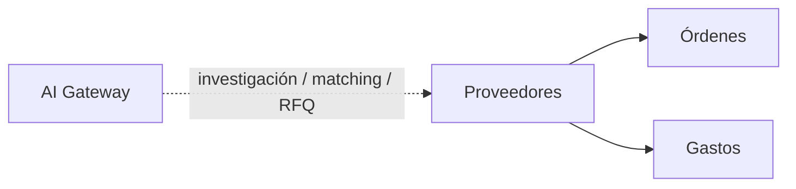

# Módulo Proveedores

## Objetivo

Mantener el catálogo de proveedores y convertirlo en una pieza reutilizable para compras, costos, gastos e investigación asistida por IA.

## Funcionalidad legacy a conservar

- listado;
- creación;
- edición;
- uso como catálogo;
- selección de proveedor en detalles de órdenes;
- compatibilidad con datos históricos donde el proveedor existe solo como texto.

## Debilidades legacy a eliminar

- catálogo demasiado mínimo;
- gastos con proveedor solo texto;
- relaciones sin garantías SQL completas;
- ausencia de trazabilidad de fuentes, contactos y precios investigados.

## Modelo objetivo

```text
suppliers
```

Campos base:

```text
id
name
canonical_name
rtn nullable
country nullable
website nullable
email nullable
phone nullable
contact_name nullable
notes nullable
is_active
created_by
updated_by
created_at
updated_at
deleted_at
```

Puede ampliarse después con:

```text
supplier_contacts
supplier_quotes
supplier_sources
```

## Compatibilidad histórica

Órdenes y gastos conservan:

```text
supplier_id nullable
supplier_name_snapshot
```

## API objetivo

```http
GET    /api/v1/suppliers
POST   /api/v1/suppliers
GET    /api/v1/suppliers/{id}
PATCH  /api/v1/suppliers/{id}
```

Filtros: `search`, `country`, `is_active`, `page`, `per_page`.

## Conexiones



### Órdenes

Cada item puede referenciar proveedor y conservar snapshot.

### Gastos

Se agrega `supplier_id` opcional sin eliminar proveedor libre/snapshot.

## Seguridad

```text
proveedores.view
proveedores.create
proveedores.update
```

## Integración de IA

Tools:

```text
search_suppliers()
get_supplier()
find_supplier_candidates()
get_supplier_price_history()
create_supplier_draft()
draft_supplier_rfq()
record_supplier_research()
```

### Casos de uso

- buscar proveedores existentes;
- encontrar candidatos externos para un item/requisito;
- comparar precio histórico con precio observado;
- proponer proveedor para un item de Orden;
- preparar RFQ;
- resumir historial de relación comercial;
- identificar proveedor potencialmente duplicado.

### Investigación externa

Cada resultado externo debe conservar evidencia suficiente:

```text
source_url
source_type
captured_at
observed_price nullable
currency nullable
availability nullable
supplier_name
part_number nullable
confidence nullable
ai_run_id
```

La IA no puede convertir una búsqueda web en dato maestro sin revisión.

### Proveedores candidatos

Un resultado de investigación debe poder vivir primero como:

```text
supplier_candidate
```

antes de convertirse en `supplier` definitivo.

Crear o promover un proveedor maestro requiere permiso/policy y queda auditado.

### RFQ

Preferir tools limitadas:

```text
draft_supplier_rfq()
send_supplier_rfq()
```

en lugar de correo genérico.

El borrador puede generarse automáticamente. Enviar el RFQ requiere aprobación humana por defecto o una regla de automatización aprobada que limite destinatario, frecuencia, template, item y cooldown.

### Límites

La IA no puede:

- crear proveedores definitivos sin policy;
- sobrescribir datos maestros por investigación web;
- marcar una cotización de proveedor como oficial si solo proviene de una página web;
- enviar RFQ ilimitados;
- revelar credenciales SMTP;
- asumir que un precio observado incluye impuestos, envío o disponibilidad sin evidencia.

## Criterios de aceptación

- CRUD legacy preservado.
- Órdenes siguen seleccionando proveedor.
- Gastos históricos por texto siguen funcionando.
- Toda investigación IA conserva fuente y fecha.
- IA puede proponer candidatos/borradores sin alterar automáticamente el maestro.
- RFQ puede prepararse por IA y enviarse solo bajo policy/aprobación.

## Pipeline IA y revisión del usuario — 2026-10-07

Ver [integración](../../../../../docs/architecture/ai-integration.md), [contrato](../../../../../docs/contracts/ai-pipeline.md) y [presentación](../../../../../docs/modules/ai-results.md). Puntuación diaria de pendientes, investigación por ítem, RFQ con Grokbot, precio sugerido con antecedentes S3/MySQL y fichas. Resultados progresivos dentro de Procesos, con fuentes, fecha y cumplimiento por requisito. Estado de investigación separado de revisión humana y presentación de oferta.

La creación básica de cotización sigue operativa sin IA. Acción adicional explícita del usuario incorpora solo alternativas, cantidades, precios y adjuntos seleccionados, mediante Quotes y sin sobrescribir ediciones humanas. No se exportan automáticamente costos, proveedores, márgenes ni notas internas al cliente.
