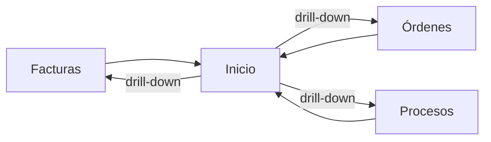

# Módulo Inicio

## Objetivo

`Inicio` es el dashboard operativo y financiero. Debe conservar la vista rápida de **facturas, órdenes y procesos**, pero dejar de recalcular grandes listados en el navegador.

## Funcionalidad legacy a conservar

- rangos `Mes`, `Año`, `Todo`;
- métricas y gráficos de facturas;
- estados y métricas de órdenes;
- conteos y estado de procesos;
- etiquetas visuales de estado;
- evolución mensual;
- montos compactos;
- tolerancia a fallo parcial de una fuente.

## Debilidades legacy a eliminar

- cálculo sobre listados paginados;
- tope práctico de la primera carga;
- fechas no homogéneas con Reportes;
- filtros de procesos distintos a facturas/órdenes;
- fallback que puede mostrar procesos expirados como actuales;
- demasiada lógica de agregación en Angular.

## Arquitectura objetivo

```http
GET /api/v1/dashboard?range=month|year|all
```

Laravel agrega directamente en MySQL.

Respuesta conceptual:

```json
{
  "period": {},
  "invoices": {},
  "orders": {},
  "processes": {},
  "alerts": [],
  "generated_at": "..."
}
```

## Datos

Inicio no tiene tablas propias. Lee de:

```text
invoices
invoice_payments
orders
order_items
processes
process_user_marks
```

## Métricas mínimas

### Facturas
- total facturado;
- pagado/pendiente según saldo;
- saldo pendiente;
- evolución mensual;
- exclusión consistente de anuladas/eliminadas.

### Órdenes
- cantidad y valor por estado;
- Pendiente / Listo / Entregado;
- inversión;
- utilidad canónica compartida con Reportes.

### Procesos
- vigentes;
- marcados;
- nuevos;
- próximos a cierre;
- última ingestión del crawler.

## Conexiones



Cada tarjeta/gráfico debe navegar al módulo fuente con filtros equivalentes.

## Seguridad

Permiso:

```text
inicio.view
```

Inicio no puede exponer datos de módulos que el usuario no tenga permiso de ver.

## IA

Puede generar resumen ejecutivo usando métricas ya calculadas:

```text
generate_daily_business_summary
```

La IA no recalcula totales.

## Criterios de aceptación

- Inicio y Reportes coinciden para mismo rango.
- No hay límite silencioso de filas.
- Anuladas no reaparecen.
- Procesos expirados no cuentan como vigentes.
- Backend hace agregaciones.
