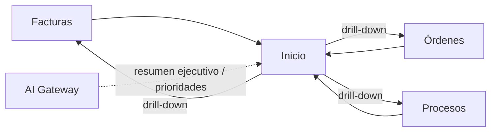

# Módulo Inicio

## Objetivo

`Inicio` es el dashboard operativo y financiero. Debe conservar la vista rápida de **facturas, órdenes y procesos**, pero dejar de recalcular grandes listados en el navegador.

## Funcionalidad legacy a conservar

- rangos `Mes`, `Año`, `Todo`;
- métricas y gráficos de facturas;
- estados y métricas de órdenes;
- conteos y estado de procesos;
- etiquetas visuales de estado;
- evolución mensual;
- montos compactos;
- tolerancia a fallo parcial de una fuente.

## Debilidades legacy a eliminar

- cálculo sobre listados paginados;
- tope práctico de la primera carga;
- fechas no homogéneas con Reportes;
- filtros de procesos distintos a facturas/órdenes;
- fallback que puede mostrar procesos expirados como actuales;
- demasiada lógica de agregación en Angular.

## Arquitectura objetivo

```http
GET /api/v1/dashboard?range=month|year|all
```

Laravel agrega directamente en MySQL.

Respuesta conceptual:

```json
{
  "period": {},
  "invoices": {},
  "orders": {},
  "processes": {},
  "alerts": [],
  "generated_at": "..."
}
```

## Datos

Inicio no tiene tablas propias. Lee de:

```text
invoices
invoice_payments
orders
order_items
processes
process_user_marks
```

## Métricas mínimas

### Facturas
- total facturado;
- pagado/pendiente según saldo;
- saldo pendiente;
- evolución mensual;
- exclusión consistente de anuladas/eliminadas.

### Órdenes
- cantidad y valor por estado;
- Pendiente / Listo / Entregado;
- inversión;
- utilidad canónica compartida con Reportes.

### Procesos
- vigentes;
- marcados;
- nuevos;
- próximos a cierre;
- última ingestión del crawler.

## Conexiones



Cada tarjeta/gráfico debe navegar al módulo fuente con filtros equivalentes.

## Seguridad

Permiso:

```text
inicio.view
```

Inicio no puede exponer datos de módulos que el usuario no tenga permiso de ver.

## Integración de IA

La IA de Inicio funciona como **capa narrativa y de priorización** sobre datos ya calculados por los servicios de dominio.

Tools:

```text
get_dashboard_metrics()
get_priority_processes()
get_pending_orders_summary()
get_receivables_summary()
get_system_health_summary()
generate_daily_business_summary()
explain_dashboard_alert()
```

### Resumen ejecutivo

Puede producir, según permisos del usuario:

```text
procesos nuevos y prioritarios
cotizaciones que requieren acción
órdenes pendientes/listas/atrasadas
facturas y saldos pendientes
gastos o variaciones relevantes
estado del crawler
estado de backups
errores de automatizaciones/IA
```

### Regla de fuente de verdad

La IA no calcula KPIs directamente a partir de filas raw.

```text
Domain/Report Services
      -> métricas
      -> AI Gateway
      -> narrativa/prioridad
```

Los números visibles en el resumen deben provenir de la misma respuesta/servicio que alimenta los widgets del dashboard.

### Priorización

La IA puede proponer prioridades usando señales ya disponibles, por ejemplo:

```text
closing_at próximo
process relevance
factura vencida
orden sin costo/proveedor
fallo reciente del crawler
backup fallido
```

La prioridad es una recomendación, no cambia automáticamente estados de negocio.

### Drill-down

Cada observación IA debe incluir referencias navegables cuando sea posible:

```text
entity_type
entity_id
reason_summary
```

para que el usuario pueda abrir el Proceso, Orden, Factura u otra entidad correspondiente.

### Degradación segura

Si IA falla o está deshabilitada:

- las métricas/gráficos siguen cargando;
- las alertas deterministas siguen funcionando;
- únicamente desaparece el resumen/narrativa IA.

### Privacidad

El resumen respeta los permisos de cada módulo fuente. Un usuario sin acceso a Facturas no recibe cifras de Facturas a través de la IA.

## Criterios de aceptación

- Inicio y Reportes coinciden para mismo rango.
- No hay límite silencioso de filas.
- Anuladas no reaparecen.
- Procesos expirados no cuentan como vigentes.
- Backend hace agregaciones.
- IA no recalcula totales ni KPIs.
- Cada recomendación IA puede enlazar a la entidad de origen cuando corresponda.
- Dashboard funciona normalmente sin IA.
