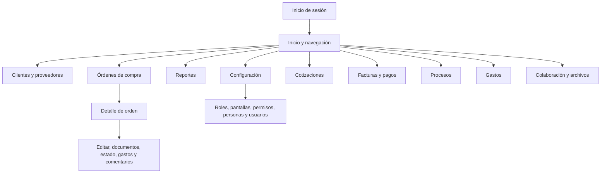

# Informe de análisis de CastilloIT

**Fuente revisada:** copia local en `C:\Users\Marco\Desktop\Bastion\app.castilloit.net`  
**Fecha:** 16 de octubre de 2026  
**Objetivo:** inventariar la aplicación existente como base para una futura implementación compatible en Rust.

## 1. Alcance y nivel de certeza

La copia contiene un frontend Angular compilado (sin TypeScript fuente ni mapas de fuentes visibles), scripts JavaScript/CSS añadidos para ampliar o corregir pantallas, y un backend Laravel 12 con controladores, modelos y rutas. `index.html` carga `main-4ZA7RVJ2.js`; ese enrutador declara cotizaciones, facturas, gastos, procesos y colaboración, además de las pantallas principales. También hay artefactos `main-*.js` de distintas compilaciones, por lo que el archivo enlazado desde `index.html` se tomó como entrada activa. El backend requiere una base de datos existente; la mayoría de las tablas de negocio no tienen migraciones en esta copia.

Este documento describe lo comprobable en esos archivos. Las pantallas y campos proceden de las rutas y plantillas compiladas, los scripts del frontend y las validaciones/controladores del servidor. No se ejecutó la aplicación ni se probaron acciones contra datos reales. No se incluyeron valores de configuración ni archivos de datos privados. Donde una pantalla no se pudo asociar con certeza a una ruta visible se indica explícitamente.

## 2. Resumen ejecutivo

- **Frontend:** Angular compilado en español. El enrutador enlazado declara inicio de sesión, inicio, clientes, proveedores, órdenes, cotizaciones, facturas, gastos, reportes, procesos, colaboración y configuración.
- **Backend:** API REST Laravel 12 bajo `/api`, con JWT/Bearer y controladores para usuarios, permisos, catálogos, compras, cotizaciones, facturas, gastos, reportes, colaboración y procesos.
- **Extensiones de interfaz:** scripts independientes amplían procesos, gastos, reportes y edición/eliminación de órdenes.
- **Persistencia:** Laravel/Eloquent para tablas principales; algunas funciones guardan manifiestos/registros JSON en almacenamiento privado. La migración de procesos está presente. El esquema completo de negocio debe confirmarse con la base activa.
- **Paridad para Rust:** la API y el frontend cubren módulos adicionales al flujo de compras; hay que preservar también las rutas de PDF, nota de entrega y recibo de pago de facturas.

## 3. Arquitectura y conexiones

| Capa | Evidencia | Función |
|---|---|---|
| Aplicación web | `index.html`, `main-*.js`, `chunk-*.js`, CSS | SPA Angular; las rutas web que no corresponden a archivos físicos sirven la aplicación. |
| API | `back/routes/api.php` | Endpoints bajo `/api/auth`; login/refresh/me bajo `/api/public`; proceso programado de cotizaciones bajo `/api/cron`. |
| Backend | `back/app/Http/Controllers` | Reglas de negocio, validación, cálculos, documentos, reportes y correo. |
| Base de datos | Eloquent y consultas de controladores | Usuarios, roles, permisos, catálogos, órdenes y datos de negocio. Las migraciones de negocio están incompletas en esta copia. |
| Archivos | `back/storage/app/private`, `uploads`, `media`, `private_csv` | Adjuntos y almacenamiento auxiliar. La visibilidad efectiva depende de reglas del servidor desplegado. |
| Correo y exportación | Controladores de cotizaciones/reportes, Laravel Excel | Envío SMTP inmediato o programado; exportación Excel y CSV. |
| Navegador | JWT Bearer en `localStorage`, Angular HttpClient y scripts con `fetch`/XHR | El frontend adjunta el token a solicitudes autenticadas. No se encontró integración MCP ni API específica para agentes de IA. |

### Recorrido general

El mapa refleja las rutas del frontend activo; la secuencia real de pasos dentro de cada pantalla debe validarse en una sesión autenticada.

## 4. Módulos, pantallas y experiencia

### 4.1 Acceso e inicio

- Pantallas de login, inicio, perfil y página “No Encontrada”; rutas de aplicación bajo `/auth`.
- Login con correo y contraseña; el backend entrega token y datos básicos/roles. Hay consulta del usuario (`me`), renovación (`refresh`) y salida.
- La navegación principal declara Clientes, Proveedores, Órdenes de Compra, Reportes, Configuración y Mi Perfil. Los módulos pueden depender de permisos.

### 4.2 Perfil y usuarios

- Mi Perfil: consultar/editar datos propios y cambiar contraseña.
- Usuarios: consultar/buscar/paginar; crear con correo, contraseña, confirmación y rol; editar; cambiar estado con observación.
- Validaciones visibles: formato de correo, contraseña de al menos ocho caracteres y rol requerido.

### 4.3 Administración: roles, pantallas y permisos

- Roles: crear, listar, consultar todos y editar.
- Pantallas: crear, listar, consultar todas y editar.
- Permisos: asignar/listar/editar/eliminar permisos por rol y pantalla; consultar módulos disponibles y los módulos del usuario; guardar selección.
- El modelo contempla cuatro acciones: insertar, modificar, eliminar y consultar.

### 4.4 Personas

- Alta, listado y edición; tabla con número, nombre, DNI, género, país y acciones; paginación.
- Campos visibles: nombre completo, DNI/documento de identidad, país y género (Masculino/Femenino). Todos aparecen como requeridos.

### 4.5 Clientes

- Listado con búsqueda/paginación; catálogo completo para selectores; alta y edición.
- El backend normaliza/deduplica clientes y combina datos coincidentes. El modelo utiliza nombre (`cliente_name`) y RTN, entre otros datos.
- Hace falta cotejar el formulario compilado y la base real para cerrar el inventario de todos los campos.

### 4.6 Proveedores y destinos

- Proveedores: listado, consulta, alta y edición; catálogo para selectores. El modelo identifica al proveedor al menos por nombre.
- Destinos: endpoint de catálogo con identificador y descripción para selección.

### 4.7 Órdenes de compra

- Listado con búsqueda/filtros y detalle por identificador.
- Crear orden, editar cabecera y líneas, subir documentos, visualizar/descargar documentos.
- Editar datos de detalle, cambiar estado de una línea o de toda la orden, marcar entregada, clonar y eliminar documentos/orden.
- `castillo-order-inline-edit.js` añade edición en línea y cálculos de inversión, venta, ISV y total; gestiona gastos asociados visibles en el detalle.
- `castillo-delete-order.js` añade botón de borrado con confirmación escrita antes de enviar la solicitud.
- El servidor registra creador/actualizador. Deben cotejarse límites y tipos de documentos con las validaciones reales.
- Flujo típico: listado → abrir detalle → editar datos → adjuntar documentos y actualizar estados → marcar entrega o clonar → confirmar eliminación si aplica.

### 4.8 Gastos

- API de listado, creación, edición y eliminación, con filtros de usuario/orden.
- `castillo-gastos.js` muestra una lista editable vinculada a productos/detalles de orden, recalcula el total y permite eliminar elementos.
- Gastos se normalizan y serializan como JSON. El router activo incluye `/gastos`; el script auxiliar también integra gastos con el detalle de órdenes. Los campos exactos requieren revisión visual junto con validaciones del servidor.

### 4.9 Cotizaciones

- API para listar, consultar, crear, editar, cambiar estado, clonar y eliminar cotizaciones.
- Adjuntos: cargar, previsualizar, descargar y eliminar.
- Correo: envío inmediato o programado con mensaje, destinatarios/copias y adjuntos; configuración SMTP; generación PDF en backend; proceso de cron para envíos programados.
- Rutas de pantalla detectadas: `/cotizaciones`, `/cotizaciones/:id` y `/cotizaciones/:id/pdf`. La sesión activa permitirá enumerar botones, campos y estados completos.

### 4.10 Facturas

- API para listar, consultar, crear, editar, cambiar estado, registrar pago, clonar y eliminar.
- Crear factura desde cotización u orden. Al migrar deben preservarse importes, pagos, saldo/estado y procedencia.
- Rutas detectadas: `/facturas`, `/facturas/:id`, `/facturas/:id/pdf`, `/facturas/:id/nota-entrega` y `/facturas/:id/recibo`. El flujo incluye listado/detalle y documentos, además de las acciones de estado y pago expuestas por API.

### 4.11 Reportes

- Pantalla `/auth/reportes` y script auxiliar que lee fechas, solicita resumen y renderiza resultados.
- API para resumen de órdenes, reportes de facturas/gastos y exportación Excel.
- El resumen de compras incluye número de órdenes, venta total, inversión, ISV, subtotales, inversión en productos, otros gastos y utilidad.
- Presenta importes en lempiras (HNL), con dos decimales. Flujo: elegir fechas → solicitar/revisar reporte → exportar cuando esté disponible.

### 4.12 Procesos

- Script `castillo-procesos.js` conectado a `/api/auth/procesos`.
- Importar CSV, consultar estado/filas/detalle, buscar/filtrar, marcar, añadir notas, exportar CSV y purgar registros antiguos.
- Filtros identificados: búsqueda textual, municipio, marcados, fechas y dirección. Las columnas dependen del CSV/configuración.
- Tiene modelos/migraciones propios: `procesos_rows` y `procesos_marks`.
- Flujo: importar archivo → revisar filas/estado → filtrar y abrir → marcar/anotar → exportar o purgar registros antiguos.

### 4.13 Colaboración y archivos

- API para listar, subir, previsualizar, descargar y eliminar documentos de colaboración.
- Metadatos en manifiesto de almacenamiento privado y documentos en archivos.
- Ruta de pantalla detectada: `/colaboracion`. Falta confirmar visualmente campos, botones y permisos.

### 4.14 Configuración de empresa y correo

- Configuración de empresa: consultar/guardar datos y logo; expone cálculo de estado relacionado con numeración fiscal SAR.
- Configuración de correo: consultar/guardar SMTP por usuario.
- Las rutas de configuración aparecen en Angular, aunque la pantalla anidada puede agrupar estas opciones.

## 5. Mapa de API

Todas las rutas tienen prefijo `/api`. El contrato exacto de campos, códigos y mensajes debe extraerse endpoint por endpoint antes de implementar Rust.

| Grupo | Operaciones principales |
|---|---|
| Público/autenticación | `POST public/login`, `POST public/refresh`, `POST public/me`; `GET auth/logout`. |
| Perfil | `GET mi-perfil`, `PUT editar-mi-perfil`, `PUT editar-password`. |
| Roles y pantallas | Crear/listar/editar roles y pantallas; permisos CRUD por rol/pantalla y permisos por módulo. |
| Personas/usuarios | Crear/listar/editar personas; CRUD parcial de usuarios, cambio de estado. |
| Empresa/correo | `GET/POST configuracion/empresa`, `GET/POST configuracion/correo`. |
| Clientes/proveedores/destinos | Listar/paginar, CRUD parcial y catálogos para selectores. |
| Órdenes | Crear/listar/consultar/editar/clonar/eliminar; documentos, datos de línea, estados de línea/orden y entrega. |
| Cotizaciones | CRUD, estado, clonar, correo inmediato/programado, adjuntos y cron. |
| Facturas | CRUD, estado, pago, clonar y creación desde cotización/orden. |
| Gastos | CRUD. |
| Reportería | Resumen de órdenes, facturas, gastos y Excel. |
| Colaboración | Listar/subir/previsualizar/descargar/eliminar archivos. |
| Procesos | Estado/filas/detalle, importación CSV, marcas, notas, exportación y purga. |

## 6. Entidades y persistencia

Modelos observados: usuarios, roles, pantallas/objetos, relación rol-objeto, personas, clientes, proveedores, destinos, estados, órdenes, detalle de órdenes, filas/marcas de procesos y logs. La API también gestiona cotizaciones, ítems/adjuntos/contactos y correos programados, facturas/pagos y gastos; parte de esos datos usa manifiestos JSON en vez de modelos Eloquent dedicados.

Migraciones presentes: tablas estándar Laravel, tablas de procesos, comentarios de órdenes y ampliación del número de orden. El esquema completo de negocio no está aquí; se necesita exportar solo la estructura (sin datos) de la base actual antes de fijar la migración a Rust.

## 7. Hallazgos para el rediseño seguro

Son observaciones estáticas del código, no una prueba de explotación ni una auditoría dinámica.

1. **Autenticación de rutas:** el grupo `/api/auth` en `routes/api.php` tiene prefijo, pero no declara middleware de autenticación/autorización ahí. Algunos controladores resuelven usuario manualmente vía JWT; revisar endpoint por endpoint que se autentique antes de leer o cambiar datos. En Rust centralizar autenticación, permisos y alcance de datos en middleware obligatorio.
2. **Credencial en navegador:** el frontend guarda JWT en `localStorage`. Definir expiración, rotación y revocación; elegir almacenamiento considerando XSS y clientes IA.
3. **Permisos:** existen roles y permisos por módulo/acción. Deben comprobarse en el servidor, no solo ocultando botones.
4. **Persistencia JSON y archivos:** los manifiestos paralelos a la base pueden sufrir conflictos concurrentes o escrituras parciales. Diseñar transacciones, bloqueo/versionado y auditoría.
5. **Archivos privados:** verificar que `back/storage`, `private_csv` y adjuntos no se puedan servir directamente desde el directorio público. Usar descargas autorizadas, límites de tamaño/tipo, nombres seguros y retención definida.
6. **Borrados y purga:** orden, cotización, factura, adjuntos y procesos tienen operaciones destructivas. Añadir permiso explícito, auditoría e idempotencia; definir recuperación/retención.
7. **Cron de correo:** revisar protección del endpoint programado, secreto, limitación de solicitudes y registro sin exponer credenciales.
8. **SMTP:** cifrar credenciales en reposo y evitar devolverlas al navegador en claro.
9. **Cabeceras web:** `.htaccess` establece varias cabeceras, pero la CSP observada solo fuerza HTTPS y no define orígenes permitidos. Verificar reglas efectivas de Apache/CDN y elaborar CSP compatible.
10. **IA/MCP:** exponer herramientas tipadas, validar cada argumento, aplicar los mismos permisos, auditar actor/acción y requerir confirmación para cambios irreversibles. No exponer SQL ni acceso genérico a archivos al agente.

## 8. Ficha de paridad funcional para la versión Rust

Por cada pantalla/acción, registrar ruta, rol/permisos, campos (etiqueta, tipo, requerido, formato, valores, defecto, validación), columnas y filtros de tablas, botones/confirmaciones, solicitudes API, mensajes y navegación posterior, estados vacíos/carga/error, entidades afectadas y efectos secundarios. Cada ficha terminará con criterios de aceptación que comparen el flujo existente con el nuevo.

## 9. Información pendiente para cerrar el levantamiento

- App activa y cuenta de prueba con roles representativos para revisar visualmente menús, formularios, modales y estados.
- Esquema de base de datos sin filas: tablas, claves, índices, vistas y procedimientos usados.
- Requests/responses, validaciones, mensajes y códigos HTTP de cada endpoint.
- Ejemplos de estructura CSV de procesos, columnas, estados y reglas de importación/marcado/purga.
- Campos completos de clientes, proveedores, órdenes, cotizaciones, facturas, pagos y gastos.
- Límites/tipos de adjuntos, reglas de acceso y retención.
- Matriz real de roles y permisos.
- Confirmación de si cotizaciones, facturas, colaboración y gastos tienen pantallas en otra entrada/versión frontend.

## 10. Archivos de referencia

- Frontend y extensiones: `index.html`, `main-4ZA7RVJ2.js` (entrada enlazada), chunks referenciados, `castillo-procesos.js`, `castillo-gastos.js`, `castillo-reportes.js`, `castillo-delete-order.js`, `castillo-order-edit-fix.js`, `castillo-order-inline-edit.js`.
- Rutas/backend: `back/routes/api.php`, `back/app/Http/Controllers/`, `back/app/Models/`, `back/app/Services/ProcesoCsvImportService.php`.
- Esquema parcial: `back/database/migrations/`.
- Despliegue: `.htaccess`, `back/bootstrap/app.php`, `back/composer.json`.

## 11. Próximo paso

Con una cuenta de prueba, completar el inventario visual campo por campo para los flujos críticos. Luego exportar el esquema de base (sin datos), fijar el contrato compatible y diseñar el backend Rust, la API versionada y las herramientas MCP con permisos explícitos.

## 12. Inventario de campos, botones y funciones

Este inventario se extrajo del router enlazado por `index.html`, los chunks lazy que ese router asigna a cada pantalla, los scripts `castillo-*.js` y las reglas del backend. `*` indica requerido cuando la plantilla lo marca así o el servidor rechaza el dato vacío. “Por confirmar” significa que la etiqueta/control no quedó inequívocamente visible en el artefacto estático; no se debe eliminar del clon sin validarlo en pantalla.

### 12.1 Acceso e inicio

| Pantalla | Campo/control | Función |
|---|---|---|
| Login | Correo (`email`), contraseña (`password`) | Autenticar y guardar token de sesión. |
| Dashboard | Rango del dashboard | Volver a consultar los indicadores del rango elegido. |
| Dashboard | Composición por estado de órdenes/facturas | Gráficas agregadas de órdenes y facturas por estado. |

**Botones/acciones:** Iniciar sesión (validar credenciales); navegación lateral (abrir módulos disponibles); cerrar sesión (invalidar sesión local/servidor); Mi perfil (abrir perfil). Los nombres visibles exactos del botón de login y menú deben cotejarse visualmente.

### 12.2 Clientes

| Campo | Nombre de API/modelo | Requerido | Función |
|---|---|---:|---|
| Buscar cliente | `search` | No | Filtra lista por texto. |
| Cliente | `cliente_name` | Sí | Nombre del cliente. |
| Contacto | `user_contact` | No | Persona de contacto. |
| Correo | `email` | No | Correo de contacto. |
| RTN | `rtn` | No | Identificación tributaria. |
| Teléfono | `phone_number` | No | Teléfono fijo. |
| Móvil | `mobile_number` | No | Teléfono móvil. |
| Dirección | `direction` | No | Dirección del cliente. |

**Botones/acciones:** Buscar (consulta con filtro); Nuevo (limpia el formulario); Editar (carga fila al formulario); Guardar/actualizar (crea o edita y recarga lista); paginación de resultados.

### 12.3 Proveedores

| Campo | Nombre de API/modelo | Requerido | Función |
|---|---|---:|---|
| Buscar proveedor | `search` | No | Filtra lista. |
| Proveedor | `supplier_name` | Sí | Nombre del proveedor. |
| Contacto | `user_contact` | No | Persona de contacto. |
| Correo | `email` | No | Correo de contacto. |
| RTN | `rtn` | No | Identificación tributaria. |
| Teléfono | `phone_number` | No | Teléfono fijo. |
| Móvil | `mobile_number` | No | Teléfono móvil. |
| Dirección | `direction` | No | Dirección del proveedor. |

**Botones/acciones:** Buscar; Editar (carga los datos de la fila); Guardar proveedor (crea o actualiza); cancelar/limpiar se infiere del reinicio de formulario al guardar, la presencia y texto del botón quedan por confirmar.

### 12.4 Órdenes de compra: listado y detalle

| Pantalla | Campo | Requerido | Función |
|---|---|---:|---|
| Listado | Buscar orden, factura o cliente | No | Búsqueda general. |
| Listado | Cliente (`id_client`) | No | Filtro por cliente. |
| Listado | Estado (`id_estado`) | No | Filtro por estado. |
| Listado | Valor mínimo/máximo (`min_total`, `max_total`) | No | Acota por total. |
| Detalle | Número de orden (`n_orders`) | Depende | Identificador de la orden. |
| Detalle | Número de factura (`n_bill`) | No | Número asociado a la factura/entrega. |
| Detalle | Fecha de orden (`order_date`) | Sí al crear | Fecha de emisión. |
| Detalle | Fecha de entrega (`received_date`) | No | Fecha recibida/entregada. |
| Detalle | Cliente (`id_client`) o Cliente manual (`client_name`) | Uno requerido | Selecciona cliente existente o captura nombre. |
| Detalle | RTN del cliente (`client_rtn`) | No | Identificación tributaria copiada/editable. |
| Detalle | Destino (`id_destination`) | Sí al guardar, regla del servidor | Destino de la orden. |
| Detalle | Estado (`id_estado`) | Sí/regla del catálogo | Estado de orden. |
| Detalle | Comentarios (`comments`) | No | Observaciones de cabecera. |
| Producto | Descripción (`description`), cantidad (`cantidad`), precio venta (`sale_price`), costo (`purchase_price`) | Cantidad y precios numéricos | Línea de producto y cálculo de totales. |
| Producto | Proveedor (`id_supplier`), tracking, ISV | No | Proveedor, rastreo y tratamiento de impuesto. |
| Producto | Gastos adicionales | Por confirmar | Gastos asociados y suma a inversión. |

**Botones/acciones del listado:** Nueva orden (abre creación); Aplicar filtros (recarga con filtros); Limpiar filtros (restaura búsqueda/filtros); Editar/abrir (detalle); Convertir a factura (crea factura desde la orden); Marcar como entregado (solicita número de factura y cambia estado); Clonar (crea copia); Eliminar (confirmación y borrado); paginación. Hay además menú de acciones por fila.

**Botones/acciones del detalle:** Guardar orden (crea/actualiza); Agregar producto / Nuevo producto (añade línea); Quitar producto (retira línea); Agregar gasto / Eliminar gasto (actualiza inversión); Marcar entregada (solicita número de factura); cargar documento; abrir/descargar/eliminar documento; cambiar estado; volver al listado. El script auxiliar permite edición en línea, adjuntar comentarios y recalcular venta, ISV, inversión, otros gastos, inversión total y utilidad/resultado.

### 12.5 Cotizaciones: listado, editor y correo

| Pantalla | Campo | Nombre | Requerido | Función |
|---|---|---|---:|---|
| Listado | Buscar cotización, cliente o ítem | `search` | No | Filtro textual. |
| Editor | Número | `quote_number` | Automático o editable | Identificador de cotización. |
| Editor | Número de orden | `order_number` | No | Referencia comercial. |
| Editor | Cliente / Cliente manual | `id_client`, `client_name` | Uno requerido | Cliente del documento. |
| Editor | Fecha | `quote_date` | Sí | Fecha de cotización. |
| Editor | Valida por días / Valida hasta | `valid_days`, `valid_until` | Días predeterminados a 15 | Vigencia. |
| Editor | Estado | `status` | Sí, predeterminado Borrador | Estado comercial. |
| Editor | Descuento general | `discount_type`, `discount_value` | No | Descuento por cantidad o porcentaje. |
| Editor | Contacto, nombre preparador | `contact_email`, `prepared_by_name` | No | Contacto y responsable. |
| Editor | Ítems | `description`, `quantity`, `unit_price`, `discount_type`, `discount_value`, `tax_type` | Descripción/cantidad/precio | Líneas, descuentos e ISV 15%, ISV 18% o exento. |
| Editor | Notas privadas y términos | `notes`, `terms` | No | Información interna y términos mostrados en cotización. |
| Editor | Adjuntos | Título/nombre y archivo | Archivo requerido al subir | Documentación complementaria. |
| Correo | Para, CC, CCO | `email_to`, `email_cc`, `email_bcc` | Destinatario requerido | Destinatarios del envío. |
| Correo | Asunto y mensaje | `email_subject`, `email_message` | Asunto autogenerado; editable | Contenido del correo. |
| Correo | Programar fecha/hora | `email_scheduled_at` | No | Vacío envía ahora; fecha futura programa envío en hora de Honduras. |
| Correo | PDF/documentos | PDF generado y adjuntos seleccionados | No | Vista previa y selección de documentos para adjuntar. |

**Botones/acciones del listado:** Nueva cotización; Editar/abrir; PDF; Marcar como enviado; Convertir a orden de compra; Convertir a factura; Enviar por correo; Clonar; Eliminar; selección individual/seleccionar todo y acciones masivas; paginación.

**Botones/acciones del editor:** Guardar; Editar; Cancelar; PDF; Agregar ítem; Quitar ítem; cargar/ver/descargar/eliminar documento; volver. Los totales y la vista previa se actualizan durante la edición. **Correo:** Enviar ahora o Programar envío; cerrar/cancelar; selección de PDF y adjuntos.

### 12.6 Facturas y pagos

| Pantalla | Campo | Nombre | Requerido | Función |
|---|---|---|---:|---|
| Listado | Buscar factura o cliente | `search` | No | Búsqueda. |
| Editor | Número y número de orden | `invoice_number`, `order_number` | Número automático/según configuración | Identificador y referencia. |
| Editor | Cliente / Cliente manual | `id_client`, `client_name` | Uno requerido | Cliente. |
| Editor | Fecha | `invoice_date` | Sí | Fecha de factura. |
| Editor | Términos/forma | `payment_term_type` | Sí: Contado o Crédito | Define contado/crédito. |
| Editor | Crédito días | `credit_days` | Para crédito | Plazo. |
| Editor | Estado | `status` | Predeterminado Borrador | Estado de factura. |
| Editor | Descuento general | `discount_type`, `discount_value` | No | Cantidad o porcentaje. |
| Editor | Referencias fiscales | `purchase_order_exempt_number`, `registration_certificate_number`, `sag_registration_number`, `client_request_id` | No | Referencias de exoneración/registro/solicitud. |
| Editor | Producto | descripción, cantidad, precio venta, costo, proveedor, tracking, comentarios, tipo/valor de descuento e impuesto | Descripción y valores numéricos | Línea, margen e impuestos. |
| Editor | Gastos | `amount`, `notes` y tipo/categoría por confirmar | No | Gasto adicional e inversión. |
| Editor | Notas | `notes`, `public_notes` | No | Notas privadas y públicas. |
| Editor | Pago | `amount`, método, referencia, fecha | Pago obligatorio para contado: total de factura | Registra el pago y actualiza saldo. Métodos exactos por confirmar en selector. |

**Botones/acciones del listado:** Nueva factura; Ingresar pago (abre modal con fecha, monto, método, referencia; Guardar pago/Cancelar); Marcar como enviado; Clonar; PDF; Nota de entrega; Emitir recibo; Eliminar; abrir/editar y paginación.

**Botones/acciones del editor:** Guardar factura; Agregar/Quitar ítem; Agregar gasto / quitar gasto; Agregar pago / quitar pago; confirmar pago de contado; Editar; Cancelar; PDF; volver. Si es contado, bloquea guardar hasta registrar pago por el total. Panel de totales muestra exonerado, exento, gravado 15/18%, descuentos, ISV, pagado, saldo pendiente, inversión de productos/otros gastos, inversión total y utilidad estimada.

### 12.7 Gastos

| Campo | Nombre | Requerido | Función |
|---|---|---:|---|
| Buscar factura o proveedor | `search` | No | Búsqueda. |
| Fecha | `expense_date` | Sí | Fecha del comprobante. |
| Número de factura | `invoice_number` | Sí | Identificador del comprobante. |
| Proveedor | `provider` | Sí | Emisor/proveedor. |
| Moneda | `currency` | Sí, HNL observado como opción | Moneda del gasto. |
| Gravado | `taxable_amount` | Debe ser >0 o haber exento | Base gravada; ISV15 se calcula. |
| Exento | `exempt_amount` | Debe ser >0 o haber gravado | Base exenta. |
| Fechas desde/hasta | `date_from`, `date_to` | No | Filtran lista. |

**Botones/acciones:** Nuevo gasto (limpia formulario); Guardar gasto/Actualizar gasto; Editar (carga fila); Eliminar (pide confirmación); Buscar/filtrar; Limpiar filtros; paginación. Tabla: factura, fecha, proveedor, moneda, gravado, exento, ISV 15%, total y acciones. No aceptar ambos importes en cero.

### 12.8 Reportes

| Campo/control | Función |
|---|---|
| Fecha inicio / fecha fin | Periodo del reporte; ambos requeridos para consultar. |
| Tipo de reporte | Alterna facturas, gastos y órdenes de compra. |
| Estado | Filtro de estado del tipo seleccionado. |
| Paginación | Cambia página del conjunto consultado. |

**Botones/acciones:** Consultar/Aplicar (carga datos del periodo); pestañas Reportes de facturas / gastos / órdenes; exportar Excel; paginación. Se muestran totales por tipo; facturas incluyen pagado/saldo, órdenes incluyen inversión/venta/inversión en productos/otros gastos, gastos incluyen bases e ISV. La etiqueta del botón de exportación debe cotejarse visualmente.

### 12.9 Procesos

| Campo/control | Función |
|---|---|
| Buscar | Filtra filas por texto/expediente/resumen. |
| Entidad/municipio | `entity` y filtro municipal | Filtra entidad/municipio. |
| Dirección | Filtro de dirección. |
| Solo marcados | Limita a filas marcadas. |
| Ocultar municipios | Reduce filas agrupadas/municipales. |
| Nota | Texto asociado al registro seleccionado. |
| CSV | Archivo de importación/exportación. |

**Botones/acciones:** Actualizar (relee estado); Importar CSV; Exportar CSV; ver todo el proceso; marcar/desmarcar registro (marca “De interés”); Guardar nota; paginación anterior/siguiente. Columnas se derivan del CSV, incluyendo expediente, entidad, resumen, fecha de recepción, fecha de recepción de ofertas, dirección y especificaciones. Purga de antiguos está en mantenimiento/configuración y debe ser restringida.

### 12.10 Colaboración / archivos

| Campo | Nombre | Requerido | Función |
|---|---|---:|---|
| Tipo/alcance | `scope` (empresa/persona) | Sí | Decide si documento es común o de persona. |
| Persona | `id_persona` | Si scope persona | Asocia carpeta/persona. |
| Título/nombre visible | `title` | Sí | Nombre legible del archivo. |
| Archivo | `file` | Sí | Documento a subir. |
| Notas | `notes` | No | Contexto del archivo. |
| Buscar archivo | Texto | No | Busca título, nombre original o notas. |
| Tipo/Persona | Filtros | No | Filtra categoría y propietario. |

**Botones/acciones:** Actualizar; Empresa/Personas (abrir carpetas); Filtrar; Limpiar; subir/Guardar archivo; Ver (previsualizar); Descargar; Papelera (eliminar); paginación. Antes de guardar, requiere archivo y, para alcance personal, persona.

### 12.11 Configuración administrativa

| Sección | Campos | Botones/acciones |
|---|---|---|
| Empresa/SAR | nombre empresa, RTN, dirección, teléfono, correo, logo, rango autorizado (`limit_range`), fecha límite (`limit_date`), factura actual (`current_invoice`), texto SAR | Guardar datos de empresa; Cancelar cambios; seleccionar/subir logo. Calcula días y facturas restantes/alertas. |
| Correo saliente | servidor SMTP (`smtp_host`), puerto, cifrado (`smtp_encryption`: TLS/SSL), usuario, contraseña, correo remitente, nombre remitente | Guardar correo; contraseña vacía conserva credencial guardada. |
| Usuarios | correo, persona, rol, contraseña/nueva contraseña; búsqueda por correo; estado/observación | Nuevo/Guardar usuario; Editar/Guardar; cambiar estado; buscar. |
| Personas | nombre completo, DNI, país, género | Nueva/Guardar persona; Editar/Guardar. DNI, país y género requeridos en formulario legacy. |
| Roles | nombre, descripción | Nuevo/Guardar rol; Editar/Guardar. |
| Pantallas/módulos | nombre, descripción, tipo | Crear/Editar/Guardar pantalla; consultar módulos. |
| Permisos | rol, pantalla/módulo y permisos ver/crear/editar (la API legacy contempla además eliminar/consultar) | Seleccionar rol; marcar capacidades; Guardar permisos. |
| Mantenimiento | antigüedad para purgar procesos | Depurar procesos antiguos. Acción destructiva. |

## 13. Acciones y resultados de negocio a conservar

| Acción | Resultado/efecto secundario observado |
|---|---|
| Guardar cotización/factura | Recalcula descuentos/impuestos y totales; presenta vista previa. |
| Convertir cotización en orden/factura | Crea el nuevo documento derivado y comunica éxito/error. |
| Convertir orden en factura | Crea factura relacionada con la orden. |
| Marcar orden entregada | Solicita número de factura; cambia estado solo con dato presente. |
| Enviar cotización | Genera/adjunta PDF, permite adjuntos elegidos, envía ahora o agenda fecha/hora. |
| Registrar pago | Actualiza total pagado y saldo; pago contado debe igualar total antes de guardar factura. |
| Borrar | Solicita confirmación; la extensión de detalle de orden añade confirmación escrita reforzada. |
| Importar procesos | Refresca filas/estado a partir del CSV; permite marcas y notas después de importación. |
| Cargar documento de colaboración | Requiere archivo; ámbito de persona exige propietario. |

Los textos exactos de confirmación, mensajes de error/success y orden de campos también forman parte del flujo a preservar; en el informe se enumeraron los observados, pero deben capturarse con una cuenta de prueba antes de cerrar aceptación visual.
