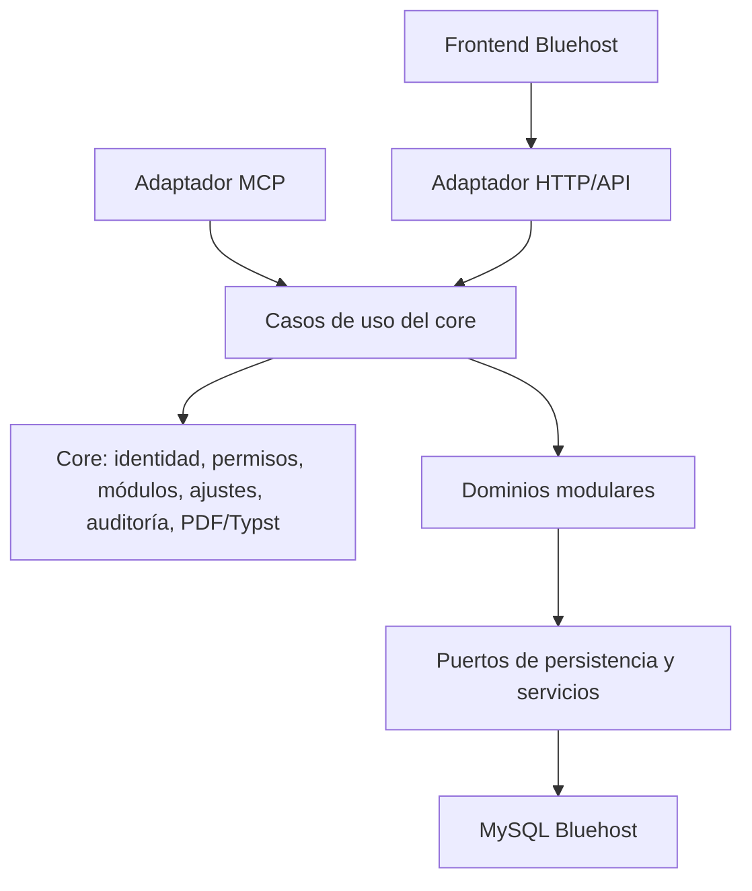

# Arquitectura objetivo en Rust

## Enfoque

Comenzar como monolito modular: un backend desplegable con límites de dominio explícitos, interfaces internas estables y módulos aislados. Mantener la posibilidad de separar procesos más adelante cuando exista una necesidad operativa demostrada.

## Capas conceptuales



## Límites

- **Core:** autenticación, autorización, registro/ciclo de vida de módulos, Ajustes, auditoría y servicios compartidos de límites, sesiones/CSRF, controles de acceso y generación PDF mediante Typst. Los límites por cuenta se aplican dentro del core; el perímetro Cloudflare aplica límites por IP/ruta.
- **Módulo:** entidades, casos de uso y reglas de un dominio; su API, pantallas, herramientas MCP, permisos y settings.
- **Adaptadores:** HTTP y MCP convierten protocolos externos a casos de uso; no contienen reglas de negocio ni omiten las políticas compartidas de identidad, autorización, límites, CSRF cuando aplique y auditoría.
- **Persistencia:** detrás de interfaces/repositorios del dominio. Evitar que un módulo modifique tablas de otro directamente.

## Estructura inicial propuesta

```text
crates/
  app/                 # composición del servidor
  core/                # identidad, permisos, módulos, ajustes, auditoría
  api/                 # rutas HTTP, DTO y errores API
  mcp/                 # transporte MCP y registro de herramientas
  modules/
    clientes/
    proveedores/
    ordenes_compra/
    gastos/
    cotizaciones/
    facturas/
    reportes/
    procesos/
    colaboracion/
```

La organización es conceptual, con estas decisiones para el primer corte del Core:

- Workspace Cargo con `crates/core`, `crates/api` y `crates/mcp`, y `apps/server` como composición ejecutable. Los módulos de negocio se agregarán conforme a su ficha y de uno en uno.
- `tokio` como runtime asíncrono y `axum` como adaptador HTTP.
- `sqlx` con el driver MySQL, consultas parametrizadas y `MySqlSslMode::VerifyIdentity`; no se permite degradar a TLS opcional. La CA se suministra por configuración del ambiente. El acceso remoto debe probarse contra Bluehost/MySQL 5.7 antes del despliegue.
- `tower-http` para CORS exacto, límite de cuerpo, identificador de solicitud y cabeceras HTTP de seguridad.
- El primer corte no registra módulos de negocio ni publica herramientas MCP. El crate MCP queda como punto de extensión; transporte, OAuth y registro de clientes se implementan después conforme a `06-mcp.md`.

El frontend se fija mediante `adr/ADR-0002-frontend-react.md`: React y TypeScript estricto, compilados con Vite a archivos estáticos para Bluehost. Los componentes comparten cliente API, identidad, navegación y diseño del Core; las pantallas se cargan bajo demanda. Node.js se limita al desarrollo y CI. Rust conserva toda autorización y validación. Las decisiones sobre cuotas distribuidas, Typst y proveedor MCP se completan conforme a sus contratos.

## Conexión y despliegue progresivo de módulos

- El backend debe poder componerse y desplegarse con el core solo, sin registrar rutas, pantallas, permisos, settings ni herramientas MCP de módulos de negocio.
- Después del despliegue y la validación del core, se incorpora un módulo por release siguiendo su ficha y el contrato de `04-contrato-de-modulos.md`.
- Se elige un backend Rust común: cada release de módulo actualiza el artefacto desplegable compartido, que incluye Core y los módulos incorporados hasta esa versión.
- La configuración de despliegue establece qué módulos pueden estar disponibles en cada ambiente. El Administrador del sistema activa o desactiva módulos incluidos y permitidos desde `Ajustes > Core > Módulos`; ambas condiciones deben cumplirse y las migraciones deben estar listas. Un módulo deshabilitado no expone pantallas, rutas API ni herramientas MCP.
- Cada release incorpora y valida un módulo a la vez. No se cargan código arbitrario ni binarios de terceros dentro del proceso. Los módulos como artefactos independientes o procesos separados quedan fuera del primer release.

Esta estrategia permite lanzar y probar el core primero y avanzar por módulos sin convertir la primera versión en una arquitectura de microservicios. El detalle de artefactos CI/CD, activación y rollback está pendiente y debe respetar este orden de publicación.

## Persistencia y transacciones

- Bluehost usa MySQL 5.7, confirmado por el usuario. El Core inicial debe ser compatible con MySQL 5.7; confirmar la versión de mantenimiento exacta y validar conexión/TLS en el hosting.
- MySQL 5.7 incluye el tipo nativo `JSON`; la validación de forma y contenido de settings sigue siendo responsabilidad de Rust, usando el esquema declarado por Core o el módulo. No depender de capacidades que no existan en 5.7.
- MySQL 5.7 está en Sustaining Support de Oracle desde el 25 de octubre de 2023; antes de producción se debe revisar con Bluehost la ruta de actualización soportada. Esta observación no cambia por sí sola el despliegue acordado.
- Las migraciones se versionan por módulo y se ejecutan de forma controlada.
- Las conversiones orden→factura y cotización→orden/factura preservan relaciones y deben ser atómicas.
- Importaciones, pagos, correos y archivos deben usar idempotencia o registro de operación cuando aplique.
- PDFs generados y adjuntos privados se guardan en almacenamiento privado de objetos en AWS, separado del disco de despliegue del backend. El Core valida permisos antes de permitir lectura o descarga; los objetos no son públicos y no caducan mientras exista su registro asociado. Al borrar el registro, el flujo autorizado confirma y audita también el borrado de sus archivos. Servicio, versionado y respaldo quedan por definir técnicamente.
- La generación de PDF usa Typst mediante un servicio común del Core. Cotizaciones incorpora Typst 0.15.1 con plantilla fija versionada en `crates/modules/cotizaciones/templates`, datos JSON sin evaluación de código, raíz temporal privada y límites de concurrencia/plazo. Empresa y SMTP siguen en el Core; la habilitación operativa exige verificar almacenamiento privado y configuración. Otras plantillas y su política de evolución siguen pendientes; ver `modulos/cotizaciones-acciones.md`.

Facturas reutiliza como dependencia de código el calculador puro de Cotizaciones, igual a la delegación observada en Legacy. Esta dependencia no requiere activar Cotizaciones ni concede acceso a sus datos; los casos de uso, tablas, migraciones, permisos y API de Facturas permanecen separados. El primer corte solo persiste borradores sin emisión fiscal; ver `modulos/facturas-implementacion.md`.

## Observabilidad

Registrar solicitudes, módulo/caso de uso, latencia, errores y actor autenticado usando identificadores de correlación. No registrar contraseñas, tokens, credenciales SMTP ni contenido privado de documentos.

## Seguridad transversal en la arquitectura

- Límites configurables por operación antes de ejecutar consultas o asignar memoria: autenticación/OTP, cuerpos y archivos, paginación, rangos de fechas, lotes, timeouts y concurrencia de trabajos costosos.
- Autorización común por acción y recurso para UI, API y MCP; los módulos aportan permisos y alcances, pero no sustituyen las comprobaciones del core.
- Sesiones con cookies protegidas; para peticiones mutables autenticadas por cookie, los adaptadores aplican CSRF y validación exacta de origen.
- Conexión MySQL remota acotada y verificada; no permitir acceso general desde Internet.
- Reportes y exportaciones respetan límites de tiempo y concurrencia; el comportamiento al alcanzar el tope se define por operación sin cambiar el flujo de usuario de forma implícita.

Los requisitos verificables están en `08-seguridad-y-permisos.md`; sus límites y configuración de infraestructura están en `09-despliegue.md`.

Colaboración usa el crate `crates/modules/colaboracion`; el Core autoriza las carpetas, ejecuta S3 privado y registra settings/auditoría. La política de módulos del ambiente y su migración gobiernan su disponibilidad.

## Decisiones técnicas pendientes

Completar validación integral del esquema MySQL y las sesiones existentes, almacenamiento compartido para cuotas si se ejecutan varias instancias, configuración técnica de activación por ambiente, integración de Typst y gestión de plantillas/fuentes, y librería/versión de transporte MCP. El frontend React + TypeScript + Vite ya está decidido. Confirmar la ruta de actualización de MySQL antes de producción.

## Referencias de versión MySQL

- [MySQL 5.7 Reference Manual: tipo JSON](https://dev.mysql.com/doc/refman/5.7/en/json.html).
- [MySQL Product Support EOL Announcements](https://www.mysql.com/support/eol-notice.html): MySQL 5.7 pasó a Sustaining Support el 25 de octubre de 2023; Oracle recomienda actualizar a MySQL 8.0.

## Órdenes de compra: primer corte local

`crates/modules/ordenes_compra` es dueño de órdenes, cálculo y catálogo de destinos confirmado bajo Ajustes. Tiene migraciones/ledger propios y no escribe tablas de otros módulos. Clientes manuales son instantáneas hasta definir vinculación; conversiones quedan pendientes. Destinos es catálogo de dominio, no un almacén alternativo de settings. Ver `modulos/ordenes-de-compra-implementacion.md`.

## Coordinación transaccional entre documentos

El crate interno document-flows implementa los casos de uso que atraviesan Cotizaciones, Órdenes y Facturas. Los adaptadores HTTP no ejecutan reglas ni SQL de dominio. El coordinador solo escribe sus relaciones/recibos y llama a los contratos transaccionales públicos de cada propietario. Mantiene una transacción MySQL común, orden de bloqueos explícito y autorización de ambos módulos. Tiene ledger propio; no registra un módulo ni permisos nuevos. Ver modulos/cotizaciones-conversiones.md.
