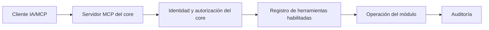

# MCP del core y los módulos

## Responsabilidad

El core hospeda la infraestructura MCP común y mantiene el registro de herramientas. Cada módulo aporta herramientas específicas. Un servidor MCP no implementa lógica de negocio aparte: traduce la petición a un caso de uso normal del módulo.

**Estado de implementación:** MCP no se expone en el primer corte del Core. No se agregan rutas ni herramientas hasta implementar OAuth/PKCE, consentimiento administrativo y del usuario, identidad delegada, autorización vigente, auditoría y confirmaciones humanas conforme a este documento.

Inicio de desarrollo local: `crates/mcp` valida desafíos PKCE S256 y verificadores conforme a RFC 7636. También contiene reglas aisladas para exigir aprobación administrativa y coincidencia exacta de redirección, limitar alcances a los del cliente y usuario, y comprobar vencimientos y estado vigente de un grant. La preparación del servidor OAuth incorpora análisis acotado de solicitudes de autorización y canje, rechazo de parámetros ambiguos, vinculación al recurso configurado, generación de credenciales opacas y hashes separados por propósito. Las validaciones del canje y renovación comprueban los vínculos y detectan credenciales consumidas; son funciones puras y requieren una transacción que bloquee el grant, consuma la credencial, registre auditoría y emita o rote los tokens de forma atómica. Ante reutilización, esa transacción debe revocar el grant y la familia. Estas piezas no autentican, no consultan todavía el Core ni revocan registros por sí mismas. No hay servidor OAuth integrado, almacenamiento de grants, consentimiento, rotación efectiva de refresh tokens, transporte MCP ni herramientas, y no se habilita ninguna ruta. La integración y la puesta en marcha requieren completar y verificar los controles descritos aquí.

Se añadió una migración MySQL preliminar, aún no registrada ni aplicada, para clientes, solicitudes, consentimiento, grants y hashes de códigos y tokens. Hay operaciones preliminares de revocación con auditoría y un auxiliar para cambios de seguridad del usuario, todavía sin conectar al Core. La base operativa está en Bluehost; una consulta de solo lectura desde AWS confirmó MySQL 5.7.44-48 y conexión TLS. Las validaciones y la primera prueba de persistencia pasaron en Linux con MySQL 5.7 aislado ([ejecución de CI](https://github.com/Ahcast/Bastion/actions/runs/41178628715)); las nuevas operaciones deben pasar sus propias pruebas. No considerar el servidor OAuth terminado ni habilitar la migración o las rutas hasta integrar y probar todas las transacciones.

El workflow independiente `MCP MySQL checks` prepara una base MySQL 5.7 desechable para las pruebas de persistencia. No usar el URL de la base operativa como `BASTION_MCP_TEST_URL`.

## Modelo de operación

## Registro de herramienta

Cada herramienta declara nombre estable y módulo propietario, propósito, esquema de argumentos tipado, salida, permiso requerido, alcance de datos, nivel de riesgo, idempotencia y límites. Las herramientas describen claramente si consultan o cambian datos.

## Seguridad

- Solo se enumeran herramientas habilitadas y autorizadas para el usuario representado por la autorización MCP. En la IA interactiva inicial, el cliente se autoriza en nombre del usuario conectado; las cuentas de servicio se reservan para automatizaciones futuras.
- Cada invocación vuelve a validar identidad, permiso, empresa/tenant y acceso al objeto concreto. Reutiliza los mismos casos de uso y políticas que la API.
- Denegar por defecto; validar argumentos, campos consultables/modificables y límites de tamaño, filas, rango de fechas, lote, tiempo y concurrencia antes de ejecutar.
- Aplicar cuotas por usuario/cuenta/agente además de los límites por IP/ruta del perímetro. Las respuestas y listados tienen un máximo; no se exportan colecciones ilimitadas en una sola invocación.
- Sin acceso directo a SQL, consola, shell, secretos o rutas arbitrarias de archivos.
- Auditar actor, herramienta, módulo, recurso, resultado y correlation ID, con redacción de información sensible.
- Mutaciones sensibles (borrar, pagar, enviar correo, convertir documentos, purgar) requieren confirmación explícita vinculada al actor, acción y argumentos confirmados. El cliente IA no puede autoaprobarla.
- Limitar tasa, duración, tamaño de petición/respuesta y concurrencia por herramienta y actor. Si una herramienta usa trabajos asíncronos, exigir autorización vigente para consultar el estado y descargar resultados.
- Auditar herramienta, actor, objeto, resultado y correlation ID; excluir credenciales, tokens, OTP, secretos y contenido sensible innecesario.

## Diseño de herramientas

Preferir operaciones concretas de dominio y respuestas estructuradas. Consultas paginadas y limitadas. Mutaciones separadas de consultas; evitar una herramienta genérica que acepte SQL o instrucciones libres.

## Exposición inicial derivada del informe

Posibles capacidades incluyen buscar/listar documentos, consultar detalles y reportes, crear/actualizar órdenes/cotizaciones/facturas, registrar pagos, administrar archivos y revisar procesos. Son candidatas, no una autorización automática. Cada herramienta se mapea a `ver`, `editar` (incluye crear/actualizar) o `eliminar`, se limita por recurso/tenant y declara su riesgo/confirmación. La matriz efectiva del usuario o cliente MCP se verifica en servidor.

## Transporte y credenciales pendientes

Usar Streamable HTTP sobre HTTPS para MCP remoto en modo stateless: no conservar sesiones de protocolo en el servidor; cada llamada presenta autorización y vuelve a validar identidad, permisos, alcance y límites. Los grants OAuth sí se guardan como autorizaciones persistentes separadas de la sesión MCP y se pueden revocar. Usar OAuth Authorization Code + PKCE para clientes de IA interactiva. Solo los clientes aprobados previamente por un Administrador del sistema pueden iniciar OAuth; esa aprobación define además el máximo de alcances permitidos y no concede datos. Cada usuario solo autoriza alcances incluidos en ese límite y en sus permisos vigentes. Un usuario puede solicitar habilitar un cliente no autorizado o ampliar el máximo de alcances de un cliente aprobado; la solicitud queda pendiente y no crea grants ni tokens. Tras aprobación administrativa, el solicitante ve el estado Aprobada en Ajustes y recibe correo para completar OAuth y autorizar sus alcances, incluidos los nuevos aprobados; cada usuario aprueba/rechaza el cliente y sus alcances solicitados, y debe volver a aprobar si aumentan. Si el Administrador rechaza la solicitud, el estado se muestra en Ajustes, se notifica por correo al solicitante y puede volver a solicitarla más adelante. La identidad se delega al usuario conectado. Los access tokens duran 15 minutos; refresh tokens rotan y vencen como máximo a los 15 días, momento en que se requiere nueva autorización con TOTP. La revocación manual, la desactivación, el cambio/recuperación de contraseña y la retirada de autorización administrativa invalidan el grant; retirar la autorización de un cliente revoca inmediatamente todos sus grants y tokens de usuario. Si se reduce su máximo de alcances, revocar los grants y tokens afectados y exigir que esos usuarios completen OAuth y consientan de nuevo dentro del límite actualizado. El objetivo del primer release es admitir cualquier cliente que cumpla el perfil MCP remoto/OAuth definido, sujeto a aprobación administrativa y a validación de interoperabilidad; se mantendrá una matriz de compatibilidad probada. La especificación MCP 2026-07-28 recomienda Client ID Metadata Documents (CIMD) y conserva Dynamic Client Registration (DCR) para compatibilidad heredada; Bastion prioriza CIMD y admite DCR solo cuando una integración validada lo requiera. MCP también contempla el prerregistro, que podrá usarse para una integración verificada si hace falta. La aprobación de cada cliente se vincula a su identidad registrada, el máximo de alcances y URI de redirección permitidas. Si cambia la ficha CIMD aprobada, bloquear nuevas conexiones hasta que un Administrador revise y apruebe el cambio. Aplicar coincidencia exacta de URI de redirección, según [RFC 9700](https://datatracker.ietf.org/doc/rfc9700/). Esta prioridad se basa en la [especificación oficial de autorización MCP 2026-07-28](https://modelcontextprotocol.io/specification/2026-07-28/basic/authorization), que recomienda CIMD y conserva DCR para compatibilidad. MCP se publica desde AWS detrás de HTTPS; nunca se conecta desde el agente directamente a MySQL.
