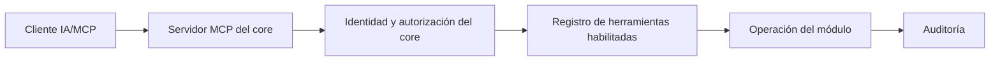

# MCP del core y los módulos

## Responsabilidad

El core hospeda la infraestructura MCP común y mantiene el registro de herramientas. Cada módulo aporta herramientas específicas. Un servidor MCP no implementa lógica de negocio aparte: traduce la petición a un caso de uso normal del módulo.

**Estado de implementación:** MCP se desarrolla en routers aislados y permanece desactivado en la aplicación activa. Antes de habilitarlo faltan controles de perímetro, notificaciones, revisión de concurrencia y pruebas integrales de interoperabilidad y operación.

Las piezas preparadas incluyen OAuth Authorization Code con PKCE, canje y rotación transaccionales, revocación, consentimiento ligado a sesión, descubrimiento, cuotas y auditoría. Las herramientas de consulta para cotizaciones, facturas y órdenes de compra llaman a los servicios de dominio existentes y comprueban los permisos vigentes. Las migraciones OAuth preparadas no se han aplicado en la base operativa.

El workflow `MCP MySQL checks` ejecuta las pruebas sobre una base MySQL 5.7 desechable. La base operativa permanece en Bluehost; no usar su URL como `BASTION_MCP_TEST_URL`. Los routers preparados no equivalen a una versión desplegada o disponible para clientes.

## Modelo de operación

El router HTTP MCP en preparación permanece aislado de la aplicación activa. Integra validación de bearer y permisos vigentes, límites, auditoría y descubrimiento; permite probar consultas de dominio autorizadas. No constituye una versión desplegable: incluye un límite local por IP y prepara una cuota compartida en MySQL entre instancias, con direcciones protegidas mediante HMAC. Su clave y activación aún requieren configuración y verificación; también faltan controles en el proxy, compatibilidad entre clientes y verificaciones operativas.

Se prepara una composición aislada que reúne los routers y separa CORS con credenciales para el frontend de Bastion del CORS sin credenciales para clientes MCP. El inicio HTTP de autorización, el canje de tokens y cada invocación MCP vuelven a comprobar la ficha del cliente y deniegan la solicitud si no se puede validar. No se registra en el servidor activo; aún faltan límites de perímetro, redacción de parámetros en logs del proxy y validación integral antes de publicarla.

El router aislado prepara soporte MCP 2025-11-25: validación JSON-RPC, inicialización y listado junto con autenticación, límites y auditoría. No está conectado a la aplicación; la compatibilidad todavía requiere negociación completa de versiones y pruebas con clientes reales.

Los documentos de descubrimiento OAuth se preparan a partir de direcciones HTTPS canónicas configuradas por el servidor, con metadatos para recurso y emisor. Un router aislado atiende sus rutas well-known para pruebas; no está conectado a la aplicación activa. No se anuncia compatibilidad CIMD hasta contar con obtención segura de metadatos y autorización completa.

Se preparan las respuestas de aprobación y rechazo al URI registrado, incluyendo el emisor `iss` y codificación del estado. Se rechazan parámetros OAuth ambiguos al registrar el cliente y antes de crear el grant, incluso si ya había sido registrado. El flujo HTTP deberá preservar estos controles en todos los errores y evitar exponer el código en registros; todavía no está conectado.

Un router de consentimiento aislado prepara y decide solicitudes mediante sesión del Core, origen exacto y CSRF ligado a la sesión. La decisión vuelve a comprobar cliente, redirección y permisos, y sus respuestas prohíben caché. La pantalla preliminar exige revisar la solicitud y elegir explícitamente. La navegación de prueba permanece apagada salvo que se configure explícitamente `window.BASTION_MCP_ENABLED = true` en el frontend; las rutas aún no están conectadas a la aplicación activa. Faltan verificar CORS en el despliegue, límites de perímetro, configuración segura del proxy y pruebas completas de interoperabilidad antes de exponerlas.

Se prepara el registro transaccional de solicitudes de clientes y su revisión por un Administrador del sistema. Cada solicitud queda ligada al hash de la ficha y a los alcances solicitados; aprobarla no crea grants de usuario. Al detectar una ficha cambiada se revocan los grants y las nuevas redirecciones permanecen como candidatas hasta la revisión. Un router aislado combina sesión, CSRF y obtención de metadatos; vuelve a comprobar la sesión al guardar o revisar. La pantalla en Ajustes, apagada por defecto, distingue los alcances solicitados de los aprobados. Las migraciones 7 a 9 no deben aplicarse sin el respaldo y la revisión habituales. Se prepara el traslado transaccional de avisos MCP a la bandeja cifrada existente, con un Administrador del sistema como remitente configurado explícitamente. La notificación queda en cola hasta que el correo se envíe o falle. El trabajador está apagado por defecto y requiere configurar `BASTION_MCP_NOTIFICATION_SENDER_USER_ID` con un administrador activo que tenga SMTP configurado; la migración 10, la configuración y el trabajador aún no están instalados ni activos. Los límites de perímetro y la activación de las rutas siguen pendientes.

## Registro de herramienta

Cada herramienta declara nombre estable y módulo propietario, propósito, esquema de argumentos tipado, salida, permiso requerido, alcance de datos, nivel de riesgo, idempotencia y límites. Las herramientas describen claramente si consultan o cambian datos.

## Seguridad

- Solo se enumeran herramientas habilitadas y autorizadas para el usuario representado por la autorización MCP. En la IA interactiva inicial, el cliente se autoriza en nombre del usuario conectado; las cuentas de servicio se reservan para automatizaciones futuras.
- Cada invocación vuelve a validar identidad, permiso, empresa/tenant y acceso al objeto concreto. Reutiliza los mismos casos de uso y políticas que la API.
- Denegar por defecto; validar argumentos, campos consultables/modificables y límites de tamaño, filas, rango de fechas, lote, tiempo y concurrencia antes de ejecutar.
- Aplicar cuotas por usuario/cuenta/agente además de los límites por IP/ruta del perímetro. Las respuestas y listados tienen un máximo; no se exportan colecciones ilimitadas en una sola invocación.
- Sin acceso directo a SQL, consola, shell, secretos o rutas arbitrarias de archivos.
- Auditar actor, herramienta, módulo, recurso, resultado y correlation ID, con redacción de información sensible.
- Mutaciones sensibles (borrar, pagar, enviar correo, convertir documentos, purgar) requieren confirmación explícita vinculada al actor, acción y argumentos confirmados. El cliente IA no puede autoaprobarla.
- Limitar tasa, duración, tamaño de petición/respuesta y concurrencia por herramienta y actor. Si una herramienta usa trabajos asíncronos, exigir autorización vigente para consultar el estado y descargar resultados.
- Auditar herramienta, actor, objeto, resultado y correlation ID; excluir credenciales, tokens, OTP, secretos y contenido sensible innecesario.

## Diseño de herramientas

Preferir operaciones concretas de dominio y respuestas estructuradas. Consultas paginadas y limitadas. Mutaciones separadas de consultas; evitar una herramienta genérica que acepte SQL o instrucciones libres.

## Exposición inicial derivada del informe

Decisión del usuario: la primera versión permitirá consultas de cotizaciones, facturas y órdenes de compra. Se preparan listados paginados y consulta por identificador, exclusivamente de lectura, sujetos al permiso Core `documentos/ver`, al módulo activo y al consentimiento OAuth correspondiente. Un router de pruebas conecta el registro y adaptador a los servicios de dominio con cuotas y auditoría de inicio y resultado; permanece deshabilitado hasta completar la integración, límites compartidos en el ingreso, compatibilidad con clientes reales y las verificaciones pendientes de despliegue. Las acciones de modificación requieren una decisión posterior. Las llamadas iniciadas registran su resultado o intentan registrar la expiración del plazo; si la base de datos no está disponible, puede quedar solo el evento de inicio como señal de interrupción.

Posibles capacidades incluyen buscar/listar documentos, consultar detalles y reportes, crear/actualizar órdenes/cotizaciones/facturas, registrar pagos, administrar archivos y revisar procesos. Son candidatas, no una autorización automática. Cada herramienta se mapea a `ver`, `editar` (incluye crear/actualizar) o `eliminar`, se limita por recurso/tenant y declara su riesgo/confirmación. La matriz efectiva del usuario o cliente MCP se verifica en servidor.

## Transporte y credenciales pendientes

Usar Streamable HTTP sobre HTTPS para MCP remoto en modo stateless: no conservar sesiones de protocolo en el servidor; cada llamada presenta autorización y vuelve a validar identidad, permisos, alcance y límites. Los grants OAuth sí se guardan como autorizaciones persistentes separadas de la sesión MCP y se pueden revocar. Usar OAuth Authorization Code + PKCE para clientes de IA interactiva. Solo los clientes aprobados previamente por un Administrador del sistema pueden iniciar OAuth; esa aprobación define además el máximo de alcances permitidos y no concede datos. Cada usuario solo autoriza alcances incluidos en ese límite y en sus permisos vigentes. Un usuario puede solicitar habilitar un cliente no autorizado o ampliar el máximo de alcances de un cliente aprobado; la solicitud queda pendiente y no crea grants ni tokens. Tras aprobación administrativa, el solicitante ve el estado Aprobada en Ajustes y recibe correo para completar OAuth y autorizar sus alcances, incluidos los nuevos aprobados; cada usuario aprueba/rechaza el cliente y sus alcances solicitados, y debe volver a aprobar si aumentan. Si el Administrador rechaza la solicitud, el estado se muestra en Ajustes, se notifica por correo al solicitante y puede volver a solicitarla más adelante. La identidad se delega al usuario conectado. Los access tokens duran 15 minutos; refresh tokens rotan y vencen como máximo a los 15 días, momento en que se requiere nueva autorización con TOTP. La revocación manual, la desactivación, el cambio/recuperación de contraseña y la retirada de autorización administrativa invalidan el grant; retirar la autorización de un cliente revoca inmediatamente todos sus grants y tokens de usuario. Si se reduce su máximo de alcances, revocar los grants y tokens afectados y exigir que esos usuarios completen OAuth y consientan de nuevo dentro del límite actualizado. El objetivo del primer release es admitir cualquier cliente que cumpla el perfil MCP remoto/OAuth definido, sujeto a aprobación administrativa y a validación de interoperabilidad; se mantendrá una matriz de compatibilidad probada. La especificación MCP 2026-07-28 recomienda Client ID Metadata Documents (CIMD) y conserva Dynamic Client Registration (DCR) para compatibilidad heredada; Bastion prioriza CIMD y admite DCR solo cuando una integración validada lo requiera. MCP también contempla el prerregistro, que podrá usarse para una integración verificada si hace falta. La aprobación de cada cliente se vincula a su identidad registrada, el máximo de alcances y URI de redirección permitidas. Si cambia la ficha CIMD aprobada, bloquear nuevas conexiones hasta que un Administrador revise y apruebe el cambio. Aplicar coincidencia exacta de URI de redirección, según [RFC 9700](https://datatracker.ietf.org/doc/rfc9700/). Esta prioridad se basa en la [especificación oficial de autorización MCP 2026-07-28](https://modelcontextprotocol.io/specification/2026-07-28/basic/authorization), que recomienda CIMD y conserva DCR para compatibilidad. MCP se publica desde AWS detrás de HTTPS; nunca se conecta desde el agente directamente a MySQL.

Validación CIMD preliminar: se comprueba la identidad exacta del cliente y del documento, se limitan y verifican URI de redirección y se detectan cambios mediante hash del documento. Solo se acepta el perfil de cliente público con método none en esta pieza; faltan clientes confidenciales, revalidación de la ficha en el flujo activo y pruebas integrales. No se habilitan rutas con esta validación.

Se prepara un transporte CIMD aislado que filtra respuestas DNS, fija la dirección al conectar, verifica TLS para el nombre original y limita tiempo y tamaño, sin proxies ni redirecciones. Admite HTTPS por el puerto 443 y rechaza respuestas mixtas, direcciones privadas y rangos IPv4 e IPv6 especiales no públicos. Aún faltan pruebas adversariales completas de red, integración con la aprobación administrativa y restricciones de salida en AWS; el transporte no está habilitado en la aplicación.
