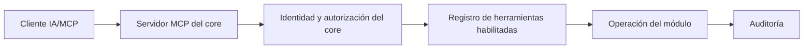

# MCP del core y los módulos

## Responsabilidad

El core hospeda la infraestructura MCP común y mantiene el registro de herramientas. Cada módulo aporta herramientas específicas. Un servidor MCP no implementa lógica de negocio aparte: traduce la petición a un caso de uso normal del módulo.

**Estado (2026-11-01, Honduras):** MCP y OAuth están habilitados en AWS; la interfaz está publicada en Bluehost. La primera publicación usó la revisión `1b27ef1e575a50d04ee9fa1eefa5435e74b39228`; el backend recibió después actualizaciones de Licitaciones. Las migraciones Core 3 a 11 se aplicaron con respaldo previo y una restauración de prueba en tablas temporales. Las herramientas de la primera publicación son de lectura para cotizaciones, facturas y órdenes de compra, sujetas a permisos y consentimiento.

El backend expone Streamable HTTP con OAuth Authorization Code y PKCE, clientes públicos CIMD aprobados por un administrador, consentimiento del usuario, revocación, cuotas y auditoría. No admite clientes confidenciales ni registro dinámico en esta versión. Admite documentos CIMD que incluyen `none` entre varios métodos, seleccionando exclusivamente `none`, y anuncia la identificación del emisor en las respuestas de autorización. Para clientes como Grok Bot, se admite el retorno HTTP al host exacto `localhost`, además de las redirecciones HTTPS o loopback numérico autorizadas. La aprobación del cliente y el consentimiento del usuario siguen siendo necesarios. La configuración y las claves permanecen en el entorno del servidor; el frontend no contiene secretos.

El servicio de protección `bastion-mcp-egress.service` y su tabla nftables están instalados y verificados. Restringen el puerto TCP 443 del usuario del backend hacia redes privadas y de infraestructura sin cambiar la política de UFW. El proxy de AWS aplica redacción de datos sensibles. El frontend y las rutas de descubrimiento responden públicamente; una solicitud MCP sin credenciales recibe 401. Se verificaron disponibilidad de los módulos, concordancia de los binarios y respaldo restaurable.

Las pruebas de CI incluyen MySQL 5.7 y el SDK oficial de MCP con token sintético; OAuth completo se prueba por separado. El usuario confirmó que la conexión real del cliente autorizado ya funciona. Los permisos adicionales requieren su propia aprobación y consentimiento. No usar la base operativa como `BASTION_MCP_TEST_URL`. `migrate-core` aplica exclusivamente las migraciones del Core.

## Registro de herramienta

Cada herramienta declara nombre estable y módulo propietario, propósito, esquema de argumentos tipado, salida, permiso requerido, alcance de datos, nivel de riesgo, idempotencia y límites. Las herramientas describen claramente si consultan o cambian datos.

## Seguridad

- Solo se enumeran herramientas habilitadas y autorizadas para el usuario representado por la autorización MCP. En la IA interactiva inicial, el cliente se autoriza en nombre del usuario conectado; las cuentas de servicio se reservan para automatizaciones futuras.
- Cada invocación vuelve a validar identidad, permiso, empresa/tenant y acceso al objeto concreto. Reutiliza los mismos casos de uso y políticas que la API.
- Denegar por defecto; validar argumentos, campos consultables/modificables y límites de tamaño, filas, rango de fechas, lote, tiempo y concurrencia antes de ejecutar.
- Aplicar cuotas por usuario/cuenta/agente además de los límites por IP/ruta del perímetro. Las respuestas y listados tienen un máximo; no se exportan colecciones ilimitadas en una sola invocación.
- Sin acceso directo a SQL, consola, shell, secretos o rutas arbitrarias de archivos.
- Auditar actor, herramienta, módulo, recurso, resultado y correlation ID, con redacción de información sensible.
- Mutaciones sensibles (borrar, pagar, enviar correo, convertir documentos, purgar) requieren confirmación explícita vinculada al actor, acción y argumentos confirmados. El cliente IA no puede autoaprobarla.
- Limitar tasa, duración, tamaño de petición/respuesta y concurrencia por herramienta y actor. Si una herramienta usa trabajos asíncronos, exigir autorización vigente para consultar el estado y descargar resultados.
- Auditar herramienta, actor, objeto, resultado y correlation ID; excluir credenciales, tokens, OTP, secretos y contenido sensible innecesario.

## Diseño de herramientas

Preferir operaciones concretas de dominio y respuestas estructuradas. Consultas paginadas y limitadas. Mutaciones separadas de consultas; evitar una herramienta genérica que acepte SQL o instrucciones libres.

### Ampliación autorizada: borradores y licitaciones

El usuario autoriza consultar licitaciones y crear y editar borradores en los cuatro módulos. Cada módulo tiene alcances `:read` y `:write` independientes. Escritura requiere ambos alcances y permisos Core `ver` y `editar`, aprobación administrativa del alcance y consentimiento del usuario; las autorizaciones anteriores no conceden automáticamente los alcances nuevos. La creación usa una clave de idempotencia y las modificaciones exigen la versión consultada. Cotizaciones solo admite estado Borrador; Facturas solo edita Borrador y rechaza pagos. En Órdenes de compra, el usuario aprobó usar Pendiente como etapa inicial: tanto el registro existente como los datos propuestos deben mantener todos los productos pendientes, sin factura ni fecha de recepción. No se permite enviar, pagar, convertir, entregar ni eliminar mediante estas herramientas.

En Licitaciones se consultan expedientes y lotes, se crean expedientes vacíos, se cambia su nombre y se editan variables y partidas. Las variables no autorizan descartar lotes; editar un lote reemplaza su lista de partidas. Esta lista describe el alcance implementado, no edición de archivos, generación de PDF o todas las funciones del módulo. Las escrituras pueden fallar por reglas del módulo, permisos o cambios de versión; ante un conflicto el cliente debe consultar de nuevo antes de actuar. La disponibilidad de estas capacidades requiere verificar CI y la revisión operativa desplegada.

## Exposición inicial derivada del informe

La primera versión expone listados paginados y consultas por identificador de cotizaciones, facturas y órdenes de compra, exclusivamente de lectura y sujetos al permiso Core `documentos/ver`, al módulo activo y al consentimiento OAuth. Las acciones de modificación requieren una decisión posterior. Las llamadas se auditan; si la base de datos no está disponible puede quedar solo el evento de inicio como señal de interrupción.

Posibles capacidades incluyen buscar/listar documentos, consultar detalles y reportes, crear/actualizar órdenes/cotizaciones/facturas, registrar pagos, administrar archivos y revisar procesos. Son candidatas, no una autorización automática. Cada herramienta se mapea a `ver`, `editar` (incluye crear/actualizar) o `eliminar`, se limita por recurso/tenant y declara su riesgo/confirmación. La matriz efectiva del usuario o cliente MCP se verifica en servidor.

## Transporte y credenciales

Usar Streamable HTTP sobre HTTPS para MCP remoto en modo stateless: no conservar sesiones de protocolo en el servidor; cada llamada presenta autorización y vuelve a validar identidad, permisos, alcance y límites. Los grants OAuth sí se guardan como autorizaciones persistentes separadas de la sesión MCP y se pueden revocar. Usar OAuth Authorization Code + PKCE para clientes de IA interactiva. Solo los clientes aprobados previamente por un Administrador del sistema pueden iniciar OAuth; esa aprobación define además el máximo de alcances permitidos y no concede datos. Cada usuario solo autoriza alcances incluidos en ese límite y en sus permisos vigentes. Un usuario puede solicitar habilitar un cliente no autorizado o ampliar el máximo de alcances de un cliente aprobado; la solicitud queda pendiente y no crea grants ni tokens. Tras aprobación administrativa, el solicitante ve el estado Aprobada en Ajustes y recibe correo para completar OAuth y autorizar sus alcances, incluidos los nuevos aprobados; cada usuario aprueba/rechaza el cliente y sus alcances solicitados, y debe volver a aprobar si aumentan. Si el Administrador rechaza la solicitud, el estado se muestra en Ajustes, se notifica por correo al solicitante y puede volver a solicitarla más adelante. La identidad se delega al usuario conectado. Los access tokens duran 15 minutos; refresh tokens rotan y vencen como máximo a los 15 días, momento en que se requiere nueva autorización con TOTP. La revocación manual, la desactivación, el cambio/recuperación de contraseña y la retirada de autorización administrativa invalidan el grant; retirar la autorización de un cliente revoca inmediatamente todos sus grants y tokens de usuario. Si se reduce su máximo de alcances, revocar los grants y tokens afectados y exigir que esos usuarios completen OAuth y consientan de nuevo dentro del límite actualizado. El objetivo del primer release es admitir cualquier cliente que cumpla el perfil MCP remoto/OAuth definido, sujeto a aprobación administrativa y a validación de interoperabilidad; se mantendrá una matriz de compatibilidad probada. La especificación MCP 2026-07-28 recomienda Client ID Metadata Documents (CIMD) y conserva Dynamic Client Registration (DCR) para compatibilidad heredada; Bastion prioriza CIMD y admite DCR solo cuando una integración validada lo requiera. MCP también contempla el prerregistro, que podrá usarse para una integración verificada si hace falta. La aprobación de cada cliente se vincula a su identidad registrada, el máximo de alcances y URI de redirección permitidas. Si cambia la ficha CIMD aprobada, bloquear nuevas conexiones hasta que un Administrador revise y apruebe el cambio. Aplicar coincidencia exacta de URI de redirección, según [RFC 9700](https://datatracker.ietf.org/doc/rfc9700/). Esta prioridad se basa en la [especificación oficial de autorización MCP 2026-07-28](https://modelcontextprotocol.io/specification/2026-07-28/basic/authorization), que recomienda CIMD y conserva DCR para compatibilidad. MCP se publica desde AWS detrás de HTTPS; nunca se conecta desde el agente directamente a MySQL.

La validación CIMD comprueba la identidad exacta del cliente, las URI de redirección y los cambios en su documento. Se admite el perfil de cliente público con método `none`; la interoperabilidad con cada cliente real requiere validación.

El transporte CIMD valida DNS y TLS, fija la dirección al conectar y limita tiempo y tamaño; rechaza direcciones privadas y otras direcciones especiales no públicas. La protección de salida en AWS añade una capa independiente.
