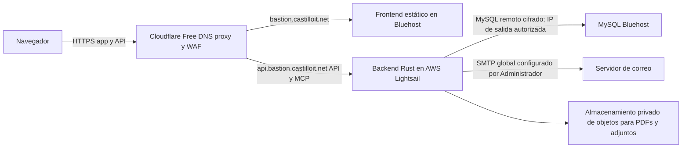

# Despliegue y ambientes

## Topología acordada

Cloudflare se usa como proxy HTTP/HTTPS delante de `app` y `api`. El navegador carga el frontend y sus solicitudes API/MCP pasan también por Cloudflare hacia AWS. El tráfico AWS↔MySQL Bluehost es una conexión MySQL directa; Cloudflare no la protege ni la transporta.

El transporte MCP remoto usa Streamable HTTP sobre HTTPS y no conserva sesiones de protocolo en el proceso; cada solicitud debe llevar autorización válida. La autorización OAuth se persiste por separado del transporte.

## Dominios confirmados

- `bastion.castilloit.net`: frontend en Bluehost; registro A configurado hacia `162.241.224.215`.
- `api.bastion.castilloit.net`: API y MCP en AWS Lightsail con IP estática `34.236.78.141`, confirmada por el usuario. Sustituye a `52.204.2.154`; DNS verificado desde Lightsail hacia la IP nueva. La API y el listener HTTPS aún no están desplegados en la instancia.

HTTPS obligatorio.

## Cloudflare Free como WAF

Se acuerda usar el plan gratuito como primera capa WAF, sujeto a verificar la cuenta y funciones al configurar el dominio. En Cloudflare se debe activar la zona y poner en modo proxied (nube naranja) los registros HTTP/HTTPS de `bastion.castilloit.net` y `api.bastion.castilloit.net`. Solo entonces esas solicitudes pasan por el WAF; un registro DNS-only va directamente al origen.

El plan Free ofrece el Free Managed Ruleset, reglas personalizadas y una regla de limitación de tasa. En esa regla, la ruta puede usarse como criterio y la IP como contador; no permite limitar por cuenta de usuario. Se reservará para rutas sensibles de autenticación cuando estas queden definidas. El core mantiene límites por cuenta/usuario para contraseña, OTP y recuperación. La regla de borde no es un límite exacto de capacidad y puede tener unos segundos de demora, por lo que no reemplaza los límites del backend.

El WAF gratuito inspecciona solo el tamaño de cuerpo disponible para sus reglas de análisis (1 MB en el plan Free); solicitudes mayores todavía pueden llegar completas al origen. El backend debe validar y limitar el cuerpo completo y los archivos por su cuenta. El panel Free ofrece eventos de seguridad muestreados, por lo que los logs propios de autenticación y API siguen siendo necesarios.

Para el frontend de Bluehost, configurar **Full (strict)** con certificado válido para el hostname; no usar modo Flexible. Para el API en AWS, preferir Cloudflare Tunnel (sin costo adicional de Cloudflare) y mantener el puerto del backend sin exposición pública; el servicio debe escuchar solo en una interfaz privada/loopback cuando la topología lo permita. El tráfico del túnel está cifrado independientemente del modo SSL/TLS de la zona. Si se usa conexión directa, configurar Full (strict) y limitar AWS a rangos de IP Cloudflare. Confirmar si Bluehost permite limitar el origen del frontend; si acepta acceso directo, alguien que conozca su IP puede intentar saltarse el WAF. Registrar cualquier limitación antes de producción.

Al migrar DNS, copiar y verificar primero los registros de correo (MX, SPF, DKIM, DMARC y `mail`) y dejarlos DNS-only. Cloudflare no debe ponerse como proxy delante de SMTP. La conectividad de MySQL permanece protegida mediante IP AWS autorizada, TLS verificado y usuario mínimo privilegio.

Cloudflare Free limita la expresión de su única regla de rate limit y no admite límites por cuerpo/cuenta en esa regla. Los transportes de MCP de larga duración deben probarse a través del proxy: el proxy read timeout al origen es 125 segundos; si se eligiera WebSocket, el WAF inspeccionaría el handshake HTTP inicial y no los mensajes posteriores. Favorecer operaciones asíncronas o streaming con actividad/heartbeats compatibles y validar este comportamiento cuando se elija el transporte.

La regla de rate limit de Cloudflare se reserva para rutas sensibles y se ajusta revisando eventos/falsos positivos; no se asume un modo de observación específico que no esté disponible en el plan. El backend siempre aplica cuotas por cuenta/actor y topes de operación, incluidos cuerpos completos y archivos.

Fuentes del proveedor: [planes de Cloudflare](https://www.cloudflare.com/plans/), [disponibilidad de funciones WAF por plan](https://developers.cloudflare.com/waf/), [límites de rate limiting del plan](https://developers.cloudflare.com/waf/rate-limiting-rules/), [DNS proxied y casos de uso](https://developers.cloudflare.com/dns/proxy-status/use-cases/), [protección del origen](https://developers.cloudflare.com/fundamentals/security/protect-your-origin-server/), [Cloudflare Tunnel](https://developers.cloudflare.com/cloudflare-one/networks/connectors/cloudflare-tunnel/), [Full (strict)](https://developers.cloudflare.com/ssl/origin-configuration/ssl-modes/full-strict/), [timeouts de conexión](https://developers.cloudflare.com/fundamentals/reference/connection-limits/) y [WebSockets](https://developers.cloudflare.com/network/websockets/).

## Conectividad de MySQL

La base de Bluehost es MySQL 5.7, confirmado por el usuario. El esquema y las migraciones iniciales deben ser compatibles con 5.7; el tipo `JSON` nativo está disponible en esta versión y Rust valida los valores conforme a los esquemas de settings. Confirmar la versión de mantenimiento exacta que ofrece el plan y ejecutar las migraciones contra esa versión antes del despliegue.

Oracle mantiene MySQL 5.7 en Sustaining Support desde el 25 de octubre de 2023 y recomienda actualizar a MySQL 8.0. La disponibilidad y el procedimiento de actualización dependen de Bluehost; deben revisarse antes de producción y registrarse sin asumir que el plan actual permite cambiar de versión. Esta condición es un riesgo de ciclo de vida que debe ponderarse para producción.

Bluehost permite agregar IPs autorizadas para acceso MySQL remoto. AWS debe proporcionar una salida estable; registrar esa IP como host permitido. No abrir MySQL a cualquier IP. El backend nuevo exige CA TLS y verificación de identidad del certificado; confirmar que Bluehost lo soporta antes del despliegue, pues el proceso falla al iniciar si no puede verificar el servidor. Configurar usuario exclusivo, credenciales secretas, pool moderado, timeout, reintentos limitados y monitoreo de conexiones.

El usuario confirma la IP estática de Lightsail `34.236.78.141`. Al preparar la conexión MySQL, autorizar esa IP en Bluehost y revisar cualquier autorización anterior para `52.204.2.154`; la actualización de la lista de acceso queda pendiente de ejecutar y verificar.

Para probar la conexión antes de crear tablas, ejecutar `cargo run -p bastion-server -- check-db` con las variables `MYSQL_HOST`, `MYSQL_PORT`, `MYSQL_DATABASE`, `MYSQL_USER`, `MYSQL_PASSWORD` y `MYSQL_TLS_CA`. El comando valida TLS y ejecuta solo `SELECT 1`; no inicia el servidor ni ejecuta migraciones o mantenimiento. El servidor normal no carga las credenciales de migración; `MYSQL_MIGRATOR_USER` y `MYSQL_MIGRATOR_PASSWORD` se proporcionan exclusivamente al comando `migrate`. Guardar los secretos fuera del repositorio y del frontend, con acceso restringido al servicio que los usa.

La aplicación puede sufrir impacto si falla el enlace AWS↔Bluehost o el hosting de la base. Medir latencia y disponibilidad; definir comportamiento de error sin perder pagos/importaciones. Comparar este riesgo con mover MySQL a AWS cuando se conozcan carga, presupuesto y requisitos.

## Frontend en Bluehost

Publicar build estático, separar configuración pública por ambiente (URL API, sin secretos) y establecer fallback de rutas SPA a `index.html`. Mantener CORS del API con orígenes exactos. No desplegar archivos backend, dumps, adjuntos privados ni archivos de entorno en el document root.

Publicación del 2026-10-21: los cuatro archivos estáticos de `web/` (`index.html`, `app.js`, `config.js` y `panel.css`) están en `/home4/pzvswzmy/public_html/website_8a43abe8`, destino indicado por el usuario, con permisos `644`. `config.js` apunta a `https://api.bastion.castilloit.net`. Se conservaron las reglas de seguridad y el fallback de `.htaccess` y se añadió revalidación de caché para esos archivos sin versión en el nombre. El contenido previo está respaldado fuera del document root en `/home4/pzvswzmy/bastion/deploy-backups/frontend-20261021T083746Z.tar.gz`, con permisos `600`.

Los SHA-256 de los cuatro archivos publicados coinciden con la copia local; el navegador carga la pantalla de acceso con estilos en `https://bastion.castilloit.net/`. En la comprobación, las solicitudes HTTP automáticas recibieron `406`, mientras el navegador cargó el frontend. La API HTTPS aún no respondió a `/health/live`, por lo que la pantalla muestra un error de conexión al API; publicar el frontend no completa el despliegue del backend.

Diagnóstico posterior del 2026-10-21: el frontend responde HTTP 200 y su CSP publicada permite `https://api.bastion.castilloit.net`; `config.js` usa ese mismo origen. El DNS de la API resuelve a `34.236.78.141`, pero la conexión TCP a HTTPS/443 vence tras 10 segundos sin respuesta. La disponibilidad de HTTPS debe resolverse antes de validar CORS: revisar el despliegue del backend, el proxy/certificado HTTPS y las reglas de red de Lightsail. Se actualizó también `web/.htaccess` local para permitir el origen correcto en futuras publicaciones. No se modificó el servidor durante este diagnóstico.

## Backend en AWS

Compute y servicio concretos pendientes de elección. Separar ambientes dev/staging/producción, guardar secretos en mecanismo administrado, exponer únicamente HTTPS y observar salud/errores/uso de MySQL. Desplegar API y MCP desde la misma base de código inicialmente, compartiendo autorización y auditoría.

La aplicación usa `America/Tegucigalpa` para la hora presentada y tareas programadas; persiste marcas de tiempo en UTC. No depender de la zona horaria local del host AWS.

El backend debe poder generar PDFs con Typst. El empaquetado de la integración, las plantillas y las fuentes requeridas debe formar parte del release probado; PDFs y adjuntos se almacenan en objetos privados de AWS, separados del disco de despliegue. No se habilita acceso público: el Core comprueba permisos antes de leer o entregar un archivo. No hay caducidad automática mientras exista el registro asociado; al borrarlo con permiso y confirmación se eliminan también los archivos y queda auditoría. El servicio concreto, integración de descarga, versionado y política de respaldo quedan pendientes.

## Orden de despliegue confirmado

La publicación debe permitir probar el core en los servidores antes de incorporar módulos. Secuencia objetivo:

1. Preparar un ambiente de prueba en AWS y Bluehost, con configuración y base MySQL de prueba separadas de producción.
2. Publicar el frontend shell y backend con el core solo. En esta etapa no se registran módulos de negocio ni sus rutas, pantallas, ajustes o herramientas MCP.
3. Verificar en esos servidores el acceso, enrolamiento y verificación TOTP, dispositivos/IP confiables, reautenticación a los 15 días (también con sesión persistente), `Mantenerme loggeado`, CSRF, usuarios/permisos, navegación, Ajustes del core, API, MCP, auditoría, conexión a MySQL, logs y recuperación ante errores.
4. Incorporar un único módulo al siguiente release. Revisar compatibilidad, ejecutar solo sus migraciones identificadas, habilitarlo en el ambiente de prueba y recorrer sus flujos UI/API/MCP.
5. Después de aceptar esa etapa, avanzar al siguiente módulo con el mismo proceso. Promover a producción los releases ya validados según el plan operativo que se defina.

La interfaz presenta solo los módulos habilitados en el ambiente. El despliegue define qué módulos están permitidos; el Administrador del sistema puede activar o desactivar desde `Ajustes > Core > Módulos` los permitidos, incluidos en el artefacto y con migraciones aplicadas. El despliegue de un módulo no debe cambiar accidentalmente los módulos ya validados. En el monolito modular inicial, cada incorporación produce una nueva versión del backend común (Core más módulos incluidos); el frontend estático de Bluehost también se publica cuando cambian sus pantallas. Se despliega un módulo a la vez aunque el artefacto sea compartido.

No probar con la base productiva. Cada ambiente debe usar base, credenciales y datos de prueba separados. Antes de exigir TOTP en producción, asegurar enrolamiento y recuperación de cuentas para todos los usuarios que deban acceder. Las migraciones de módulo deben ser repetibles o detectar su versión aplicada, y el procedimiento de rollback debe preservar datos; no ejecutar borrados automáticos como parte de una reversión.

La primera etapa usa el backend común; módulos como artefactos dinámicos o servicios separados quedan fuera de alcance.

## Archivos, correo y backups

- PDFs y adjuntos privados se guardan como objetos en AWS; no se exponen públicamente y las descargas requieren autorización del Core.
- Servicio AWS concreto, integración de entrega/descarga, límites, versionado, cifrado y política de respaldo/restauración de objetos por definir; la retención y eliminación ligada al registro ya están acordadas.
- El Administrador configura un único host/puerto/TLS SMTP global en el Core; cada usuario guarda su correo y contraseña SMTP personales. Restringir la regla de egreso SMTP del backend AWS a TCP 465/587 y, cuando haya rangos de IP estables, a los CIDR publicados por el proveedor. La aplicación valida TLS y bloquea IPs internas/reservadas después de resolver DNS. No aceptar endpoint SMTP aportado en una solicitud de usuario. Verificar antes del despliegue que el servidor de correo elegido permite uno de esos puertos y TLS obligatorio.
- Acordar backups de la base y de archivos, y probar restauración.

## Release y compatibilidad

El workflow `.github/workflows/check.yml` genera el artifact `bastion-server-linux-x86_64` después de verificar formato, compilación y pruebas. El ejecutable se compila en Ubuntu 24.04 para `x86_64-unknown-linux-gnu`, compatible con la arquitectura y glibc verificadas en Lightsail. El archivo `bastion-server-linux-x86_64.tar.gz.sha256` verifica el tarball; dentro están el ejecutable, `SHA256SUMS`, `Cargo.lock`, `.env.example` sin secretos y `BUILD.txt` con commit/toolchain. Los artifacts se conservan 30 días. El workflow no conecta a MySQL, no ejecuta migraciones y no despliega servicios. Antes de instalar, verificar la suma, conservar la versión anterior y preparar variables, CA de MySQL y HTTPS según este documento.

Desplegar backend y frontend de forma independiente con contrato API versionado. Publicar cambios aditivos primero; retirar versiones solo con plan de compatibilidad. Registrar versión de módulos/settings y migraciones.

El pipeline debe aceptar una composición core-only y releases que incorporen un solo módulo cada vez. Cada release identifica versiones del core y módulos incluidos, y las migraciones que ejecutó. Mantener una versión previamente aceptada disponible para rollback; el procedimiento de reversión debe considerar que los cambios de esquema y datos no siempre son reversibles.

## Pendiente

Región/servicio AWS, verificación de la lista de acceso MySQL con la IP estática confirmada, certificados del API, conexión con las credenciales nuevas de MySQL, versión de mantenimiento y plan Bluehost con remote MySQL/TLS y ruta de actualización, dominios, topología exacta de ambientes, servicio y controles técnicos de almacenamiento/descarga de objetos, CI/CD, representación técnica de la lista permitida por ambiente y estado activo editable en Ajustes, backups/SLO y presupuesto. El orden Core-first, módulo por release, control de activación combinado, uso de objetos privados en AWS y ciclo de vida ligado al registro quedan confirmados; faltan herramientas y procedimientos concretos.
