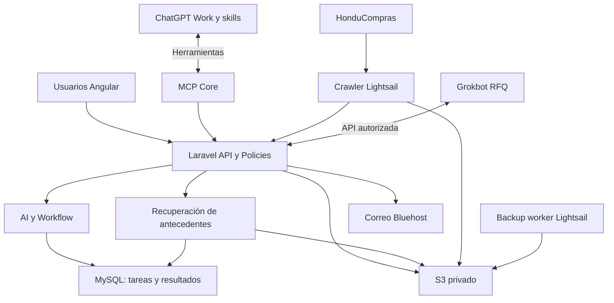

# Proyecto Bastion
## Documento maestro del proyecto

**Empresa:** Castillo IT S. de R.L.  
**Proyecto:** Bastion  
**Estado:** Arquitectura conceptual aprobada como base, pendiente de validación senior y refinamiento técnico  
**Versión documental:** 0.6 — Maestro vigente consolidado  
**Fecha:** 7 de octubre de 2026

## Uso de esta especificación por desarrolladores e IA

Este maestro define alcance y decisiones transversales vigentes. El historial anterior se conserva en Git, no como instrucciones alternativas dentro del documento. “Debe” expresa un objetivo; no demuestra implementación ni despliegue.

| Tema | Documento de detalle |
| --- | --- |
| Core, identidad, API/MCP y seguridad | [Core](architecture/core.md) |
| Rutas y dependencias | [Core y módulos](architecture/core-modules.md) |
| Arquitectura general | [Oficina AI](architecture/oficina-ai-v2.md) |
| Ejecución IA y pipeline | [Integración IA](architecture/ai-integration.md) |
| Tareas, reservas y resultados IA | [Contrato IA](contracts/ai-pipeline.md) |
| Antecedentes de precios | [RAG](knowledge-rag/README.md) |
| Presentación de resultados | [UX IA](modules/ai-results.md) |
| Reglas comerciales por módulo | [Índice de módulos](modules/README.md) |
| Protocolo del cliente crawler existente | [Contrato del crawler](../aws/lightsail/crawler/docs/IMPORT_CONTRACT.md) |

Leer maestro y detalle del área antes de implementar. El documento especializado detalla su contrato; no autoriza cambiar el alcance, los permisos o una decisión transversal. Si persiste una contradicción, documentarla y resolverla explícitamente, no elegir silenciosamente una variante ni mezclar esquemas.
Separar decisiones definidas, propuestas por validar y capacidades implementadas. Ejemplos de tablas, rutas, estados y horarios no constituyen migraciones ni servicios activos. No implementar opciones futuras como requisitos de la primera versión.
La aplicación nueva de Bluehost sigue en etapa documental; el crawler tiene código y pruebas, sin que ello acredite un receptor Laravel desplegado.

---

# 1. Resumen ejecutivo

**Bastion** es el ecosistema central de operación, automatización, colaboración y AI de Castillo IT.

Su propósito es convertir la operación de la oficina en un sistema integrado donde:

- los procesos de contratación pública se descubren automáticamente;
- los procesos se versionan y conservan históricamente;
- la AI clasifica, puntúa y analiza oportunidades;
- un agente autónomo investiga productos, precios y proveedores;
- si no existe precio público y el interés es alto, se preparan RFQ y se envían bajo autorización;
- los empleados podrán usar un asistente delegado como ampliación por fases;
- clientes, proveedores, cotizaciones, órdenes de compra, facturas y gastos quedan conectados;
- todas las acciones relevantes quedan auditadas;
- las acciones de alto impacto requieren autorización;
- GitHub conserva el código;
- MySQL conserva la verdad transaccional;
- Amazon S3 conserva archivos, histórico y backups;
- AWS Lightsail ejecuta el crawler y tareas técnicas;
- Bluehost hospeda el núcleo operativo de Bastion.

La arquitectura debe permanecer **modular, API-first, event-driven y AI-ready**, evitando quedar atada a un único proveedor de AI.

---

# 2. Nombre del proyecto

El nombre oficial del proyecto es:

> **Proyecto Bastion**

El nombre oficial debe usarse en toda la documentación del proyecto.

---

# 3. Objetivos de Bastion

## 3.1 Objetivo principal

Crear una plataforma central para administrar y automatizar la operación comercial y administrativa de Castillo IT.

## 3.2 Objetivos funcionales

Bastion debe cubrir:

- dashboard operativo en tiempo real;
- gestión de clientes;
- gestión de proveedores;
- procesos de contratación;
- análisis y clasificación de procesos;
- cotizaciones;
- órdenes de compra recibidas de clientes;
- facturación;
- gastos;
- reportes;
- colaboración;
- documentos;
- workflows;
- autorizaciones;
- auditoría;
- agentes AI autónomos;
- asistentes AI para empleados;
- investigación de precios;
- gestión de RFQ;
- respuestas de proveedores;
- integración con correo;
- integración con GitHub;
- backups automáticos;
- recuperación de antecedentes S3/MySQL para recomendar precios; búsqueda vectorial opcional posterior.

## 3.3 Objetivos no funcionales

El sistema debe ser:

- modular;
- extensible;
- auditable;
- seguro por defecto;
- tolerante a fallos;
- idempotente;
- recuperable;
- desacoplado de proveedores AI;
- mantenible por un equipo pequeño;
- compatible inicialmente con la infraestructura actual;
- preparado para crecer.

---

# 4. Principios de arquitectura

Las reglas base del proyecto son:

1. **MySQL es la fuente de verdad de datos estructurados y transaccionales.**
2. **S3 es almacenamiento histórico, documental, raw y de backups.**
3. **GitHub es la fuente de verdad del código.**
4. **Laravel controla la lógica empresarial.**
5. **Angular es la interfaz principal para usuarios.**
6. **Lightsail ejecuta extracción y tareas técnicas, no la lógica principal de negocio.**
7. **Los agentes AI nunca acceden directamente a MySQL.**
8. **AI utiliza API/MCP con permisos limitados.**
9. **Las acciones críticas requieren autorización humana.**
10. **Todo cambio importante queda auditado.**
11. **El sistema debe operar aunque ChatGPT o Grok no estén disponibles temporalmente.**
12. **El crawler nunca reemplaza el histórico: observa, acumula, compara, versiona y reporta.**
13. **El sistema debe permitir agregar módulos futuros sin rediseñar el núcleo.**
14. **No se implementarán microservicios prematuramente.**
15. **La arquitectura inicial será un modular monolith.**

---

# 5. Infraestructura actual

## 5.1 Bluehost
Plan Choice Plus: destino de Angular, Laravel, MySQL y correo. La nueva aplicación Bastion aún no se acredita desplegada.
- Dominio: `https://bastion.castilloit.net`.
- PHP seleccionable 8.1–8.5; objetivo 8.5, CLI/extensiones por verificar.
- SSH y FTP disponibles; usar SSH/SFTP para despliegue.
- Cron mínimo de un minuto.
- Document root: `~/public_html/website_091cdca8`; exponer solo activos públicos.
- Servidor reportado: **Percona Server for MySQL 5.7.44-48**. Compatibilidad de paquetes/migraciones y soporte de seguridad por validar.

## 5.2 AWS Lightsail
Instancia documentada: 1 GB RAM, 2 vCPU, 40 GB SSD. Ejecuta crawler, retries, checkpoints, entrega y workers de backup. No es la base maestra ni se le asignan modelos locales, OCR pesado o vector DB por defecto.

## 5.3 Amazon S3
Bucket confirmado por el usuario: `castilloit-honducompras-crawler`, región `us-east-1`. Documentos operativos y backups requieren ubicación/aislamiento definidos; nombres como `castilloit-backups` y `castilloit-documents` son propuestas, no buckets cuya creación esté verificada. Archivos privados, versiones y metadatos en MySQL.

## 5.4 GitHub
Repositorio vigente: [Ahcast/Bastion](https://github.com/Ahcast/Bastion). Monorepo con `bluehost/`, `aws/` y `docs/`. GitHub mantiene código, documentación y CI/CD; crawler y backups se ejecutan en Lightsail.

---

# 6. Arquitectura general



Core/API/MCP, módulos y Angular se alojan en Bluehost. Work ejecuta IA externamente; Grokbot y recepción de respuestas requieren conexión y runtime validados. No existe acceso directo de agentes a MySQL. [Detalle de conexiones](architecture/ai-integration.md).

---

# 7. Responsabilidad por ubicación

## 7.1 Bluehost — Bastion Core

Ejecuta:

- Angular SPA;
- Laravel;
- REST API;
- autenticación;
- RBAC;
- workflow engine;
- approval engine;
- audit log;
- importador de procesos;
- lógica de negocio;
- integración con MySQL;
- endpoints para agentes;
- endpoints internos;
- generación de documentos cuando sea razonable;
- jobs según capacidad del hosting.

Almacena en MySQL:

- usuarios;
- roles;
- permisos;
- clientes;
- proveedores;
- procesos;
- versiones de procesos;
- items;
- cotizaciones;
- órdenes de compra;
- facturas;
- gastos;
- RFQ;
- respuestas de RFQ;
- precios;
- tareas;
- workflows;
- aprobaciones;
- auditoría;
- estado AI;
- referencias a documentos.

## 7.2 AWS Lightsail

Ejecuta:

- crawler HonduCompras;
- scheduler;
- retries;
- checkpoints;
- estado técnico del crawler;
- generación raw;
- subida a S3;
- entrega de resultados a Bluehost;
- backup worker;
- sincronización de backups a S3.

No debe convertirse en fuente maestra de negocio.

## 7.3 Amazon S3

Almacena:

- raw del crawler;
- CSV;
- JSON;
- run manifests;
- error manifests;
- documentos históricos;
- PDFs;
- datasheets;
- snapshots;
- backups MySQL;
- backups de archivos;
- documentos generados;
- archivos de colaboración.

No reemplaza MySQL.

## 7.4 GitHub

Almacena:

- código;
- migrations;
- tests;
- documentación;
- configuración no secreta;
- scripts;
- workflows CI/CD;
- infraestructura declarativa.

Nunca almacenar:

- `.env`;
- contraseñas;
- API keys;
- AWS keys;
- dumps SQL;
- CSV empresariales;
- documentos sensibles.

---

# 8. Stack tecnológico propuesto

## 8.1 Frontend
Baseline propuesto: Angular 22.x, TypeScript 6.x, RxJS 7.x y Node 24 LTS para build; versiones/compatibilidad por validar antes de instalar. Angular Router, Signals, Reactive Forms, HttpClient, standalone components y carga diferida por módulo.
Rutas vigentes:
- `bluehost/frontend/src/app/core/`: sesión, API, guards, configuración y shell; Inicio/Configuración en `core/pages/dashboard` y `core/pages/settings`.
- `bluehost/frontend/src/app/modules/`: customers, suppliers, processes, quotes, purchase-orders, invoices, expenses, reports y collaboration.
- `bluehost/frontend/src/app/shared/`: UI, pipes, directivas y utilidades.
Interfaz íntegramente en español; identificadores técnicos en inglés.

## 8.2 Backend
Monolito modular, Laravel 13/PHP 8.5 como objetivo sujeto a compatibilidad real; Composer 2.
- `bluehost/backend/app/Core/`: identidad, RBAC/MFA, configuración/SMTP, API/MCP, auditoría, archivos y ejecución común.
- `bluehost/backend/app/Modules/`: Customers, Suppliers, Processes, Quotes, PurchaseOrders, Invoices, Expenses, Reports, Collaboration, Workflow y AI.
Core no importa módulos concretos. Los módulos usan contratos públicos y no escriben tablas de otros módulos directamente. Actions/Policies se comparten entre entradas.

## 8.3 Base de datos
Destino confirmado: **Percona/MySQL 5.7.44-48**, InnoDB y utf8mb4 según configuración a validar. No depender de funciones exclusivas de MySQL 8. Verificar soporte/parches, conexiones, índices, migraciones, rendimiento y restauración. Un cambio de versión exige decisión/migración explícita.

## 8.4 Crawler
Código existente bajo `aws/lightsail/crawler/`: Python 3.12+, Requests, BeautifulSoup y SQLite. Dependencias y ejecución reales: README/OPERATIONS/lockfile del crawler. No introducir navegador ni otro cliente HTTP por referencias conceptuales anteriores.

## 8.5 API
Core: REST JSON/HTTPS, `/api/v1/` y `/api/internal/v1/`; OpenAPI 3.1/Scramble propuestos. Paginación, filtros permitidos, correlación, idempotencia y validación. El prefijo internal no concede privacidad por sí solo.

## 8.6 MCP
Core: `https://bastion.castilloit.net/mcp`, laravel/mcp y Streamable HTTP propuestos; Passport/OAuth con PKCE para delegación. Validar descubrimiento, audiencia, revocación, protocolo y clientes. MCP invoca las mismas Actions/Policies; no duplica negocio. Ver [Core](architecture/core.md).

---

# 9. Autenticación y autorización

## 9.1 SPA
Sanctum con sesión por cookies, CSRF, Fortify y TOTP obligatorio. Mismo origen en bastion.castilloit.net; cookie `__Host-bastion_session`, Secure, HttpOnly, SameSite=Lax, Path=/, sin Domain. No tokens de sesión en localStorage. Sin acceso a negocio antes de completar MFA; recuperar contraseña no elimina MFA.

## 9.2 Servicios
Crawler, backup, Work y Grokbot usan identidades separadas, revocables y con mínimo alcance. `crawler-lightsail` solo ingiere y reporta sus runs. Permisos/scopes concretos y guard correspondiente según Core; no aceptar tokens indistintamente entre SPA, MCP y servicios.

## 9.3 Grokbot RFQ
Identidad de propósito limitado para consultar RFQ autorizadas y solicitar envío mediante Core. No pagos, ofertas presentadas, administración ni credenciales SMTP. La lectura/escritura de precios desde respuestas requiere contrato y permiso específico.

## 9.4 Asistente delegado
Capacidad futura bajo permisos efectivos del empleado, conexión y Policy. requested_by se deriva de delegación autenticada; no se confía en argumentos enviados por el modelo.

## 9.5 ChatGPT Work
Conecta por MCP con alcance explícito para consultar tareas, leer contexto autorizado y guardar resultados. Las automatizaciones desatendidas requieren validar credenciales/delegación persistente y compatibilidad real de cuenta. Nunca acceso directo a MySQL.
Detalles de OAuth, RBAC, sesiones y reautenticación en [Core](architecture/core.md); no ampliar permisos para sortear un fallo de automatización.

---

# 10. Módulos de la aplicación

Menú aprobado:

```text
Inicio
Clientes
Proveedores
Órdenes de Compra
Cotizaciones
Facturas
Gastos
Reportes
Procesos
Colaboración
Configuración
```

---

# 11. Módulo Inicio

Dashboard operativo.

Debe mostrar:

- procesos nuevos;
- procesos actualizados;
- procesos prioritarios;
- procesos asignados;
- cotizaciones pendientes;
- cotizaciones por vencer;
- órdenes activas;
- facturas pendientes;
- gastos;
- RFQ pendientes;
- proveedores sin respuesta;
- aprobaciones;
- tareas;
- actividad AI;
- errores del crawler;
- backups;
- alertas.

Feed de actividad:

```text
17:31 Investigación IA disponible para ítem X
17:22 ENEE modificó proceso Y
17:10 proveedor respondió RFQ-581
16:58 cotización Q-1432 aprobada
16:40 OC cliente recibida
```

---

# 12. Módulo Clientes

Vista 360°.

Información:

- datos legales;
- RTN;
- contactos;
- direcciones;
- instituciones;
- procesos;
- cotizaciones;
- órdenes de compra;
- facturas;
- pagos;
- documentos;
- notas;
- historial;
- actividad.

---

# 13. Módulo Proveedores

Debe contener:

- empresa;
- país;
- contactos;
- emails;
- categorías;
- marcas;
- productos;
- RFQ;
- cotizaciones recibidas;
- precios;
- lead times;
- MOQ;
- términos de pago;
- documentos;
- historial;
- evaluación;
- confiabilidad;
- tiempos de respuesta.

---

# 14. Módulo Procesos

Fuente principal:

HonduCompras crawler.

Estados de negocio posibles:

```text
Nuevo
Revisión
Asignado
Analizando
Interesante
Cotizando
Oferta preparada
Presentado
Adjudicado
Perdido
Cancelado
Cerrado
```

Funciones:

- ver proceso;
- ver histórico;
- ver cambios;
- ver documentos;
- asignar responsable;
- asignar equipo;
- prioridad;
- comentarios;
- tareas;
- análisis AI;
- score;
- items;
- crear cotización;
- iniciar research;
- iniciar procurement.

Resultados IA dentro de Procesos: bandeja priorizada con cierre/responsable/avance; detalle con resumen, alternativas por ítem, cumplimiento con evidencia, RFQ, precio sugerido, documentos e historial. Publicación progresiva; información insuficiente no equivale a irrelevancia. Ver [presentación](modules/ai-results.md).

---

# 15. Módulo Cotizaciones

Origen:

```text
Proceso -> Cotización
```

o:

```text
Cliente -> Cotización directa
```

Datos:

- cliente;
- proceso;
- items;
- cantidades;
- costo;
- precio;
- impuestos;
- margen;
- flete;
- proveedores;
- documentos;
- datasheets;
- versiones;
- approvals.

Estados:

```text
Borrador
Costeo
Revisión
Aprobada internamente
Enviada
Aceptada
Rechazada
Vencida
```

---

## 15.1 Incorporación de resultados IA

La creación básica desde proceso transfiere cliente/entidad, expediente y source_process_id sin depender de IA. Una acción adicional explícita permite incorporar solo ítems, cantidades, alternativas, precios y adjuntos seleccionados a un borrador. Previsualización, idempotencia y control de versión; no sobrescribir ediciones humanas. Costos, proveedores, márgenes y notas permanecen internos salvo selección autorizada. Múltiples cotizaciones por proceso siguen permitidas.

# 16. Módulo Órdenes de Compra

En el menú inicial significa:

> órdenes de compra emitidas por clientes después de aprobar una cotización.

Entidad conceptual:

`customer_purchase_orders`

Campos:

- cliente;
- número de OC;
- cotización;
- fecha;
- items;
- monto;
- lugar de entrega;
- fecha de entrega;
- documentos;
- estado.

Estados:

```text
Recibida
Confirmada
Comprando
En tránsito
Recibido
Preparando entrega
Entregado
Facturado
Cerrado
```

A futuro debe existir separado:

`supplier_purchase_orders`

para órdenes emitidas por Castillo IT a proveedores.

---

# 17. Módulo Facturas

Relacionable con:

- cliente;
- cotización;
- orden de compra;
- items;
- impuestos;
- pagos.

Estados:

```text
Borrador
Emitida
Entregada
Pendiente
Parcialmente pagada
Pagada
Vencida
Anulada
```

---

# 18. Módulo Gastos

Datos:

- proveedor;
- categoría;
- fecha;
- monto;
- moneda;
- impuesto;
- proceso;
- cotización;
- OC;
- factura soporte;
- comprobante.

Categorías posibles:

```text
Compra producto
Flete
Aduana
Impuestos
Transporte
Viáticos
Software
Servicios
Publicidad
Oficina
Otros
```

Objetivo:

- rentabilidad real por proceso;
- rentabilidad por cotización;
- rentabilidad por OC;
- análisis financiero.

---

# 19. Módulo Reportes

Reportes:

- ventas;
- compras;
- margen;
- clientes;
- proveedores;
- procesos;
- cotizaciones;
- facturas;
- gastos;
- RFQ;
- AI;
- operaciones.

Ejemplos:

- margen por cliente;
- margen por institución;
- procesos ganados/perdidos;
- cotizaciones por usuario;
- tiempo promedio de cotización;
- proveedor más competitivo;
- cuentas por cobrar;
- gastos por categoría;
- rentabilidad por OC.

---

# 20. Módulo Colaboración

No debe intentar recrear Google Drive completo.

Debe permitir:

- archivos;
- carpetas;
- documentos;
- comentarios;
- menciones;
- tareas;
- notas;
- versiones;
- relación con entidades.

Ejemplo:

```text
Proceso ENEE-123/
├── TDR.pdf
├── oferta_tecnica.docx
├── datasheets/
├── cotizacion_proveedor.pdf
├── comentarios
└── tareas
```

Los archivos pueden vivir en S3.

MySQL guarda:

- metadata;
- entity link;
- owner;
- timestamps;
- version;
- S3 key.

---

# 21. Módulo Configuración

Debe incluir:

```text
Empresa
Usuarios
Roles
Permisos
Equipos
Impuestos
Monedas
Series de documentos
Plantillas
Email
Integraciones
AI Agents
Workflows
Aprobaciones
Categorías
Auditoría
Seguridad
```

Integraciones futuras:

- AWS;
- Gmail/email;
- Google Drive;
- GitHub;
- Grok;
- ChatGPT;
- S3;
- HonduCompras;
- otras fuentes.

---

# 22. Workflow Engine

Debe ser transversal.

Entidades:

- procesos;
- cotizaciones;
- OC;
- facturas;
- RFQ;
- gastos;
- tareas.

Ejemplo cotización:

```text
Borrador
   ↓
Costeo
   ↓
Revisión
   ↓
Aprobación
   ↓
Enviada
```

El sistema debe permitir extender o redefinir workflows.

---

# 23. Event-driven interno

Ejemplos:

`QuoteApproved`

puede disparar:

- audit;
- notifications;
- dashboard refresh;
- AI;
- workflow.

`CustomerPurchaseOrderReceived`

puede disparar:

- crear workflow;
- crear tareas;
- notificar responsable;
- iniciar procurement;
- actualizar dashboard.

Objetivo:

- desacoplar módulos;
- permitir funciones futuras.

---

# 24. Approval Engine

Workflow administra aprobaciones; Core aporta identidad, Policies y auditoría.

## 24.1 Análisis y borradores
Con permiso puede analizar, clasificar, investigar, buscar precios/proveedores, preparar candidatos, documentos y borradores de RFQ. Preparar una solicitud no autoriza su envío.

## 24.2 Escrituras y correo
Cambios comerciales requieren permiso/Policy del módulo. Envíos RFQ o follow-up requieren aprobación por defecto o regla previa explícitamente autorizada con propósito, destinatarios y límites. El correo al cliente y acciones sensibles siguen los controles Core/Workflow.

## 24.3 Acciones críticas
Presentar ofertas, emitir órdenes a proveedores, comprometer dinero y autorizar pagos requieren decisión humana. Aprobación vinculada a acción, entidad, versión/hash y vigencia; cambios relevantes invalidan la aprobación. Reevaluar antes de ejecutar y evitar duplicados.

---

# 25. Auditoría

Tabla conceptual:

`audit_events`

Debe guardar:

- actor_type;
- actor_id;
- requested_by;
- action;
- entity_type;
- entity_id;
- timestamp;
- source;
- before;
- after;
- result;
- correlation_id.

Ejemplo:

```text
actor: grok-procurement
action: RFQ_SENT
item: 843
supplier: 72
rfq: RFQ-2026-00581
```

Ejemplo asistente:

```text
actor: grok-office-assistant
requested_by: user_18
action: INVOICE_CREATED
quote: Q-1842
invoice: INV-3382
```

---

# 26. Crawler HonduCompras

El crawler es un componente crítico.

## 26.1 Responsabilidad

Debe:

```text
DISCOVER
EXTRACT
NORMALIZE
COMPARE
VERSION
ARCHIVE
DELIVER
```

No debe decidir:

- si un proceso es buen negocio;
- score;
- margen;
- responsable;
- proveedor;
- precio de venta.

## 26.2 Schedule

Mínimo:

```text
01:00
19:00
```

Debe permitir más ejecuciones sin cambiar código.

## 26.3 Filosofía

Nunca:

```text
TRUNCATE + RELOAD
```

Siempre:

```text
APPEND DE CONOCIMIENTO
```

## 26.4 Identidad

Prioridad:

1. ID oficial HonduCompras;
2. número de proceso;
3. URL canónica;
4. fingerprint/hash.

En Bastion:

```text
UNIQUE(source, external_id)
```

## 26.5 Estados de cambio

```text
NEW
UPDATED
UNCHANGED
```

## 26.6 Estados de completitud

Independientes:

```text
EMPTY
PARTIAL
COMPLETE
```

Ejemplo:

```text
NEW + EMPTY
```

posteriormente:

```text
UPDATED + COMPLETE
```

## 26.7 Versionado

Tablas:

```text
processes
process_versions
```

`processes`:

- estado actual;
- latest hash;
- first_seen_at;
- last_seen_at;
- current_version.

`process_versions`:

- versiones;
- snapshot;
- hash;
- cambios;
- detected_at.

## 26.8 Hash

No usar HTML bruto.

Construir:

`canonical_payload`

Normalizar:

- espacios;
- saltos;
- fechas;
- URLs;
- HTML;
- encoding;
- orden de documentos.

Después:

```text
SHA256(canonical_payload)
```

## 26.9 Tipos de cambio

```text
DESCRIPTION_CHANGED
DEADLINE_CHANGED
STATUS_CHANGED
DOCUMENT_ADDED
DOCUMENT_REMOVED
DOCUMENT_CHANGED
METADATA_CHANGED
```

## 26.10 Documentos

Por documento:

- nombre;
- URL;
- SHA256;
- first_seen;
- last_seen;
- version.

Si mismo nombre pero contenido distinto:

`DOCUMENT_UPDATED`

## 26.11 Runs

Ejemplo conceptual de identificador; el formato operativo lo define el código/contrato del crawler:

```text
HC-YYYYMMDD-HHMM
```

Ejemplo:

`HC-20261006-1900`

Campos:

- run_id;
- start;
- end;
- status;
- coverage;
- pages expected;
- pages processed;
- pages failed;
- records;
- retries;
- delivery;
- S3;
- ACK.

Estados:

```text
SUCCESS
PARTIAL_SUCCESS
FAILED
```

## 26.12 Tolerancia a fallos

Si:

```text
48 páginas esperadas
46 OK
2 FAIL
```

resultado:

`PARTIAL_SUCCESS`

Los 46 resultados se guardan.

Las 2 páginas van a retry queue.

## 26.13 Retries

- timeout configurable;
- exponential backoff;
- jitter opcional;
- retries por unidad;
- no repetir todo si solo falla una página.

## 26.14 Checkpoints

Guardar:

- páginas completadas;
- páginas fallidas;
- retry queue;
- pending delivery.

Estado técnico local:

- SQLite.

## 26.15 Artefactos

Nombres conceptuales de artefactos (el contrato operativo, estructura y manifests reales se consultan en el README/OPERATIONS del crawler):

```text
processes.csv
processes.json
run.json
errors.json
```

## 26.16 S3

Ejemplo:

```text
s3://castilloit-honducompras-crawler/raw/
2026/
  10/
    06/
      1900/
        processes.csv
        processes.json
        run.json
        errors.json
```

## 26.17 Delivery
El código del crawler y su contrato de entrega se encuentran en [IMPORT_CONTRACT](../aws/lightsail/crawler/docs/IMPORT_CONTRACT.md). No asumir receptor Laravel implementado ni interoperabilidad ya probada.
Base objetivo: `/api/internal/v1/crawler`; crear runs, entregar lotes de procesos y completar. Implementar el receptor contra el schema/checksums/fields_present y reglas de orden del contrato del cliente existente; no inventar otro protocolo desde ejemplos del maestro.

## 26.18 ACK
El cliente actual exige 200/201 y status IMPORTED con batch_id para procesos; complete confirma COMPLETED. Persistir transacción y ACK antes de responder. HTTP 202 de recepción no equivale a importación y requiere ampliar el cliente con polling antes de usarlo.
Un sublote rechazado se revierte y permanece reintentable. Ausencia de campos/documentos en una entrega parcial no borra información ni revierte observaciones más recientes.

## 26.19 Idempotencia

Usar:

`Idempotency-Key`

Para:

- batches;
- runs;
- RFQ;
- acciones reintentables.

## 26.20 Bluehost caído

Si scraping terminó:

```text
HonduCompras -> OK
S3 -> OK
Bluehost -> FAIL
```

estado:

`PENDING_DELIVERY`

Se reintenta entrega.

No se vuelve a scrapear.

## 26.21 Ausencia no significa borrado

Si hoy faltan procesos:

- no marcarlos eliminados automáticamente;
- usar missing_count;
- considerar cobertura;
- requerir varias observaciones;
- o estado explícito del sitio.

## 26.22 Replay

Debe poder:

```text
S3 raw
  ↓
replay
  ↓
importer
```

sin consultar HonduCompras.

## 26.23 Dry-run

Soportar:

```text
crawler --dry-run
```

## 26.24 CLI

Ideal:

```text
crawler run
crawler retry
crawler status
crawler replay <run_id>
crawler upload <run_id>
crawler validate <run_id>
```

## 26.25 Métricas

- tiempo total;
- tiempo por página;
- requests;
- errores;
- RAM;
- records;
- coverage;
- retries.

## 26.26 Health

Ejemplo:

```text
crawler: OK
last_success: ...
last_run: ...
last_coverage: 98%
pending_retries: 2
pending_uploads: 0
```

## 26.27 AI queue

Bastion decide:

```text
Sin puntuación completada -> pendiente, incluidos rezagados
Parcial con datos útiles -> evaluación provisional
Cambio relevante -> revisión separada según política
Vacío -> información insuficiente, esperar datos
Sin cambios con tarea pendiente -> retomar
Sin cambios ya puntuado -> no repetir
```

---

# 27. ChatGPT en Bastion

ChatGPT Work es el ejecutor inicial prioritario del pipeline, aprovechando mecanismos del plan Plus con skills y tareas programadas. Bastion administra pendientes/resultados; Laravel no invoca Plus como API. Compatibilidad, límites y ejecución desatendida requieren prueba real.

## 27.1 Pipeline
| Paso | Trabajo | Resultado |
| --- | --- | --- |
| 1 | Puntuación diaria de nuevos sin análisis completado y rezagados | Interés, razones, dudas y versión |
| 2 | Investigación web/catálogos por ítem relevante | Alternativas, precios fechados y cumplimiento por requisito |
| 2.5 | Alto interés sin precio: localizar contactos y preparar RFQ para Grokbot | Solicitud trazable |
| 3 | Publicar avances en Procesos | Revisión progresiva por usuario |
| 4 | Skill comercial + antecedentes RAG; cálculos Laravel | Rango y precio sugerido |
| 5 | Ficha fabricante o propia sustentada | Adjunto ligado al producto exacto |

Tareas con reservas temporales, idempotencia y guardado por unidad. Analizado solo después de persistir; límites/fallos conservan pendientes. Datos insuficientes no implican descarte. Precios, documentos y stock requieren evidencia/fecha. Una ficha propia declara autoría Castillo IT y no inventa certificaciones.
El usuario selecciona producto/precio y crea la cotización; investigación completa no significa oferta presentada.

## 27.2 Supervisión
Puede consultar prioridades, pendientes y avances dentro de sus permisos. No modifica KPIs canónicos ni decisiones de negocio sin Actions autorizadas.

## 27.3 Ingeniería
Codex trabaja en código, pruebas, PR y migraciones sin acceso automático a producción. Ese rol es distinto del ejecutor operativo Work configurado para investigación.

Contratos y condiciones de salida: [integración IA](architecture/ai-integration.md) y [tareas IA](contracts/ai-pipeline.md).

---

# 28. Grokbot — RFQ y respuestas

Grokbot atiende las RFQ preparadas por ChatGPT para ítems de alto interés sin precio publicado. Su alojamiento y conexión siguen pendientes de validar.

1. Bastion registra RFQ con ítems, especificaciones, cantidades, contacto verificado/fuente y fecha límite.
2. Workflow valida aprobación o regla previa autorizada.
3. Grokbot reclama tarea y solicita `send_supplier_rfq`.
4. Core envía por SMTP Bluehost y registra estado/correlación.
5. Worker de correo propuesto recupera respuestas y adjuntos; ubicación por capacidad.
6. Bastion deduplica/vincula respuesta; ambigüedad va a revisión. La IA puede extraer precios conservando original.

No herramienta de correo arbitrario ni credenciales SMTP para el bot. SMTP aceptado no prueba entrega; timeout incierto requiere conciliación antes de repetir. Follow-up solo con autorización y límites. La investigación principal del pipeline corresponde a Work; no se impone un segundo investigador Grok en la primera versión.

---

# 29. Asistente de oficina — ampliación por fases

Rol:

> puente entre empleado y Bastion.

Ejemplos:

- crea factura;
- genera datasheet package;
- busca cotización;
- envía correo;
- crea documento;
- consulta cliente;
- genera reporte.

## 29.1 Principio

El asistente hereda permisos del empleado.

Nunca:

```text
Empleado cualquiera
  ↓
AI
  ↓
credenciales admin
```

Debe existir identidad delegada.

---

# 30. Castillo API

La API es el núcleo de integración.

Endpoints conceptuales:

```text
/processes
/products
/prices
/suppliers
/rfqs
/quotes
/invoices
/expenses
/documents
/tasks
/approvals
/reports
/audit
```

Ejemplos:

```http
GET  /api/v1/processes
GET  /api/v1/processes/{id}
POST /api/v1/processes/{id}/assign

GET  /api/v1/quotes
POST /api/v1/quotes
PATCH /api/v1/quotes/{id}

POST /api/v1/invoices

GET  /api/v1/suppliers

POST /api/v1/rfqs
```

---

# 31. Castillo MCP

MCP es la entrada Core para herramientas autorizadas, con schemas versionados y Actions comunes a REST. No es el módulo AI ni el motor que ejecuta modelos.
El catálogo inicial para este pipeline incluye claim_scoring_tasks, get_process_context, save_process_score, claim_research_tasks, save_item_research, create_rfq_request, search_pricing_history, save_price_recommendation, register_artifact y complete_task.
Grokbot usa herramientas RFQ acotadas con permisos separados. Nombres/esquemas siguen siendo propuestas de implementación.
Fuente contractual: [pipeline IA](contracts/ai-pipeline.md). [API/MCP](contracts/api-mcp.md) conserva capacidades de otros módulos; su presencia en un catálogo no las habilita para todos los agentes.

---

# 32. Background jobs

Laravel Queue con driver database y cron ejecuta jobs cortos de importación, correo, notificaciones, mantenimiento de tareas y procesamiento documental acotado. Controlar solapamientos, memoria, tiempo y número de jobs; stop-when-empty solo no impone presupuesto máximo.
Work ejecuta las investigaciones externamente y recoge tareas persistidas por MCP. El cron Laravel no invoca Plus ni garantiza despertar Work. RFQ en espera no ocupa un worker.
OCR/procesamiento intensivo requiere ejecutor evaluado; no asumir capacidad en Lightsail 1 GB. Redis/SQS y workers dedicados son opciones futuras, no requisitos iniciales.

---

# 33. Dashboard realtime

MVP:

- polling cada 15–30 s.

Fase 2:

- WebSocket administrado:
  - Ably;
  - Pusher.

Laravel Reverb solo si Bluehost soporta procesos persistentes.

---

# 34. Backups Bluehost -> S3

Arquitectura preferida:

```text
Bluehost
  │
SSH/SFTP
  │
Lightsail Backup Worker
  │
S3
```

Ventaja:

- evitar credenciales AWS completas en hosting compartido;
- centralizar lógica en Lightsail.

## 34.1 MySQL

Flujo:

```text
mysqldump
  ↓
gzip
  ↓
SHA256
  ↓
S3
  ↓
verify
```

## 34.2 Files

- rsync/SFTP;
- compresión;
- incremental cuando sea posible;
- S3 sync.

## 34.3 Schedule sugerido

```text
23:30 MySQL
02:30 archivos
```

## 34.4 Manifest

Cada backup:

```json
{
  "backup_id": "...",
  "source": "bluehost",
  "started_at": "...",
  "finished_at": "...",
  "size_bytes": 0,
  "sha256": "...",
  "s3_key": "...",
  "status": "success"
}
```

## 34.5 Retención propuesta, pendiente de validación

```text
diarios: 30 días
semanales: 12 semanas
mensuales: 12 meses
```

Después:

- Glacier según política.

---

# 35. Seguridad

Principio:

> Security by default + least privilege.

## 35.1 Aplicación

- HTTPS;
- WAF;
- rate limiting;
- input validation;
- CSRF;
- XSS protections;
- CSP cuando sea posible;
- secure cookies;
- session hardening;
- RBAC;
- scoped tokens;
- audit;
- approvals.

## 35.2 API

Identidades separadas:

```text
crawler-lightsail
grok-procurement
office-assistant
chatgpt
backup-worker
admin
```

## 35.3 AWS

- S3 private;
- block public access;
- encryption;
- versioning;
- lifecycle;
- IAM mínimo.

## 35.4 GitHub

- protected main;
- PR;
- checks;
- secret scanning;
- no `.env`;
- no keys;
- CI.

## 35.5 AI

Controles:

- scopes;
- tool allowlists;
- approvals;
- audit;
- no DB directa;
- protección ante prompt injection;
- sanitización de contenido externo;
- límites en email;
- no acciones financieras autónomas.

---

# 36. Observabilidad

Debe existir:

- logs estructurados;
- request_id;
- correlation_id;
- job_id;
- run_id;
- actor;
- timestamps;
- errors;
- latency;
- health checks.

Crawler:

- coverage;
- retry count;
- records;
- failed units;
- delivery status.

Backups:

- timestamp;
- size;
- checksum;
- S3 verification.

AI:

- task;
- actor;
- tools;
- result;
- duration;
- approval;
- error.

---

# 37. CI/CD

GitHub flow:

```text
feature branch
  ↓
commit
  ↓
tests
  ↓
pull request
  ↓
review
  ↓
merge
  ↓
deploy
```

Branching sugerido:

- `main`;
- feature branches.

Evitar complejidad innecesaria con `develop` si el equipo es pequeño.

---

# 38. Despliegue

## 38.1 Lightsail

GitHub Actions o deploy manual controlado:

- SSH;
- pull;
- venv;
- dependencies;
- restart scheduler/service.

## 38.2 Bluehost

Mecanismo a validar:

- SSH;
- SFTP;
- deploy nativo;
- Git support.

Debe quedar definido por senior según capacidades reales del plan.

---

# 39. Knowledge / RAG Engine

El objetivo definido es recuperar antecedentes para sugerir precio de venta con una skill comercial. No inferir equivalencia técnica por similitud.

Primera etapa:
- S3 privado: originales, texto extraído y documentos versionados.
- MySQL: metadatos, productos/referencias, precios, fechas, monedas, condiciones y referencias a fragmentos.
- Laravel: búsqueda autorizada por campos/texto y entrega de antecedentes mediante MCP.
- Work: aplica skill, explica comparables y registra recomendación.

Preparar/extractar una vez por versión; OCR según necesidad y capacidad. No leer todo el histórico en cada ejecución. Laravel calcula costos/márgenes; el usuario fija el precio. Antecedentes insuficientes se declaran, no se inventa competitividad.
S3 Vectors es ampliación opcional: requiere embeddings/índice/modelo compatible y presupuesto explícito, no incluido por almacenar PDFs ni presumido dentro de Plus. Corpus, calidad, retención y criterios comerciales siguen pendientes. Ver [RAG](knowledge-rag/README.md).

---

# 40. Módulos futuros

Bastion debe permitir agregar:

```text
Inventario
Compras a proveedores
Logística
Importaciones
Bodega
Cuentas por cobrar
Cuentas por pagar
Bancos
Activos
Contratos
Proyectos
Mantenimiento
RRHH
CRM avanzado
Servicio técnico
Integraciones externas
```

---

# 41. Modelo conceptual de datos

Entidades principales:

```text
users
roles
permissions

customers
customer_contacts

suppliers
supplier_contacts
supplier_products

processes
process_versions
process_changes
process_items

documents
document_versions

quotes
quote_items
quote_versions

customer_purchase_orders
customer_purchase_order_items

invoices
invoice_items
payments

expenses

products
price_history

rfqs
rfq_items
rfq_messages
rfq_responses

workflow_definitions
workflow_instances
workflow_events

approvals

tasks

ai_tasks
ai_runs
agent_actions

audit_events

crawler_runs
crawler_run_units
crawler_deliveries
```

---

# 42. Data ownership

| Tipo de dato | Fuente de verdad |
|---|---|
| usuarios | MySQL |
| roles/permisos | MySQL |
| clientes | MySQL |
| proveedores | MySQL |
| procesos actuales | MySQL |
| versiones de procesos | MySQL |
| raw crawler | S3 |
| crawler technical state | SQLite Lightsail |
| cotizaciones | MySQL |
| OC | MySQL |
| facturas | MySQL |
| gastos | MySQL |
| documentos físicos | S3 |
| metadata documentos | MySQL |
| código | GitHub |
| backups | S3 |
| prompts/config AI | GitHub/MySQL según uso |
| Recuperación RAG | Índices/metadatos MySQL y fuentes/texto S3; vectores opcionales |

---

# 43. Conexiones entre componentes

| Origen | Destino | Mecanismo |
|---|---|---|
| Angular | Laravel | HTTPS REST JSON |
| Laravel | MySQL | conexión DB interna |
| Laravel | S3 | AWS SDK/HTTPS |
| Lightsail | HonduCompras | HTTP(S) |
| Lightsail | S3 | boto3/AWS CLI HTTPS |
| Lightsail | Bluehost | actual push a documentar; objetivo HTTPS API |
| Lightsail backup worker | Bluehost | SSH/SFTP/rsync |
| GitHub Actions | Lightsail | SSH |
| GitHub Actions | Bluehost | SSH/SFTP/nativo pendiente |
| ChatGPT | Bastion | MCP/API HTTPS |
| Grok | Bastion | MCP/API HTTPS |
| Office Assistant | Bastion | MCP + OAuth delegated identity |
| Bastion | Email Bluehost | SMTP por Core; lectura de buzón por worker propuesto |

---

# 44. Email

El correo actual se encuentra en Bluehost.

El sistema debe poder:

- redactar RFQ;
- enviar RFQ;
- asociar correo con RFQ;
- leer respuesta;
- extraer precio;
- lead time;
- stock;
- MOQ;
- freight;
- términos;
- validez;
- datasheets.

Cada RFQ debe tener ID único:

```text
RFQ-2026-00582
```

para correlacionar replies.

---

# 45. Estados AI

Estados técnicos comunes de tareas: pending (Pendiente), running (En ejecución), waiting_supplier (En espera de proveedor), needs_review (Requiere revisión), completed (Completada), failed (Fallida), cancelled (Cancelada).
El contrato de transición/reserva/reintento está en [tareas IA](contracts/ai-pipeline.md).
Resultados como precio encontrado o puntuación provisional son atributos de etapa; no crear otra máquina de estados incompatible a partir de ejemplos antiguos. Un resultado de entrada anterior se conserva como histórico/desactualizado, no reemplaza el vigente.
Estados comerciales, revisado por usuario y oferta presentada son independientes.

---

# 46. Versionado y consistencia

## Procesos

Cada cambio significativo:

- nueva version;
- diff;
- hash;
- timestamp;
- trigger AI si corresponde.

## Cotizaciones

Deben soportar versionado cuando se modifica una cotización enviada o aprobada.

## Documentos

Document hash para detectar reemplazos.

---

# 47. Fallos previstos

## HonduCompras lento/inestable

Mitigación:

- retries;
- backoff;
- checkpoint;
- partial success;
- replay;
- schedule 2x/día.

## Bluehost temporalmente caído

Mitigación:

- store S3;
- pending delivery;
- retry delivery.

## AI no disponible

Mitigación:

- core sigue funcionando;
- tasks quedan pendientes;
- retry posterior.

## Email falla

Mitigación:

- estado;
- retry;
- no duplicar;
- audit.

## Backup inválido

Mitigación:

- checksum;
- size validation;
- manifest;
- alerta.

---

# 48. Roadmap de implementación

| Etapa | Entregable | Condición |
| --- | --- | --- |
| 0 | Validar entorno y dependencias | Compatibilidad Bluehost/PHP/Percona y seguridad |
| 1 | Crawler y entrega | Código existente probado con receptor/ACK, retries y recuperación |
| 2 | Core y módulos base | Identidad/MFA, API/MCP, auditoría y persistencia |
| 3 | Comercial | Cotizaciones, órdenes, facturas, gastos y reportes |
| 4 | IA inicial | Prueba Work–MCP, puntuación diaria recuperable y skill revisada |
| 5 | Investigación y RFQ | Evidencia por ítem, presentación, Grokbot y retorno de respuestas |
| 6 | Precios y fichas | RAG S3/MySQL, skill comercial y adjuntos verificados |
| 7 | Colaboración/asistente ampliado | Capacidades habilitadas por fases y permisos |
| Posterior | Búsqueda vectorial u otros proveedores | Necesidad medida y autorización explícita |

La aplicación manual sigue operativa sin IA. Fechas, presupuestos y umbrales no se inventan. No se activa automatización ni correo por publicar documentación.

---

# 49. Decisiones pendientes

## Definido
Monolito modular; Bluehost para aplicación/DB/correo; Lightsail para crawler/backups; S3 para archivos; GitHub Ahcast/Bastion; dominio bastion.castilloit.net; Percona 5.7 reportado; Core separado de módulos; frontend español; MFA; API/MCP; pipeline asistido Work; RAG inicial S3/MySQL.

## Por validar o concretar
- Versiones exactas/lockfiles y compatibilidad Laravel/PHP/Angular; PHP CLI/extensiones y soporte de Percona.
- Límites de hosting, despliegue, colas, WAF, retención y restauración/RPO/RTO.
- Receptor Laravel compatible con el cliente crawler existente y su ACK.
- Roles, scopes, delegación MCP, aprobadores y reglas específicas de envío.
- Prueba Work/Plus desatendida, plugin, capacidad, hora diaria y lotes.
- Skills: rubros/pesos/umbrales, corpus RAG, evaluación de calidad y criterios comerciales.
- Runtime/integración Grokbot, lectura de correo, OCR/cuarentena y transporte de artefactos.
- Índice vectorial/embeddings solo si la recuperación inicial es insuficiente.

Estas cuestiones no reabren decisiones ya definidas ni acreditan servicios implementados.

---

# 50. Criterio de salida de la revisión senior

Antes de iniciar implementación formal deben quedar aprobados:

- stack;
- hosting;
- API contract;
- auth;
- RBAC;
- roles;
- crawler responsibilities;
- data ownership;
- S3 layout;
- GitHub strategy;
- queue strategy;
- backup strategy;
- audit;
- approvals;
- AI boundaries;
- deployment;
- rollback;
- observability.

---

# 51. Resultado final esperado

Bastion debe permitir que Castillo IT opere así:

```text
HonduCompras
    ↓
crawler automático
    ↓
procesos versionados
    ↓
AI analiza
    ↓
score
    ↓
asignación
    ↓
research de precios
    ↓
proveedores
    ↓
RFQ
    ↓
cotización
    ↓
cliente aprueba
    ↓
OC cliente
    ↓
entrega
    ↓
factura
    ↓
gastos
    ↓
reportes
```

En paralelo:

```text
Empleado
  ↓
Office Assistant
  ↓
Bastion API
  ↓
acciones según permisos
```

Y:

```text
Gerencia
  ↓
ChatGPT / Dashboard
  ↓
supervisión, análisis y autorizaciones
```

---

# 52. Resumen de responsabilidades

| Componente | Responsabilidad |
| --- | --- |
| Angular | Interfaz española y revisión de resultados |
| Core Laravel | Identidad, RBAC/MFA, configuración, API/MCP, auditoría, archivos y SMTP |
| Módulos | Reglas comerciales y Actions propias |
| AI / Workflow | Tareas/resultados / reglas y aprobaciones |
| MySQL | Verdad transaccional, pendientes e índices/metadatos de antecedentes |
| S3 | Originales, evidencia, texto, fichas, raw y backups |
| Lightsail | Crawler y workers de backup |
| GitHub | Código, documentación, contratos y futuras skills |
| ChatGPT Work | Puntuación e investigación con skills; recomendación y documentación |
| Grokbot | RFQ autorizadas; conexión/runtime por validar |
| Codex | Ingeniería |
| Asistente delegado | Capacidad ampliada futura bajo permisos del usuario |
| Usuario | Selección, precio final, creación/revisión de cotización y decisión de ofertar |
| Correo Bluehost | Transporte y buzones; respuestas registradas en Bastion |

---

# 53. Regla final del proyecto

> **Bastion debe ser el sistema operativo de la oficina de Castillo IT: modular, seguro, auditable, automatizable y capaz de incorporar agentes AI sin entregarles control irrestricto sobre los datos o las decisiones críticas.**
