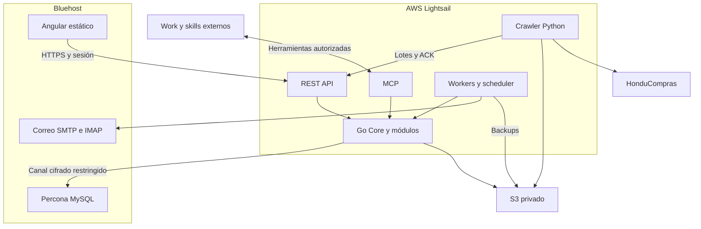

# Arquitectura y estructura

## Topología aprobada

API propuesta api.bastion.castilloit.net; frontend bastion.castilloit.net. API/MCP rutas /api/v1, /api/internal/v1 y /mcp. Son orígenes diferentes: CORS exacto, credentials y CSRF explícito. Cookie __Host-bastion_session pertenece al host API, sin Domain. No asumir que Angular agrega automáticamente XSRF a otro origen.

## Estructura de implementación

| Ruta | Contenido |
| --- | --- |
| backend/cmd/server | Composición raíz de REST/MCP y registro de módulos |
| backend/cmd/worker | Ejecución de jobs y outbox |
| backend/internal/core | identity, access, settings, api, mcp, audit, messaging, files, execution, contracts y registro modular |
| backend/internal/modules | customers, suppliers, processes, quotes, purchaseorders, invoices, expenses, reports, collaboration, workflow, ai |
| backend/database/migrations | Migraciones SQL globalmente ordenadas |
| backend/crawler | Python existente; no convertir a Go por defecto |
| backend/deploy | Configuración Go/systemd y despliegue backend al implementarlo |
| frontend/src/app/core | Sesión/API, shell, guards, Inicio y Configuración |
| frontend/src/app/modules | Módulos funcionales; carpetas purchase-orders y demás nombres técnicos |
| frontend/src/app/shared | Componentes/pipes/directivas reutilizables, sin negocio |
| docs/modules | Una especificación por módulo |
| scripts | Verificaciones del repositorio |

No crear carpetas vacías por cada concepto. Paquetes Go en minúsculas; estructura interna solo cuando tenga código. Mantener pruebas *_test.go junto al paquete y pruebas de integración acotadas.

Core no importa módulos concretos. Composición raíz inyecta contratos; módulos no escriben tablas de otros propietarios. REST y MCP llaman servicios internamente, sin HTTP a la propia API. Listados/agregados autorizados; integración entre módulos por servicios públicos/eventos. Eventos y auditoría de efectos relevantes en transacción con outbox.

MySQL Bluehost es fuente maestra; SQLite crawler solo estado técnico. S3 no reemplaza transacciones. No incluir servidor MySQL en deploy AWS. Lectura de buzón por worker Lightsail con límites; OCR futuro externo.
