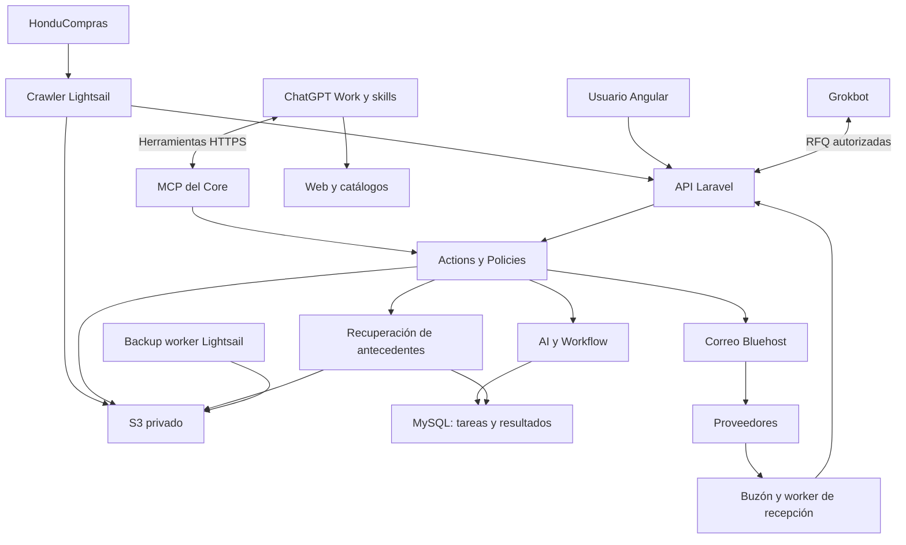

# Integración de IA — pipeline de oportunidades
Fecha: 2026-10-07. Especificación objetivo para implementación; no acredita servicios conectados ni automatizaciones activas.

## Objetivo y precedencia
Aumentar el número de procesos ofertados y reducir el tiempo de preparación. La IA investiga y propone; el usuario selecciona productos, fija precios y crea la cotización. Este documento desarrolla la integración de IA y actualiza los supuestos anteriores de ejecución por API de proveedor y RAG exclusivamente futuro. No modifica los límites de Core, el menú ni los controles de seguridad.

Referencias: [Core](core.md), [contrato IA](../contracts/ai-pipeline.md), [RAG](../knowledge-rag/README.md), [presentación](../modules/ai-results.md).

## Ubicación y propiedad
| Componente | Ejecución y responsabilidad | Persistencia |
| --- | --- | --- |
| Angular | Bluehost; bandeja y detalle de Procesos, selección hacia Cotizaciones | Mediante API |
| Core Laravel | Bluehost; API/MCP, identidad, Policies, auditoría, archivos y correo | MySQL |
| AI | Módulo Laravel; tareas durables, reservas, resultados, skills/versiones y límites | MySQL; artefactos en S3 |
| Workflow | Laravel; reglas de avance y aprobaciones | MySQL |
| ChatGPT Work | Ejecutor externo en la nube; skills, investigación web y razonamiento | Resultados devueltos a Bastion |
| Grokbot | Ejecutor RFQ externo; alojamiento y conexión pendientes de validar | RFQ y estados en Bastion |
| Crawler y backups | AWS Lightsail existente | SQLite técnico; raw y backups en S3 |
| Worker de correo | Propuesto, ubicación pendiente de capacidad y conectividad | Mensajes/adjuntos en S3, vínculos en MySQL |
| Preparación documental | Extracción/OCR una vez por versión; ejecutor según capacidad | Texto y originales en S3 |
| RAG inicial | Recuperación Laravel/MySQL de antecedentes y fragmentos S3 | Índices/metadatos MySQL; documentos S3 |
| GitHub | Código, documentación, contratos y futuras skills versionadas | Sin documentos comerciales ni secretos |

El Lightsail actual de 1 GB conserva crawler y backups. No se le asignan por defecto OCR pesado, modelos locales ni vector DB. Bluehost procesa jobs acotados; no mantiene requests abiertos durante investigaciones.

## Conexiones

- SPA: `https://bastion.castilloit.net`; API: `/api/v1/`; MCP: `/mcp`.
- API y MCP convergen en Actions/Policies; no se realiza HTTP interno a la propia API.
- Identidad y delegación siguen Core. Los procesos automáticos requieren identidad/alcances explícitos; no credenciales administrativas.
- ChatGPT utiliza MCP para pedir pendientes y guardar resultados, sin conexión directa a MySQL.
- Laravel accede a S3 mediante credenciales mínimas; la IA recibe texto autorizado o acceso temporal a objetos concretos.
- GitHub Actions hace CI/CD, nunca sustituye al runtime Lightsail del crawler/backups.

## Ejecutor inicial y plan Plus
La prioridad del usuario es aprovechar ChatGPT Work y mecanismos disponibles en su plan Plus, con tareas programadas y skills. Laravel administra la cola lógica, pero no invoca una suscripción Plus como si fuera una API de inferencia.
Una ejecución de Work consulta pendientes mediante MCP. No se asume que un evento Laravel puede despertar directamente Work: el evento deja trabajo durable y la ejecución programada lo recoge.
No se requiere una API de pago como dependencia inicial. Adaptadores de proveedores son una alternativa futura explícita, no un fallback que genere gasto sin autorización.
Validar en la cuenta: tareas desatendidas, plugin/MCP, lectura y escritura, acceso web/documental, permisos, límites de uso y volumen por ejecución. La documentación de plataforma no prueba disponibilidad ni rendimiento para esta cuenta.
La memoria del chat no es el registro de trabajos completados. El modelo y consumo se registran cuando sean conocidos; un costo no disponible se guarda como desconocido, no cero.

## Pipeline
| Paso | Trabajo | Salida |
| --- | --- | --- |
| 1. Puntuación diaria | Tomar procesos nuevos sin puntuación completada, incluyendo rezagados; aplicar skill comercial | Score, categoría, razones, dudas, versión y evidencia |
| 2. Investigación | Desglosar ítems de interés; buscar precios en web, Amazon, eBay y catálogos locales; comparar especificaciones | Candidatos y ofertas por ítem, cumplimiento y fuentes |
| 2.5. RFQ | Alto interés y precio no encontrado: buscar contactos verificados y preparar solicitud para Grokbot | RFQ trazable y respuesta vinculada |
| 3. Presentación | Publicar progresivamente resultados dentro de Procesos | Mesa de revisión disponible aun con pendientes |
| 4. Precio | Skill comercial y RAG recuperan antecedentes; Laravel calcula costos/márgenes | Rango y precio recomendado, supuestos y fuentes |
| 5. Fichas | Adjuntar ficha del fabricante o preparar ficha propia sustentada | Documento ligado al modelo e ítem |
| Cierre humano | Usuario selecciona alternativas y precios, revisa y crea cotización | Borrador comercial revisable |

Investigar y buscar fichas puede ocurrir en paralelo por ítem; el paso 3 no espera a los pasos 4/5 ni a todas las RFQ. Un ítem incompleto no bloquea los demás.

### Puntuación
No recorrer y reprocesar todo el histórico diariamente. Bastion entrega pendientes con paginación y reserva temporal. Un fallo queda pendiente/fallido, nunca analizado por haber sido leído.
Poco relevante e información insuficiente son resultados distintos. Un proceso parcial puede recibir evaluación provisional si hay información útil; no se declara completo ni se descarta por falta de datos.
Una actualización relevante puede crear una revisión separada ligada a la nueva versión, según política aún por concretar. Actualizar skill/modelo no dispara reprocesamiento masivo automáticamente.
Pesos, rubros, umbrales de interés y exclusiones se definirán en la skill con ejemplos revisados por Castillo IT; no se inventan valores aprobados.

### Investigación y evidencia
Por candidato: fabricante/marca, modelo/parte/variante, condición del producto, especificaciones y fuente. Por oferta: vendedor, URL, fecha, moneda, precio, unidad/paquete, cantidad mínima, stock y entrega confirmados o desconocidos.
Comparación por requisito: cumple, no cumple, no verificable. Separar cumplimiento técnico, disponibilidad, logística y completitud documental; no presentar un porcentaje como prueba de conformidad.
No encontrar precio no demuestra inexistencia de proveedor. Guardar avance y bloqueos; precios y stock son observaciones fechadas.

### RFQ y respuestas
ChatGPT crea solicitud con proceso, ítems, cantidades, especificaciones, destinatario y fuente del contacto, información requerida, fecha límite y referencia única.
Grokbot toma tareas autorizadas y solicita envío mediante `send_supplier_rfq`. Core mantiene las credenciales SMTP y Bluehost conserva el correo.
Envío requiere aprobación por defecto o regla previa explícitamente autorizada con límites, destinatarios y propósito; este cambio documental no autoriza envíos reales.
Un worker propuesto lee respuestas del buzón, deduplica mensajes y vincula RFQ mediante referencias/cabeceras. Si es ambiguo, revisión humana. Originales y adjuntos se conservan; la extracción IA no sustituye la evidencia.
Distinguir pendiente, aceptado por SMTP, fallido, incierto y respondido. SMTP aceptado no equivale a entrega. No reenviar a ciegas ante timeout.

### Precio y documentación
Laravel calcula con decimales compra, flete, otros costos, moneda/tipo de cambio fechado, costo puesto en destino, impuestos según configuración y margen. La IA propone con fundamentos; no calcula totales definitivos.
Comparables históricos se ajustan por fecha, cantidad, modelo, condición, impuestos y entrega. Sin evidencia suficiente, recomendar por costo/margen indicando la limitación; nunca prometer competitividad.
Ficha oficial preferida. Una ficha propia se identifica como elaborada por Castillo IT, con fuentes y datos verificables; no inventa certificaciones ni sustituye una ficha oficial cuando el pliego exige fabricante.

## Almacenamiento
MySQL: `ai_tasks`, `ai_runs`, llamadas de herramientas, feedback, versiones de skills, puntuaciones, candidatos, ofertas, comparación por requisito, RFQ, recomendaciones y vínculos documentales. Nombres/esquemas físicos por implementar.
S3: originales, texto extraído, evidencia web cuando pueda conservarse, mensajes/adjuntos, fichas y documentos generados. Rutas lógicas propuestas:
- `ai/artifacts/{run_id}/`
- `knowledge/sources/{document_id}/{version}/`
- `knowledge/extracted/{document_id}/{version}/`
- `documents/rfqs/{rfq_id}/`
- `generated/datasheets/{document_id}/{version}/`

No afirman buckets creados. Document metadata incluye checksum, versión, propietario, fuente y vínculos. Carga con estado pending/available/failed; verificar bytes antes de publicar. No persistir URLs firmadas como ubicación permanente.
Retenciones, OCR y cuarentena requieren decisión operativa. El índice es reconstruible; el original y su procedencia se conservan.

## Skills previstas
| Skill conceptual | Responsabilidad |
| --- | --- |
| Puntuación de procesos | Rubros, relevancia, dudas y criterios de avance |
| Investigación de ítems | Fuentes, variantes y comparación técnica |
| Preparación de RFQ | Contactos, especificaciones y solicitud estructurada |
| Recomendación de precios | Uso de antecedentes y explicación comercial |
| Documentación técnica | Recuperar o preparar fichas sustentadas |

Esta entrega documenta responsabilidades; no instala skills. Sus futuras definiciones y casos de evaluación irán versionados en GitHub. Cada resultado registra la versión realmente usada.

## Seguridad y continuidad
Permisos efectivos = identidad/delegación válida, alcance de conexión y Policy del recurso. Reevaluar antes de leer, guardar y ejecutar efectos. Datos externos no otorgan permisos.
No tools de SQL, shell, S3 completo ni correo arbitrario. Validar JSON, URLs y archivos; protección SSRF en descargas del servidor, cuarentena y límites de volumen.
Cancelación, revocación de conexión y apagado por etapa. La operación manual no depende de la IA. Los datos comerciales del usuario no se sobrescriben por un resultado automático.
Auditar actor, delegación, tarea, ejecución, versión de entrada, skill/modelo conocido, herramientas, fuentes, resultado y errores, sin secretos.

## Implementación y criterios de salida
1. Core/Processes disponibles; probar lectura y guardado MCP desde Work con pocos casos.
2. Puntuación diaria recuperable: duplicado, interrupción, reserva vencida y permisos revocados.
3. Investigación por ítem y presentación progresiva; evaluación humana de cumplimiento.
4. RFQ autorizada, respuesta correlacionada y conciliación de envío incierto.
5. Antecedentes S3/MySQL y pricing con fuentes; documentación técnica.
6. Medir capacidad real antes de ampliar volumen o incorporar vector search.

Pendientes: hora diaria en America/Tegucigalpa, tamaño de lotes, límites, criterios comerciales, compatibilidad Work/Plus, implementación/alojamiento Grokbot, lectura de buzón, OCR, corpus RAG, retención y métricas objetivo.
KPIs: oportunidades sin puntuar, antigüedad de pendientes, cierre cercano, RFQ sin respuesta, tiempo por oferta, investigaciones convertidas en cotizaciones y procesos efectivamente ofertados. No confundir investigación completa con oferta presentada.

## Referencias técnicas
- [Tareas programadas Work](https://learn.chatgpt.com/docs/automations).
- [Plugins y MCP](https://developers.openai.com/plugins/build/app-quickstart).
- [S3 Vectors](https://docs.aws.amazon.com/AmazonS3/latest/userguide/s3-vectors.html).
Consultadas en la conversación el 7 de octubre de 2026; validar capacidades y condiciones de cuenta antes de implementación.
