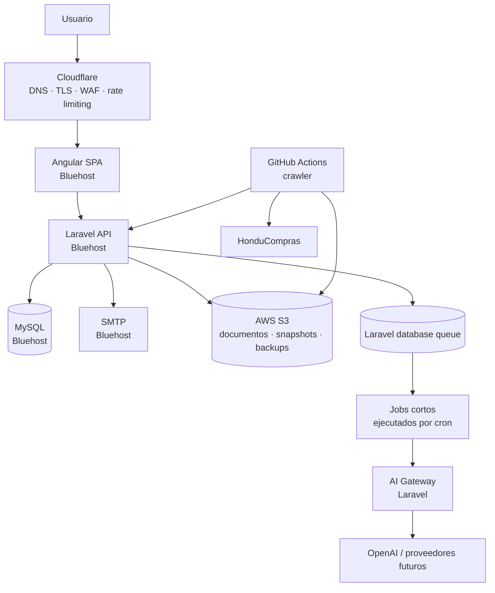
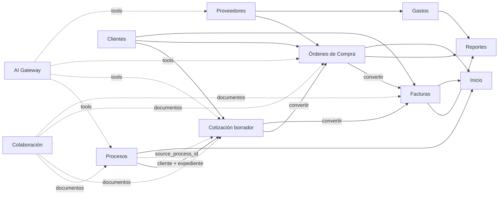

# Oficina AI v2 — Lineamientos globales e integración modular

## 1. Propósito

Este documento define la arquitectura objetivo que deben respetar todos los módulos del nuevo desarrollo de Castillo IT. La meta es **preservar las funcionalidades operativas del sistema legacy**, eliminar sus debilidades de persistencia, seguridad y acoplamiento, y dejar una base preparada para crawler, IA y automatizaciones.

El frontend se mantiene en **español**. Los nombres técnicos internos, clases, tablas, eventos y endpoints pueden mantenerse en inglés cuando ayude a conservar consistencia de desarrollo.

## 2. Arquitectura objetivo



### Distribución de responsabilidades

| Componente | Responsabilidad |
|---|---|
| Cloudflare | DNS, TLS, WAF, DDoS, rate limiting, bots/scanners y cache del frontend |
| Bluehost Choice Plus | Angular, Laravel, MySQL, email SMTP, Laravel Scheduler y jobs cortos |
| MySQL Bluehost | Fuente de verdad de todos los datos estructurados de negocio |
| AWS S3 | Fuente de verdad de binarios: documentos, adjuntos, snapshots del crawler, archivos generados y backups |
| GitHub | Repositorio, CI/CD y ejecución programada del crawler |
| Laravel AI Gateway | Único punto de acceso a modelos de IA y tools autorizadas |
| OpenAI / otros | Inferencia; nunca fuente de verdad de negocio |

No se requieren EC2, Lightsail, ECS ni RDS en esta etapa.

## 3. Reglas obligatorias para todos los módulos

1. **API-first.** Angular, crawler, IA y automatizaciones operan mediante Laravel; nadie escribe directamente a MySQL.
2. **MySQL para datos estructurados.** No se crean nuevos JSON/TXT/manifests como base funcional.
3. **S3 para binarios.** Ningún documento privado queda dentro de un árbol web publicable.
4. **Transacciones de dominio.** Cabecera, detalles, estados y referencias cruzadas se escriben atómicamente cuando pertenecen a la misma BD.
5. **Idempotencia.** Creaciones por conversión, crawler, IA y automatizaciones aceptan llave idempotente o restricción única equivalente.
6. **Autorización server-side.** Ocultar un botón no equivale a autorización.
7. **Auditoría.** Cambios relevantes guardan actor, acción, entidad, valores importantes, fecha y `request_id`.
8. **No hard-delete por defecto.** Documentos comerciales y registros con trazabilidad usan anulación/soft-delete según dominio.
9. **Cálculos críticos en backend.** Impuestos, descuentos, totales, utilidad y saldos se calculan canónicamente en Laravel.
10. **Eventos de dominio.** Las operaciones publican eventos para integrar módulos sin acoplar controladores.
11. **Jobs cortos.** En Bluehost no se depende de workers permanentes.
12. **IA sin acceso directo a DB.** La IA usa tools de aplicación con permisos explícitos.
13. **Human-in-the-loop.** La IA puede leer, clasificar, resumir, buscar y preparar borradores; acciones de alto impacto requieren aprobación.
14. **Contenido externo no confiable.** PDFs, páginas web, correos y datos del crawler se tratan como `UNTRUSTED_EXTERNAL_CONTENT`.
15. **Frontend en español.**

## 4. Seguridad y permisos

Flujo obligatorio:

```text
Request
  -> Authentication
  -> Rate limit
  -> Permission del módulo
  -> Policy del recurso
  -> Validation
  -> Domain action
  -> Audit log
  -> Domain event
```

Permisos mínimos:

```text
inicio.view

clientes.view
clientes.create
clientes.update

proveedores.view
proveedores.create
proveedores.update

ordenes.view
ordenes.create
ordenes.update
ordenes.delete
ordenes.deliver
ordenes.convert

cotizaciones.view
cotizaciones.create
cotizaciones.update
cotizaciones.delete
cotizaciones.send
cotizaciones.convert

facturas.view
facturas.create
facturas.update
facturas.cancel
facturas.payment

gastos.view
gastos.create
gastos.update
gastos.delete

reportes.view
reportes.export

procesos.view
procesos.mark
procesos.note
procesos.export
procesos.ingest
procesos.admin

colaboracion.view
colaboracion.upload
colaboracion.download
colaboracion.delete
```

Las identidades de máquina (`crawler`, `ai-agent`, automatizaciones) usan credenciales y scopes distintos de los usuarios humanos.

## 5. Persistencia transversal

Además de las tablas propias de cada módulo:

```text
documents
document_links
audit_logs
domain_events
jobs
failed_jobs
ai_runs
automation_rules
automation_runs
idempotency_keys
```

S3 conceptual:

```text
crawler/raw/{yyyy}/{mm}/{dd}/{run_id}/
documents/processes/{id}/
documents/quotes/{id}/
documents/orders/{id}/
documents/invoices/{id}/
documents/collaboration/
generated/quotes/{id}/
generated/invoices/{id}/
backups/mysql/
```

`documents` guarda metadata; S3 guarda bytes.

## 6. Integración entre módulos



Toda conversión debe dejar relación persistente:

```text
process_id -> quote_id
quote_id -> order_id
quote_id -> invoice_id
order_id -> invoice_id
```

Una conversión nunca depende exclusivamente de navegación o mapeo en Angular.

### 6.1 Proceso -> Cotización

La integración entre Procesos y Cotizaciones queda definida como una acción nativa del sistema:

```http
POST /api/v1/processes/{process}/create-quote
```

La acción crea una **cotización borrador** y transfiere exclusivamente:

```text
cliente / entidad -> cliente de la cotización
expediente        -> referencia visible del proceso
process.id        -> source_process_id
```

No se copian automáticamente items, precios, cantidades, especificaciones, documentos, fechas, marks, notas personales, scores IA ni raw del crawler.

La relación es:

```text
processes 1 ---- N quotes
```

Un proceso no se consume ni cambia de naturaleza al crear una cotización. Puede originar múltiples cotizaciones deliberadas.

La cotización debe conservar:

```text
source_process_id nullable
process_reference_snapshot nullable
client_id nullable
client_name_snapshot
```

Si la entidad del proceso coincide con un cliente existente mediante resolución exacta/canónica, se usa su `client_id`. Si no existe coincidencia, la creación **no se bloquea**: se conserva el nombre como snapshot manual y el usuario puede vincular o crear el cliente después.

El crawler y la IA nunca crean automáticamente el cliente maestro como efecto secundario de esta operación.

Para evitar duplicados por doble clic o retry, la creación puede aceptar `Idempotency-Key`. Una nueva intención explícita puede crear otra cotización para el mismo proceso.

Permisos mínimos:

```text
procesos.view
cotizaciones.create
```

La creación básica no depende de IA. Una acción posterior puede analizar las especificaciones y **proponer** items para la cotización, manteniéndose separada de la transferencia inicial de cliente + expediente.

## 7. Eventos estándar

```text
process.created
process.updated
process.marked
process.quote_created

client.created
client.updated

supplier.created
supplier.updated

quote.created
quote.updated
quote.sent
quote.converted_to_order
quote.converted_to_invoice

order.created
order.updated
order.item_purchased
order.ready
order.delivered
order.converted_to_invoice

invoice.created
invoice.updated
invoice.payment_registered
invoice.paid
invoice.cancelled

expense.created
expense.updated

document.uploaded
document.deleted

ai.run_completed
automation.completed
automation.failed
```

## 8. AI Gateway

Servicio interno de Laravel:

```text
app/AI/
  AIManager.php
  Providers/
  Tools/
  Prompts/
  Policies/
  DTO/
```

Tools ejemplo:

```text
search_processes()
get_process()
get_client()
search_suppliers()
get_previous_prices()
calculate_margin()
create_quote_draft()
draft_email()
create_task()
```

No se autoriza SQL arbitrario.

Cada ejecución guarda proveedor/modelo, versión de prompt, hash de entrada, estado, consumo, costo, resultado, actor y tiempos.

## 9. Crawler

El crawler deja FTPS/CSV como integración principal:

```text
GitHub Actions
  -> HonduCompras
  -> S3 RAW
  -> POST /api/v1/ingestion/processes
  -> MySQL
  -> eventos / IA / automatizaciones
```

CSV queda como exportación y, opcionalmente, mecanismo manual de recuperación.

## 10. Scheduler y queue

cPanel ejecuta Laravel Scheduler. Los jobs deben ser cortos y reiniciables.

```text
cron -> php artisan schedule:run
scheduler -> queue:work --stop-when-empty --max-jobs=N
```

No debe existir endpoint público de cron con token.

## 11. Migración

1. crear nuevas tablas y servicios sin romper UI legacy;
2. migrar JSON a MySQL;
3. mover binarios a S3;
4. introducir API v1;
5. mover frontend módulo a módulo;
6. activar eventos, IA y automatizaciones;
7. retirar legacy solo después de verificar equivalencia funcional.
