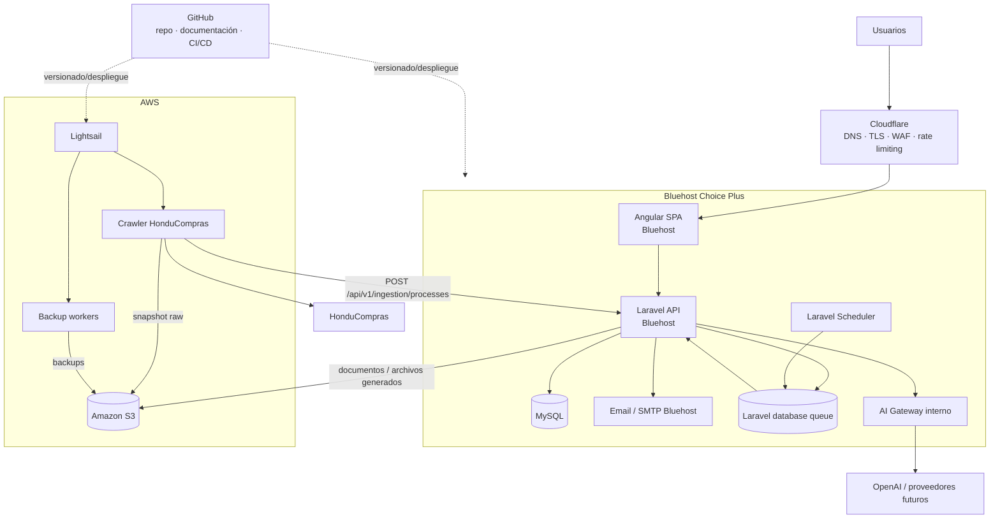
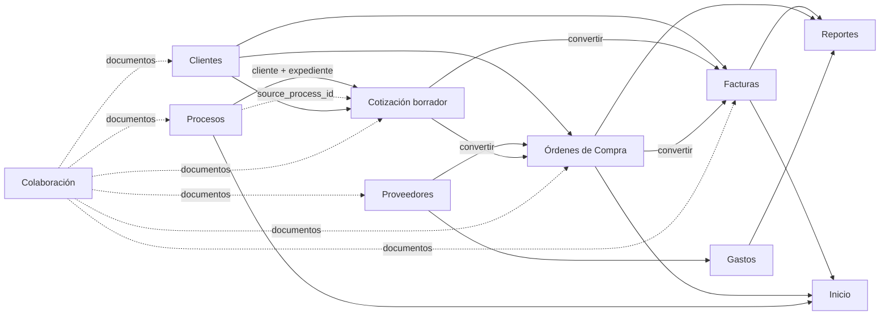
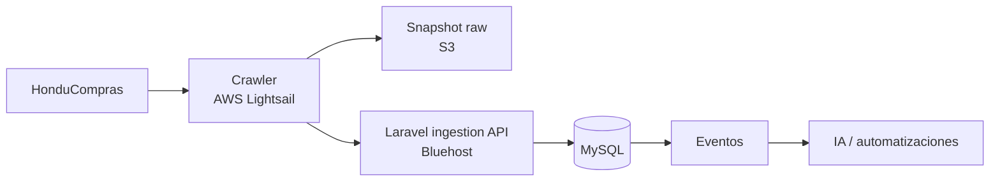
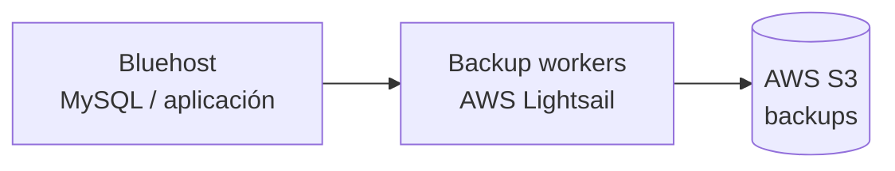

# Oficina AI v2 — Arquitectura objetivo de Bastion

## 1. Propósito y precedencia

Este documento define la arquitectura objetivo del nuevo desarrollo de Bastion. Debe preservar las funcionalidades del sistema legacy, eliminar sus debilidades de seguridad/persistencia y dejar la plataforma preparada para crawler, automatización, IA y MCP.

**Este documento corrige expresamente cualquier referencia anterior que ubique el crawler en GitHub Actions o que elimine AWS Lightsail de la arquitectura.**

La distribución aprobada es:

```text
Bluehost Choice Plus
  -> Angular
  -> Laravel
  -> MySQL
  -> email
  -> Scheduler
  -> jobs ligeros

AWS Lightsail
  -> crawler HonduCompras
  -> workers técnicos de backup

AWS S3
  -> snapshots raw del crawler
  -> documentos y archivos generados
  -> backups

GitHub
  -> código
  -> documentación
  -> CI/CD

Cloudflare
  -> DNS / TLS / WAF / DDoS / rate limiting / bots

OpenAI y proveedores futuros
  -> inferencia a través del AI Gateway de Laravel
```

No se requieren EC2, ECS ni RDS en esta etapa. **Lightsail sí forma parte de la arquitectura.**

---

## 2. Arquitectura general



---

## 3. Responsabilidades

| Componente | Responsabilidad |
|---|---|
| Cloudflare | Perímetro: DNS, TLS, WAF, DDoS, rate limits, bots/scanners y cache del frontend |
| Bluehost Choice Plus | Angular, Laravel, MySQL, correo, Scheduler y jobs ligeros |
| MySQL Bluehost | Fuente de verdad de datos estructurados/transaccionales |
| AWS Lightsail | Runtime técnico del crawler y de los workers de backup |
| AWS S3 | Binarios, documentos, snapshots raw, archivos generados y backups |
| GitHub | Código, documentación, CI/CD; **no es runtime del crawler** |
| Laravel AI Gateway | Punto único de conexión con proveedores IA y tools autorizadas |
| OpenAI / otros | Inferencia; nunca fuente de verdad ni acceso directo a MySQL |

---

## 4. Reglas globales

1. **API-first.** Angular, crawler, IA y automatizaciones operan a través de Laravel; ningún componente externo escribe directamente a MySQL.
2. **MySQL = datos estructurados.**
3. **S3 = binarios, snapshots y backups.**
4. **Lightsail = runtime técnico externo aprobado.**
5. **GitHub Actions no sustituye a Lightsail como runtime del crawler.**
6. **Jobs de Bluehost deben ser cortos y reiniciables.**
7. **Crawler y backup workers se aíslan de la lógica transaccional de negocio.**
8. **Transacciones de dominio** para cabecera/detalle/estado/relaciones.
9. **Idempotencia** para ingestión, conversiones, IA y automatizaciones.
10. **Autorización server-side** en toda API.
11. **Auditoría** de cambios relevantes.
12. **No hard-delete por defecto** para documentos y registros con trazabilidad.
13. **Cálculos críticos en Laravel.**
14. **IA sin acceso directo a DB ni shell.**
15. **Human-in-the-loop** para acciones de alto impacto.
16. Todo contenido externo se trata como `UNTRUSTED_EXTERNAL_CONTENT`.
17. Frontend, estados visibles, reportes y documentos para usuarios en español.

---

## 5. Seguridad

Flujo obligatorio:

```text
Request
  -> Authentication
  -> Rate limit
  -> Permission
  -> Resource Policy
  -> Validation
  -> Domain Action
  -> Audit
  -> Domain Event
```

Las identidades de máquina son distintas de las humanas:

```text
crawler-honducompras
backup-worker
ai-agent
automation
```

Cada una recibe scopes mínimos.

El crawler debe poder ingerir procesos y reportar runs, pero no administrar clientes, cotizaciones, facturas o usuarios.

Los workers de backup deben poder acceder únicamente a las fuentes necesarias para respaldar y al destino S3 correspondiente.

---

## 6. Persistencia transversal

MySQL:

```text
documents
document_links
audit_logs
domain_events
jobs
failed_jobs
ai_runs
automation_rules
automation_runs
idempotency_keys
```

S3:

```text
crawler/raw/{yyyy}/{mm}/{dd}/{run_id}/
documents/processes/{id}/
documents/quotes/{id}/
documents/orders/{id}/
documents/invoices/{id}/
documents/collaboration/
generated/quotes/{id}/
generated/invoices/{id}/
backups/mysql/
backups/application/
```

`documents` guarda metadata; S3 guarda bytes.

---

## 7. Módulos y conexiones



Trazabilidad:

```text
process_id -> quote_id
quote_id -> order_id
quote_id -> invoice_id
order_id -> invoice_id
```

---

## 8. Proceso -> Cotización

API:

```http
POST /api/v1/processes/{process}/create-quote
```

Transfiere únicamente:

```text
cliente / entidad -> cliente de cotización
expediente        -> referencia visible
process.id        -> source_process_id
```

No copia automáticamente:

```text
items
precios
cantidades
especificaciones
documentos
fechas
marks
notas personales
scores IA
raw crawler
```

Cardinalidad:

```text
processes 1 ---- N quotes
```

Cliente:

```text
match cliente -> client_id + snapshot
sin match     -> client_id = null + client_name_snapshot
```

La creación no se bloquea si el cliente no existe y no se crea un cliente maestro automáticamente.

---

## 9. Crawler — ubicación y flujo aprobados

El crawler **se ejecuta en AWS Lightsail**.



Flujo:

```text
HonduCompras
  -> crawler Lightsail
  -> raw S3
  -> POST /api/v1/ingestion/processes
  -> Laravel
  -> MySQL
  -> eventos
```

El crawler:

- nunca escribe directamente a MySQL;
- reporta `crawler_run_id`;
- usa reintentos/tolerancia a fallos;
- no marca ausencias como inactivas si el run fue parcial o fallido;
- conserva histórico/versiones;
- usa S3 para snapshots raw;
- CSV queda como exportación o recuperación manual, no integración primaria.

---

## 10. Backup workers — ubicación y flujo aprobados

Los **workers de backup se ejecutan en AWS Lightsail** y copian respaldos hacia S3.



Responsabilidades:

```text
extraer / recibir backup
validar integridad
comprimir/cifrar según política
subir a S3
registrar resultado
aplicar retención
alertar fallos
```

La forma exacta de extracción desde Bluehost debe implementarse con credenciales de mínimo privilegio y sin hacer público MySQL.

---

## 11. Scheduler y queue en Bluehost

cPanel ejecuta Laravel Scheduler:

```text
cron
  -> php artisan schedule:run
  -> jobs cortos
  -> queue:work --stop-when-empty --max-jobs=N
```

Bluehost no depende de daemons permanentes.

Trabajos técnicos largos que pertenezcan al crawler o backup permanecen en Lightsail.

---

## 12. AI Gateway

Servicio interno de Laravel:

```text
app/AI/
  AIManager.php
  Providers/
  Tools/
  Prompts/
  Policies/
  DTO/
```

Tools ejemplo:

```text
search_processes()
get_process()
get_client()
search_suppliers()
get_previous_prices()
calculate_margin()
create_quote_draft()
draft_email()
create_task()
```

No se autoriza SQL arbitrario.

---

## 13. Eventos principales

```text
process.created
process.updated
process.marked
process.quote_created

client.created
client.updated

supplier.created
supplier.updated

quote.created
quote.updated
quote.sent
quote.converted_to_order
quote.converted_to_invoice

order.created
order.updated
order.item_purchased
order.ready
order.delivered
order.converted_to_invoice

invoice.created
invoice.updated
invoice.payment_registered
invoice.paid
invoice.cancelled

expense.created
expense.updated

document.uploaded
document.deleted

ai.run_completed
automation.completed
automation.failed

crawler.run_completed
crawler.run_failed
backup.completed
backup.failed
```

---

## 14. GitHub

GitHub mantiene:

```text
código
documentación
CI/CD
tests
releases
```

Puede desplegar/versionar componentes hacia Bluehost y Lightsail.

**No debe describirse como el runtime del crawler ni de los backup workers.**

---

## 15. Migración

1. Seguridad del legacy.
2. Tablas nuevas y API v1.
3. Ingestión desde crawler Lightsail mediante API.
4. Snapshots raw a S3.
5. Migración de JSON a MySQL.
6. Binarios privados a S3.
7. Conversión Proceso -> Cotización.
8. Eventos / queue / AI Gateway.
9. Backup workers Lightsail -> S3.
10. Retiro gradual de endpoints y persistencia legacy después de equivalencia funcional.
