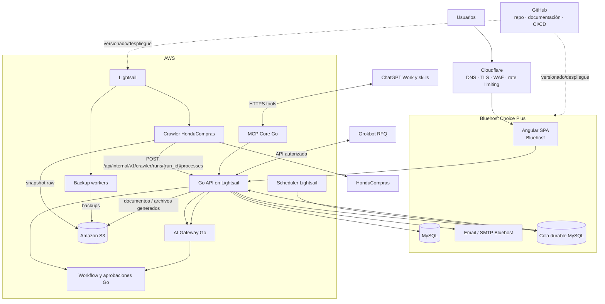
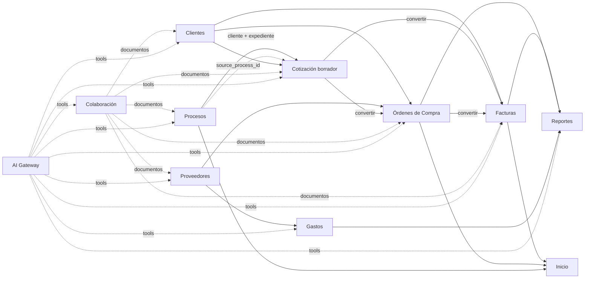
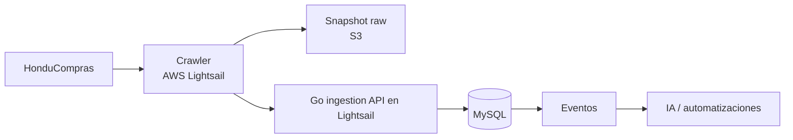
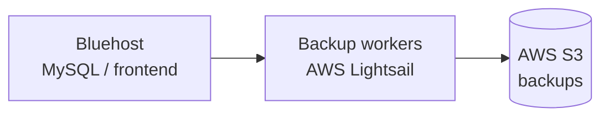

# Oficina AI v2 — Arquitectura objetivo de Bastion

## 1. Propósito y precedencia

Este documento define la arquitectura objetivo del nuevo desarrollo de Bastion. Debe preservar las funcionalidades del sistema legacy, eliminar sus debilidades de seguridad/persistencia y dejar la plataforma preparada para crawler, automatización, IA y MCP.

**Este documento corrige expresamente cualquier referencia anterior que ubique el crawler en GitHub Actions o que elimine AWS Lightsail de la arquitectura.**

La distribución aprobada es:

```text
Bluehost Choice Plus
  -> Angular estático
  -> MySQL
  -> email

AWS Lightsail
  -> backend y Core Go
  -> API REST y MCP
  -> crawler HonduCompras Python
  -> scheduler y workers

AWS S3
  -> snapshots raw del crawler
  -> documentos y archivos generados
  -> backups

GitHub
  -> código
  -> documentación
  -> CI/CD

Cloudflare
  -> DNS / TLS / WAF / DDoS / rate limiting / bots

ChatGPT Work / plan Plus
  -> skills y tareas externas mediante MCP de Bastion

Grokbot
  -> RFQ autorizadas mediante API/MCP; integración por validar

Proveedores de inferencia por API
  -> alternativa futura explícita, no dependencia inicial
```

No se requieren EC2, ECS ni RDS en esta etapa. **Lightsail sí forma parte de la arquitectura.**

---

## 2. Arquitectura general



---

## 3. Responsabilidades

| Componente | Responsabilidad |
|---|---|
| Cloudflare | Perímetro: DNS, TLS, WAF, DDoS, rate limits, bots/scanners y cache del frontend |
| Bluehost Choice Plus | Angular estático, MySQL y correo |
| MySQL Bluehost | Fuente de verdad de datos estructurados/transaccionales |
| AWS Lightsail | Backend Go, API/MCP, crawler Python, scheduler y workers |
| AWS S3 | Binarios, documentos, snapshots raw, archivos generados y backups |
| GitHub | Código, documentación, CI/CD; **no es runtime del crawler** |
| Módulo AI / Gateway interno | Tareas, resultados y herramientas; ejecución externa inicial en Work mediante MCP |
| Workflow / Approval Engine | Aprobaciones, transiciones y control de acciones sensibles |
| ChatGPT Work / Grokbot | Skills e investigación / RFQ; conexión y capacidad por validar, sin acceso directo a MySQL |

---

## 4. Reglas globales

1. **API-first.** Angular, crawler, IA y automatizaciones operan a través de Go; ningún componente externo escribe directamente a MySQL.
2. **MySQL = datos estructurados.**
3. **S3 = binarios, snapshots y backups.**
4. **Lightsail = runtime técnico externo aprobado.**
5. **GitHub Actions no sustituye a Lightsail como runtime del crawler.**
6. **Jobs de Lightsail deben ser cortos y reiniciables.**
7. **Crawler y backup workers se aíslan de la lógica transaccional de negocio.**
8. **Transacciones de dominio** para cabecera/detalle/estado/relaciones.
9. **Idempotencia** para ingestión, conversiones, IA y automatizaciones.
10. **Autorización server-side** en toda API.
11. **Auditoría** de cambios relevantes.
12. **No hard-delete por defecto** para documentos y registros con trazabilidad.
13. **Cálculos críticos en Go.**
14. **IA sin acceso directo a DB, shell, cPanel ni credenciales SMTP.**
15. **Human-in-the-loop** para acciones de alto impacto.
16. Todo contenido externo se trata como `UNTRUSTED_EXTERNAL_CONTENT`.
17. Frontend, estados visibles, reportes y documentos para usuarios en español.
18. **La aplicación debe funcionar sin IA.** Ninguna función transaccional esencial depende de un modelo externo.
19. **Provider-neutral.** Ningún módulo de negocio llama directamente a OpenAI u otro SDK.

---

## 5. Seguridad

Flujo obligatorio:

```text
Request
  -> Authentication
  -> Rate limit
  -> Permission
  -> Resource Policy
  -> Validation
  -> Domain Action
  -> Audit
  -> Domain Event
```

Las identidades de máquina son distintas de las humanas:

```text
crawler-honducompras
backup-worker
ai-agent
automation
```

Cada una recibe scopes mínimos.

El crawler debe poder ingerir procesos y reportar runs, pero no administrar clientes, cotizaciones, facturas o usuarios.

Los workers de backup deben poder acceder únicamente a las fuentes necesarias para respaldar y al destino S3 correspondiente.

Un agente IA delegado no puede superar los permisos del usuario que lo invoca.

---

## 6. Persistencia transversal

MySQL:

```text
documents
document_links
audit_logs
domain_events
jobs
failed_jobs
ai_tasks
ai_runs
ai_tool_calls
ai_prompt_versions
ai_feedback
automation_rules
automation_runs
idempotency_keys
```

S3:

```text
crawler/raw/{yyyy}/{mm}/{dd}/{run_id}/
documents/processes/{id}/
documents/quotes/{id}/
documents/orders/{id}/
documents/invoices/{id}/
documents/collaboration/
generated/quotes/{id}/
generated/invoices/{id}/
ai/artifacts/{run_id}/
backups/mysql/
backups/application/
```

`documents` guarda metadata; S3 guarda bytes.

`ai_runs` guarda trazabilidad de cada ejecución; nunca secretos.

---

## 7. Módulos y conexiones



Trazabilidad:

```text
process_id -> quote_id
quote_id -> order_id
quote_id -> invoice_id
order_id -> invoice_id
```

---

## 8. Proceso -> Cotización

API:

```http
POST /api/v1/processes/{process}/create-quote
```

Transfiere únicamente:

```text
cliente / entidad -> cliente de cotización
expediente        -> referencia visible
process.id        -> source_process_id
```

No copia automáticamente:

```text
items
precios
cantidades
especificaciones
documentos
fechas
marks
notas personales
scores IA
raw crawler
```

Cardinalidad:

```text
processes 1 ---- N quotes
```

Cliente:

```text
match cliente -> client_id + snapshot
sin match     -> client_id = null + client_name_snapshot
```

La creación no se bloquea si el cliente no existe y no se crea un cliente maestro automáticamente.

La creación básica **no depende de IA**. Después puede ejecutarse una acción separada para proponer items desde especificaciones.

---

## 9. Crawler — ubicación y flujo aprobados

El crawler **se ejecuta en AWS Lightsail**.



Flujo:

```text
HonduCompras
  -> crawler Lightsail
  -> raw S3
  -> POST /api/internal/v1/crawler/runs/{run_id}/processes
  -> Go
  -> MySQL
  -> eventos
```

El crawler:

- nunca escribe directamente a MySQL;
- reporta `crawler_run_id`;
- usa reintentos/tolerancia a fallos;
- no marca ausencias como inactivas si el run fue parcial o fallido;
- conserva histórico/versiones;
- usa S3 para snapshots raw;
- CSV queda como exportación o recuperación manual, no integración primaria.

---

## 10. Backup workers — ubicación y flujo aprobados

Los **workers de backup se ejecutan en AWS Lightsail** y copian respaldos hacia S3.



Responsabilidades:

```text
extraer / recibir backup
validar integridad
comprimir/cifrar según política
subir a S3
registrar resultado
aplicar retención
alertar fallos
```

La forma exacta de extracción desde Bluehost debe implementarse con credenciales de mínimo privilegio y sin acceso MySQL irrestricto; canal remoto cifrado limitado a Lightsail.

---

## 11. Scheduler y queue en Lightsail

Lightsail ejecuta timers systemd o cron:

```text
cron
  -> worker Go
  -> jobs cortos
  -> tareas acotadas con lease y reintentos
```

Bluehost no depende de daemons permanentes.

Trabajos técnicos largos que pertenezcan al crawler o backup permanecen en Lightsail.

---

## 12. Integración de IA

### 12.1 Arquitectura de ejecución actualizada
La especificación detallada es [integración IA](ai-integration.md). AI permanece dentro del monolito Go: administra tareas, reservas, resultados, versiones y herramientas. Core conserva MCP/API y seguridad; Workflow conserva aprobaciones.
ChatGPT Work con skills y mecanismos del plan Plus es el ejecutor inicial prioritario. Consulta pendientes por MCP y guarda resultados en Bastion; el modelo no corre en Bluehost ni en Lightsail.
Grokbot atiende RFQ autorizadas mediante herramientas de Bastion. Correo alojado en Bluehost; credenciales SMTP protegidas en el backend Lightsail; integración/alojamiento y lectura de respuestas por validar.
El RAG inicial usa fuentes S3 y recuperación Go/MySQL. No necesita vector DB dedicada; S3 Vectors queda opcional.

### 12.2 Adaptadores futuros
No llamar directamente a proveedores desde módulos de negocio. Una integración API de inferencia puede añadirse tras decisión explícita; no es dependencia inicial ni fallback automático de pago cuando Work alcanza límites. Go no invoca una suscripción Plus como API.
Capacidad desatendida, límites, herramientas y escrituras de Work deben probarse con el plugin real. Skills versionadas; desconocimiento de modelo/tokens/costo se registra como tal.

### 12.3 Tools

Ejemplos:

```text
search_processes()
get_process()
search_clients()
suggest_client_match()
search_suppliers()
find_supplier_candidates()
get_supplier_price_history()
create_quote_draft_from_process()
suggest_quote_items()
compare_quote_with_process()
calculate_quote_margin()
get_order()
suggest_purchase_cost()
get_invoice()
classify_expense()
get_report_metrics()
list_authorized_documents()
summarize_document()
draft_email()
create_task()
request_approval()
```

No se ofrece:

```text
run_sql()
execute_shell()
read_all_s3()
send_email_unrestricted()
```

### 12.4 Niveles de riesgo

```text
Nivel 1: lectura/análisis           -> automático si hay permiso
Nivel 2: creación de borradores     -> automático/auditable
Nivel 3: escritura interna reversible -> policy explícita
Nivel 4: externa/financiera/irreversible -> aprobación humana por defecto
```

Nivel 4 incluye:

```text
enviar email
emitir/enviar cotización
marcar orden Comprada/Entregada
crear factura definitiva
registrar pago
anular factura
fusionar clientes/proveedores
eliminar datos
cambiar datos fiscales
```

### 12.5 Identidad delegada

Cuando un usuario usa un asistente:

```text
Usuario
  -> AI Assistant
  -> Tool Policy
  -> misma autorización del usuario
```

La IA no hereda permisos de administrador por existir como servicio.

### 12.6 Persistencia IA

`ai_runs` mínimo:

```text
id
task_type
entity_type
entity_id
actor_type
actor_id
provider
model
prompt_version
input_hash
status
started_at
finished_at
input_tokens
output_tokens
cost
confidence nullable
result_json
error_code nullable
created_at
```

`ai_tool_calls`:

```text
id
ai_run_id
tool_name
risk_level
input_hash
status
approval_id nullable
started_at
finished_at
result_summary
```

### 12.7 Contenido externo y prompt injection

Todo contenido procedente de HonduCompras, email, web, proveedores o documentos se considera:

```text
UNTRUSTED_EXTERNAL_CONTENT
```

Instrucciones contenidas en un documento no cambian permisos ni habilitan tools.

### 12.8 Ejecución y pipeline
Evento de dominio -> tarea durable en MySQL -> ejecución programada Work reclama pendientes por MCP -> skill -> guardado validado -> siguiente tarea.
La ejecución diaria puntúa solo procesos sin puntuación completada, incluidos rezagados. La investigación avanza por ítem; RFQ de alto interés sin precio; presentación progresiva; skill/RAG para precio y fichas. Usuario decide y crea cotización.
No mantener HTTP abierto ni dormir workers esperando proveedores. Reservas con vencimiento, control de versión, guardado incremental y deduplicación según [contrato IA](../contracts/ai-pipeline.md). Cambios relevantes generan revisiones separadas, no reprocesamiento diario de todo el histórico.

### 12.9 Capacidades por módulo

| Módulo | Capacidades IA | Límite |
|---|---|---|
| Inicio | resumen ejecutivo, prioridades, alertas explicadas | no recalcula KPIs |
| Clientes | matching, duplicados sugeridos | no fusiona automáticamente |
| Proveedores | investigación, candidatos, historial, RFQ borrador | evidencia/fuente obligatoria |
| Procesos | clasificación, resumen, requisitos, relevancia, items sugeridos | raw/versiones inmutables |
| Cotizaciones | items sugeridos, comparación, margen, email | creación desde proceso no depende de IA; envío requiere aprobación |
| Órdenes | proveedor/costo sugerido, riesgo/margen | no marca Comprado/Entregado automáticamente |
| Facturas | validación cruzada, inconsistencias, borradores | no altera correlativo, pagos o SAR |
| Gastos | OCR, extracción, clasificación, duplicados | usuario confirma registro |
| Reportes | narrativa, anomalías, explicación | usa métricas canónicas |
| Colaboración | resumen/extracción de documentos | respeta ACL |

### 12.10 API/MCP

REST, MCP y tools internas convergen en las mismas Domain servicios de aplicación:

```text
REST Controller ----\
                    -> Domain Action -> Policy -> MySQL/S3/Email
MCP Tool -----------/
AI Tool ------------/
```

No se duplican reglas de negocio por canal.

---

## 13. Eventos principales

```text
process.created
process.updated
process.marked
process.quote_created

client.created
client.updated

supplier.created
supplier.updated

quote.created
quote.updated
quote.sent
quote.converted_to_order
quote.converted_to_invoice

order.created
order.updated
order.item_purchased
order.ready
order.delivered
order.converted_to_invoice

invoice.created
invoice.updated
invoice.payment_registered
invoice.paid
invoice.cancelled

expense.created
expense.updated

document.uploaded
document.deleted

ai.task_created
ai.run_started
ai.run_completed
ai.run_failed
ai.approval_required
ai.tool_called

automation.completed
automation.failed

crawler.run_completed
crawler.run_failed
backup.completed
backup.failed
```

---

## 14. GitHub

GitHub mantiene:

```text
código
documentación
CI/CD
tests
releases
```

Puede desplegar/versionar componentes hacia Bluehost y Lightsail.

**No debe describirse como el runtime del crawler ni de los backup workers.**

---

## 15. Migración

1. Seguridad del legacy.
2. Tablas nuevas y API v1.
3. Ingestión desde crawler Lightsail mediante API.
4. Snapshots raw a S3.
5. Migración de JSON a MySQL.
6. Binarios privados a S3.
7. Conversión Proceso -> Cotización.
8. `ai_tasks`, `ai_runs`, `ai_tool_calls` + AI Gateway.
9. Tools read-only y análisis de Procesos/Documentos.
10. Borradores IA de Cotizaciones/RFQ/correo.
11. Workflow/Approval Engine para acciones sensibles.
12. Backup workers Lightsail -> S3.
13. Retiro gradual de endpoints y persistencia legacy después de equivalencia funcional.

## Actualización de presentación y conversión asistida

[Resultados IA](../modules/ai-results.md) se muestran en Procesos. La conversión básica de la sección 8 sigue copiando solo entidad/expediente/referencia. Una acción adicional explícita del usuario puede incorporar ítems, alternativas, cantidades, precios y adjuntos seleccionados a un borrador mediante Quotes, con previsualización, idempotencia y control de versión. No copiar automáticamente toda la investigación ni sobrescribir ediciones humanas.

