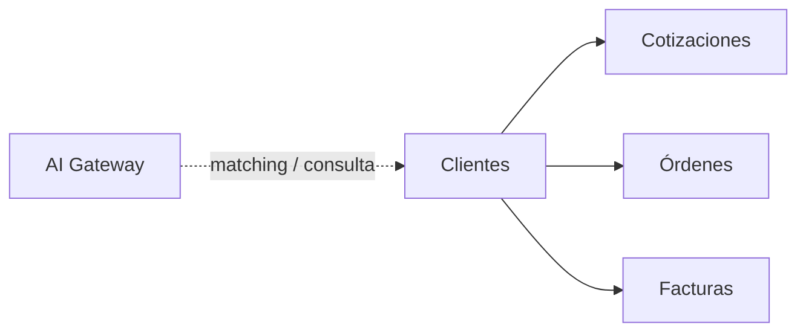

# Módulo Clientes

Catálogo/ficha implementados en Go y Angular: [contrato ejecutable](../contracts/customers.md), [OpenAPI](../contracts/customers-openapi.json), [runbook](../development/customers-runbook.md) y [estado](../development/status.md). La vista 360° incorpora vínculos comerciales al implementarse sus propietarios; no presupone cotizaciones/facturas todavía existentes.

## Objetivo

Mantener el catálogo de clientes utilizado por cotizaciones, órdenes y facturas, preservando la posibilidad de trabajar con cliente manual cuando corresponda.

## Funcionalidad legacy a conservar

- listado;
- búsqueda;
- creación;
- edición;
- nombre;
- RTN;
- contacto;
- teléfono;
- correo;
- dirección;
- uso como catálogo;
- RTN vacío permitido;
- deduplicación lógica por nombre/RTN;
- cliente manual en documentos.

## Debilidades legacy a eliminar

- deduplicación solo visual;
- carreras entre buscar/insertar;
- falta de restricción canónica;
- documentos históricos que pueden mostrar datos actuales del cliente.

## Modelo objetivo

```text
customers
```

Campos recomendados:

```text
id
name
canonical_name
rtn
canonical_rtn
contact_name
phone
email
address
is_active
created_by
updated_by
created_at
updated_at
deleted_at
```

No fusionar duplicados automáticamente si tienen referencias históricas.

## Snapshots documentales

Cotizaciones, órdenes y facturas conservan:

```text
customer_id nullable
customer_name_snapshot
customer_rtn_snapshot
customer_contact_snapshot
customer_email_snapshot
customer_address_snapshot
```

Editar el maestro no altera documentos históricos.

## API objetivo

```http
GET    /api/v1/customers
POST   /api/v1/customers
GET    /api/v1/customers/{id}
PATCH  /api/v1/customers/{id}
```

Filtros: `search`, `rtn`, `is_active`, `page`, `per_page`.

## Conexiones



## Seguridad

```text
clientes.view
clientes.create
clientes.update
```

## Integración de IA

La IA consume Clientes mediante tools del módulo; no consulta la tabla directamente.

Tools:

```text
search_customers()
get_customer()
suggest_client_match()
detect_client_duplicates()
summarize_client_activity()
```

### Casos de uso

- resolver la entidad de un Proceso contra el catálogo al crear una Cotización;
- sugerir coincidencias por nombre normalizado/RTN;
- detectar posibles duplicados;
- resumir relación comercial usando información autorizada de cotizaciones, órdenes y facturas;
- ayudar al usuario a encontrar el cliente correcto desde lenguaje natural.

### ClientResolver y Procesos

La resolución de cliente usada por `Proceso -> Cotización` debe ser determinista primero:

```text
normalización / match exacto / RTN
        |
        +-- match -> customer_id
        |
        +-- sin match -> snapshot manual
```

La IA puede **sugerir** coincidencias adicionales cuando no exista match determinista, pero no bloquea la creación de la cotización y no crea/fusiona clientes automáticamente.

### Acciones permitidas

Automáticas/read-only:

```text
buscar
leer
sugerir coincidencia
sugerir duplicado
resumir actividad
```

Requieren acción humana o permiso explícito:

```text
crear cliente maestro
actualizar datos maestros
fusionar duplicados
inactivar cliente
```

### Trazabilidad IA

Toda sugerencia de matching debe poder registrar en `ai_runs`:

```text
client_candidate_ids
confidence
reason_summary
input_hash
prompt_version
model/provider
```

La confianza es informativa y nunca sustituye una Policy.

### Privacidad

La IA solo recibe los campos necesarios para la tarea. No se envían indiscriminadamente todos los datos de clientes ni documentos asociados.

## Criterios de aceptación

- CRUD legacy preservado.
- RTN vacío sigue siendo válido.
- No se crean duplicados concurrentes equivalentes.
- Documentos históricos mantienen snapshot.
- Cotizaciones, órdenes y facturas enlazan al cliente sin depender de él para reconstruir historia.
- La IA puede sugerir matches/duplicados sin alterar automáticamente el catálogo.
- `Proceso -> Cotización` funciona aunque la IA esté deshabilitada.


## Alcance adicional conservado

# Customers


# 12. Módulo Clientes

Vista 360°.

Información:

- datos legales;
- RTN;
- contactos;
- direcciones;
- instituciones;
- procesos;
- cotizaciones;
- órdenes de compra;
- facturas;
- pagos;
- documentos;
- notas;
- historial;
- actividad.

---
