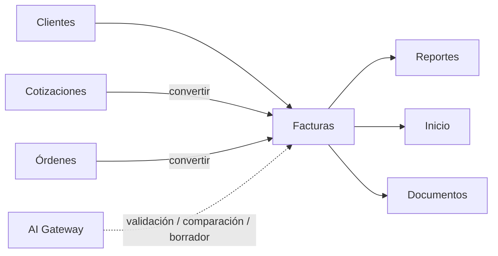

# Módulo Facturas

## Objetivo

Preservar funcionalidad fiscal y comercial de facturas, pagos, conversiones, PDF, nota de entrega y recibo, migrando de JSON a MySQL.

## Funcionalidad legacy a conservar

### Listado/acciones
- listado;
- estados;
- crear;
- editar;
- clonar;
- registrar pago;
- anular/cancelar según regla fiscal;
- convertir desde cotización;
- convertir desde orden.

### Documento
- correlativo fiscal;
- fecha;
- cliente registrado o manual;
- items;
- descuentos;
- ISV 15/18;
- exento;
- exoneración;
- notas públicas;
- costos/inversión;
- gastos adicionales;
- utilidad;
- snapshot SAR.

### Condiciones de pago

```text
contado
credito
credit_days
payments[]
paid_total
balance
```

Métodos legacy:

```text
Siafi
Cheque
Transferencia
Efectivo
```

### Derivados
- factura imprimible/PDF;
- nota de entrega;
- recibo.

## Debilidades legacy a eliminar

- `invoices.json` como almacén;
- pagos embebidos en JSON;
- contador fiscal repartido;
- falta de atomicidad entre factura/settings/origen;
- acciones inconsistentes sobre anuladas;
- recibo basado en total y no en pago real;
- validaciones fiscales solo UI;
- utilidad distinta entre módulos;
- clonación con referencias de origen ambiguas.

## Modelo objetivo

```text
invoices
invoice_items
payments
invoice_expenses
document_counters
invoice_status_history
documents
document_links
```

### invoices

```text
id
invoice_number
customer_id nullable
customer_*_snapshot
invoice_date
payment_term_type
credit_days nullable
status
subtotal
discount_total
tax_15
tax_18
exempt_total
exonerated_total
tax_total
total
paid_total
balance
products_investment
other_expenses
investment_total
profit
source_quote_id nullable
source_purchase_order_id nullable
sar_snapshot_json
idempotency_key
created_by
updated_by
created_at
updated_at
cancelled_at
deleted_at
```

### payments

```text
id
invoice_id
date
method
amount
reference
receipt_number nullable
created_by
created_at
voided_at nullable
```

## Correlativo fiscal

Una sola fuente transaccional. Preservar formato/prefijo configurado y snapshot SAR. No retroceder contador en el nuevo diseño sin una política fiscal explícita y tests.

## SAR snapshot

Al emitir, copiar datos SAR relevantes a la factura. Modificar Configuración después no cambia facturas emitidas.

## Pagos

Registrar pago:

1. lock/transacción;
2. calcular saldo en backend;
3. impedir sobrepago;
4. insertar pago;
5. recalcular pagado/saldo;
6. derivar estado;
7. auditar y emitir evento.

## Anulación

Una factura anulada no puede editarse, cobrar, clonar ni cambiar estado salvo acción administrativa explícita. Listados, Inicio y Reportes comparten el mismo scope.

## Conversiones

```http
POST /api/v1/quotes/{id}/convert-to-invoice
POST /api/v1/purchase-orders/{id}/convert-to-invoice
```

Idempotentes, trazables y atómicas.

## API objetivo

```http
GET    /api/v1/invoices
POST   /api/v1/invoices
GET    /api/v1/invoices/{id}
PATCH  /api/v1/invoices/{id}

POST   /api/v1/invoices/{id}/clone
POST   /api/v1/invoices/{id}/payments
POST   /api/v1/invoices/{id}/cancel

GET    /api/v1/invoices/{id}/pdf
GET    /api/v1/invoices/{id}/delivery-note
GET    /api/v1/invoices/{id}/payments/{payment}/receipt
```

## Recibos

El nuevo recibo debe poder referenciar un pago real:

```text
invoice_payment_id
amount
date
method
reference
```

## Conexiones



## Seguridad

```text
facturas.view
facturas.create
facturas.update
facturas.emit
facturas.fiscal.read
facturas.fiscal.manage
facturas.cancel
facturas.payment
```

Emisión, cancelación y pagos siempre auditados.

## Integración de IA

La IA se limita a asistencia, revisión y preparación de borradores. Las reglas fiscales y financieras permanecen en Go.

Tools:

```text
get_invoice()
get_invoice_items()
compare_invoice_with_quote()
compare_invoice_with_order()
detect_invoice_inconsistencies()
summarize_invoice_status()
draft_invoice_notes()
extract_invoice_supporting_document()
```

### Casos de uso

- comparar factura contra cotización/orden de origen;
- detectar diferencias de items, cantidades, precios o cliente;
- señalar inconsistencias entre total, pagos y saldo;
- resumir estado de crédito/cobro;
- extraer datos de documentos soporte como propuesta;
- preparar notas internas o explicación para el usuario.

### Límites fiscales y financieros

La IA **no puede** por sí sola:

```text
asignar/cambiar invoice_number
incrementar/decrementar correlativo
alterar sar_snapshot_json
registrar un pago real
anular/cancelar factura
cambiar total persistido fuera de InvoiceFinancials
marcar pagada manualmente
```

Estas operaciones requieren Domain servicios de aplicación específicas, permisos y, para acciones sensibles, aprobación humana.

### Cálculos

La IA nunca recalcula de forma autoritativa:

```text
subtotal
discount_total
tax_15
tax_18
tax_total
total
paid_total
balance
profit
```

Debe consumir servicios canónicos del backend y limitarse a explicar o validar los resultados.

### Documentos

Si se analiza un PDF o soporte, el documento se obtiene mediante el Document Service y ACL. El modelo no recibe acceso general a S3.

Los campos extraídos son propuestas que deben validarse antes de modificar la factura.

### Cobranza asistida

Puede generar:

```text
payment_due_summary
draft_collection_email
credit_risk_note
```

pero enviar correo o registrar un pago son acciones separadas.

## Criterios de aceptación

- Sin dependencia de `invoices.json`.
- Pagos como filas auditables.
- Definición uniforme de anulada/pagada.
- Conversiones sin duplicados.
- Snapshot SAR histórico.
- Nota de entrega y recibo disponibles.
- Tests de contado, crédito, abonos, sobrepago, anulación, clonación y correlativo.
- IA puede detectar inconsistencias sin alterar datos fiscales automáticamente.
- Ninguna ejecución IA puede modificar correlativo, SAR o pagos sin Domain Action autorizada.
- Facturas funciona completamente aunque el proveedor IA esté fuera de servicio.


## Alcance adicional conservado

# Invoices


# 17. Módulo Facturas

Relacionable con:

- cliente;
- cotización;
- orden de compra;
- items;
- impuestos;
- pagos.

Estados:

```text
Borrador
Emitida
Entregada
Pendiente
Parcialmente pagada
Pagada
Vencida
Anulada
```

---


## Presentación del módulo

# invoices


# 17. Módulo Facturas

Relacionable con:

- cliente;
- cotización;
- orden de compra;
- items;
- impuestos;
- pagos.

Estados:

```text
Borrador
Emitida
Entregada
Pendiente
Parcialmente pagada
Pagada
Vencida
Anulada
```

---


## Implementación incremental vigente

[Contrato propietario](../contracts/invoices.md). Unidad 1: motor financiero y proyección de saldos, certificada en c85a1e37e0d120d84415e02299c48dbebbc04588 / Core checks 38176231851; sin API, persistencia de facturas/pagos ni emisión. Las funciones y estados objetivo anteriores conservan su alcance y se implementan en las siguientes unidades, tras CI verde.

Unidad 2 Borradores implementada, en validación: contrato/OpenAPI, migración 0021, REST/UI y scopes/evidencia; no emisión fiscal ni pagos reales. Se cierra tras CI verde.

Unidad 2 cerrada en 88577fa0fa810958a65589beda3d9e331b8c3317 / Core checks 38179176643: Go/MySQL/race/builds, Angular 86 pruebas y navegador 11/11 aprobados. Continúa unidad 3; emisión y pagos reales no implementados todavía.

Unidad 3: política pura de correlativo en validación; configuración persistente y emisión siguen pendientes. document_counters es el contador canónico, no invoice_counter.

Unidad 3 configuración persistente implementada en validación: migración 0022, GET/PUT con permisos fiscal.read/manage globales y reauth, contador protegido, UI y evidencia atómica. Emisión continúa pendiente.

Configuración fiscal certificada en 133b9dc05ef5c5465d13e50550437c86a1bdb940 / Core checks 38180883877: Go/MySQL/race/builds, Angular 91 y navegador 12/12. Continúa emisión de unidad 3 según contrato previo; sin factura fiscal productiva ni pagos/PDF en este cierre.

Unidad 3 emisión implementada en validación: 0023 y facturas.emit, contexto de revisión, snapshots/versiones y correlativo transaccional, GET/listado/REST/UI. Producción, pagos/PDF y aceptación completa de Facturas siguen pendientes; cierre tras CI verde.
