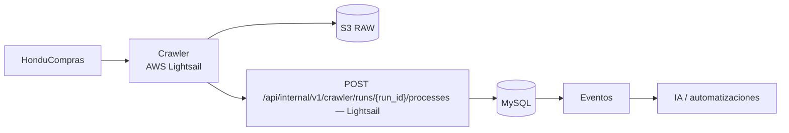

# Módulo Procesos

Catálogo de fuente e ingestión implementados en la unidad 3; [contrato](../contracts/processes.md), [OpenAPI](../contracts/processes-openapi.json), [runbook](../development/processes-runbook.md) y [evidencia](../development/status.md). Conversión a Quotes, estados/asignación comercial, colaboración y resultados AI se incorporan en sus fases; los requisitos siguientes conservan ese alcance futuro. La identidad/versionado/ACK wire vigente se rige por IMPORT_CONTRACT, sin sustituir el cliente Python.


## Objetivo

Convertir Procesos en el punto de entrada de oportunidades de HonduCompras, preservando filtros, marcas, notas y exportación legacy, con ingestión API, versionado, trazabilidad y conexión nativa hacia Cotizaciones.

## Runtime aprobado

**El crawler de HonduCompras se ejecuta en AWS Lightsail.**

GitHub conserva código, documentación y CI/CD, pero no es el runtime del crawler.



El crawler reporta `crawler_run_id` y nunca escribe directo a MySQL.

## Funcionalidad legacy a conservar

### Visualización y filtros

- tarjetas/bloques visuales;
- entidad;
- keyword;
- búsqueda sobre especificaciones y expediente;
- orden asc/desc por fecha;
- vigencia;
- solo marcados;
- ocultar municipalidades;
- resumen de solicitud con fallback a especificaciones;
- fecha de recepción;
- expediente;
- especificaciones.

### Usuario

- marcar/desmarcar interés;
- nota personal;
- conservar marca/nota al actualizar la fuente.

### Administración

- estado de fuente/ingestión;
- actualizar/refrescar;
- exportar CSV;
- resumen de leídas/nuevas/actualizadas/inactivas/errores;
- administración/depuración restringida.

## Debilidades legacy a eliminar

- crawler sin contrato formal de ingestión;
- FTPS + CSV como acoplamiento principal;
- importación manual como flujo diario;
- identidad hash ambigua;
- ausencia de historial durable por ejecución;
- `active` confundido con vigencia;
- filtros/paginación en memoria;
- frontend limitado por primera página grande;
- shapes inconsistentes de marks/notas;
- purge físico destructivo;
- formula injection en CSV.

## Ingestión y tolerancia a fallos

Flujo:

```text
HonduCompras
  -> crawler Lightsail
  -> snapshot raw S3
  -> Go ingestion API
  -> MySQL
```

Reglas:

- cada ejecución tiene `crawler_run_id`;
- la misma entrada puede reintentarse sin duplicar;
- una ejecución parcial/fallida no puede inactivar procesos por ausencia;
- el backend decide normalización, deduplicación/upsert y reglas de negocio;
- S3 conserva evidencia raw;
- CSV queda como exportación o mecanismo de recuperación manual.

## Modelo objetivo

```text
crawler_runs
processes
process_versions
process_documents
process_user_marks
process_user_notes
```

### crawler_runs

```text
id
source
started_at
finished_at
status
is_complete
records_found
new_records
updated_records
unchanged_records
errors_count
raw_snapshot_key
```

### processes

```text
id
source
external_id
expediente
entity
title
received_at
closing_at
is_source_active
first_seen_at
last_seen_at
last_changed_at
current_version_id
created_at
updated_at
```

Identidad:

```text
UNIQUE(source, external_id)
```

Si la fuente no entrega ID confiable, la estrategia sustituta debe ser explícita y versionada.

### process_versions

```text
id
process_id
crawler_run_id
content_hash
normalized_data
raw_data
created_at
```

Solo se crea una versión nueva cuando cambia contenido significativo.

## Active vs vigencia

```text
is_source_active = observado correctamente en la fuente
is_current       = closing_at >= ahora según reglas de negocio
```

No son equivalentes.

## Marcas y notas

Contrato uniforme:

```json
{
  "is_interesting": true,
  "note": "..."
}
```

Son por usuario y sobreviven a nuevas versiones.

---

## Conversión Proceso -> Cotización

### Regla funcional

Un proceso puede crear una **cotización borrador** transfiriendo exclusivamente:

```text
cliente / entidad
expediente
```

y conserva:

```text
process.id -> quotes.source_process_id
```

La acción no consume, reemplaza ni modifica el proceso.

Cardinalidad:

```text
processes 1 ---- N quotes
```

### Datos transferidos

| Proceso | Cotización |
|---|---|
| `entity` | `customer_id` si existe match + `customer_name_snapshot` |
| `expediente` | `process_reference_snapshot` |
| `id` | `source_process_id` |

No se transfieren automáticamente:

```text
especificaciones
fechas
documentos
notas personales
marks
score IA
raw crawler
items
precios
cantidades
```

La cotización queda en borrador con items vacíos.

### Resolución del cliente

```text
process.entity
    |
    v
ClientResolver
    |
    +-- match exacto/canónico -> customer_id + snapshot
    |
    +-- sin match -> customer_id = null + customer_name_snapshot
```

Reglas:

- no crear clientes automáticamente desde el crawler;
- no bloquear la cotización por falta de match;
- permitir `Vincular cliente` o `Crear cliente` posteriormente;
- editar el cliente maestro no altera el snapshot histórico.

### API

```http
POST /api/v1/processes/{process}/create-quote
```

La Action debe:

1. autenticar;
2. autorizar acceso al proceso;
3. exigir `cotizaciones.create`;
4. cargar proceso;
5. resolver cliente;
6. copiar expediente;
7. llamar a la Action pública de Quotes;
8. persistir `source_process_id`;
9. auditar;
10. publicar `process.quote_created`;
11. devolver la cotización para abrir el editor.

Debe admitir protección idempotente frente a doble clic/retry sin impedir que una nueva intención explícita cree otra cotización para el mismo proceso.

### UX

Proceso:

```text
[Crear cotización]

Cotizaciones relacionadas
COT-001247  Borrador
COT-001251  Enviada
```

Cotización:

```text
Proceso de origen
ENEE-CM-...
[Ver proceso]
```

---

## API objetivo

```http
GET   /api/v1/processes
GET   /api/v1/processes/{id}
GET   /api/v1/processes/{id}/versions
PATCH /api/v1/processes/{id}/interest
PATCH /api/v1/processes/{id}/note

POST  /api/v1/processes/{id}/create-quote

GET   /api/v1/processes/status
POST  /api/v1/processes/export

POST  /api/internal/v1/crawler/runs/{run_id}/processes
POST  /api/internal/v1/crawler/runs
```

Filtros:

```text
search
entity
interesting
source_active
current
hide_municipalities
direction
date_from
date_to
page
per_page
```

## Importar/Actualizar en UI

- `Actualizar` refresca datos y estado de la última ingestión;
- admin puede solicitar reprocesamiento;
- puede existir importador CSV de emergencia;
- mostrar última ejecución, última exitosa, encontrados, nuevos, cambiados y errores.

## Export CSV

- server-side;
- UTF-8;
- respeta filtros;
- neutraliza `=`, `+`, `-`, `@`;
- autorización obligatoria.

## Integración de IA

La IA opera sobre la **versión normalizada y/o documentos autorizados** del proceso. Nunca modifica el raw del crawler.

Tools:

```text
get_process()
get_process_versions()
summarize_process()
classify_process()
extract_requirements()
calculate_relevance()
identify_process_items()
match_internal_history()
search_suppliers()
suggest_bid_or_no_bid()
suggest_quote_items()
```

### Flujo asíncrono

Después de una ingestión exitosa:

```text
process.created / process.updated
        |
        v
ai_task
        |
        v
AI Gateway
        |
        v
structured result
        |
        v
ai_runs + datos derivados
```

La transacción de ingestión no espera la respuesta del modelo.

### Resultados derivados

Guardar por separado del dato de fuente:

```text
summary
classification
requirements
relevance_score
identified_items
bid_recommendation
analysis_status
analysis_version
ai_run_id
```

El raw y la versión del proceso siguen siendo inmutables.

### Versionado e invalidación

Un resultado IA debe vincularse al `process_version_id` o `content_hash` analizado.

Si cambia el contenido significativo:

```text
process_versions.content_hash cambia
    -> análisis previo = stale
    -> nueva tarea opcional
```

Si el hash no cambia, puede reutilizarse el análisis para evitar costo duplicado.

### Relevancia / Bid-No Bid

La IA puede proponer:

```text
relevance_score
bid_recommendation
reason_summary
confidence
```

pero no marca automáticamente el proceso como descartado, adjudicado o comprometido. La decisión comercial pertenece al usuario/Workflow.

### Identificación de items

`identify_process_items()` puede convertir especificaciones en una propuesta estructurada de items. Esa propuesta:

- no modifica el proceso;
- no crea automáticamente items de Cotización;
- puede ser consumida luego por `suggest_quote_items()`;
- conserva referencias a la versión y evidencia de origen.

### Proceso -> Cotización

La creación básica permanece determinista:

```text
cliente + expediente -> cotización borrador
```

Luego, opcionalmente:

```text
[Generar items con IA]
```

analiza la versión del proceso y propone items para revisión humana.

### Prompt injection

Todo contenido de HonduCompras se trata como `UNTRUSTED_EXTERNAL_CONTENT`. Instrucciones embebidas en especificaciones no pueden habilitar tools, cambiar políticas de autorización ni ordenar envíos/compras.

### Observabilidad

La UI debe poder mostrar al menos:

```text
Sin analizar
Analizando
Analizado
Falló
Desactualizado
```

sin bloquear el uso normal del proceso.

## Seguridad

```text
procesos.view
procesos.mark
procesos.note
procesos.export
procesos.ingest
procesos.admin
```

Crear cotización:

```text
procesos.view
cotizaciones.create
```

Ingestión utiliza identidad machine-to-machine del crawler Lightsail.

Las tools IA heredan los permisos del actor; un usuario sin `procesos.view` no puede consultar un proceso mediante el asistente.

## Criterios de aceptación

- El crawler sigue ejecutándose en Lightsail.
- Filtros, marcas, notas y export continúan.
- No hay tope silencioso de filas.
- Reintentos no duplican procesos.
- Runs parciales/fallidos no inactivan por ausencia.
- Cambios generan versiones.
- Marks/notas sobreviven.
- `active` y `vigente` permanecen separados.
- CSV no es integración primaria.
- Un proceso crea una cotización borrador con cliente y expediente.
- No se copian items/precios/especificaciones automáticamente.
- Un proceso puede relacionarse con varias cotizaciones.
- Cliente desconocido no bloquea la creación.
- Doble clic/retry no crea duplicados involuntarios.
- IA nunca modifica raw/versiones del crawler.
- Resultados IA quedan asociados al `process_version_id`/hash analizado.
- Crear cotización sigue funcionando sin IA.
- Items/requisitos IA son propuestas revisables, no cambios silenciosos.

## Pipeline IA y revisión del usuario — 2026-10-07

Ver [integración](../architecture/ai-integration.md), [contrato](../contracts/ai-pipeline.md) y [presentación](ai-results.md). Puntuación diaria de pendientes, investigación por ítem, RFQ con Grokbot, precio sugerido con antecedentes S3/MySQL y fichas. Resultados progresivos dentro de Procesos, con fuentes, fecha y cumplimiento por requisito. Estado de investigación separado de revisión humana y presentación de oferta.

La creación básica de cotización sigue operativa sin IA. Acción adicional explícita del usuario incorpora solo alternativas, cantidades, precios y adjuntos seleccionados, mediante Quotes y sin sobrescribir ediciones humanas. No se exportan automáticamente costos, proveedores, márgenes ni notas internas al cliente.


## Alcance adicional conservado

# Processes


# 14. Módulo Procesos

Fuente principal:

HonduCompras crawler.

Estados de negocio posibles:

```text
Nuevo
Revisión
Asignado
Analizando
Interesante
Cotizando
Oferta preparada
Presentado
Adjudicado
Perdido
Cancelado
Cerrado
```

Funciones:

- ver proceso;
- ver histórico;
- ver cambios;
- ver documentos;
- asignar responsable;
- asignar equipo;
- prioridad;
- comentarios;
- tareas;
- análisis AI;
- score;
- items;
- crear cotización;
- iniciar research;
- iniciar procurement.

---


# 26. Crawler HonduCompras

El crawler es un componente crítico.

## 26.1 Responsabilidad

Debe:

```text
DISCOVER
EXTRACT
NORMALIZE
COMPARE
VERSION
ARCHIVE
DELIVER
```

No debe decidir:

- si un proceso es buen negocio;
- score;
- margen;
- responsable;
- proveedor;
- precio de venta.

## 26.2 Schedule

Mínimo:

```text
01:00
19:00
```

Debe permitir más ejecuciones sin cambiar código.

## 26.3 Filosofía

Nunca:

```text
TRUNCATE + RELOAD
```

Siempre:

```text
APPEND DE CONOCIMIENTO
```

## 26.4 Identidad

Prioridad:

1. ID oficial HonduCompras;
2. número de proceso;
3. URL canónica;
4. fingerprint/hash.

En Bastion:

```text
UNIQUE(source, external_id)
```

## 26.5 Estados de cambio

```text
NEW
UPDATED
UNCHANGED
```

## 26.6 Estados de completitud

Independientes:

```text
EMPTY
PARTIAL
COMPLETE
```

Ejemplo:

```text
NEW + EMPTY
```

posteriormente:

```text
UPDATED + COMPLETE
```

## 26.7 Versionado

Tablas:

```text
processes
process_versions
```

`processes`:

- estado actual;
- latest hash;
- first_seen_at;
- last_seen_at;
- current_version.

`process_versions`:

- versiones;
- snapshot;
- hash;
- cambios;
- detected_at.

## 26.8 Hash

No usar HTML bruto.

Construir:

`canonical_payload`

Normalizar:

- espacios;
- saltos;
- fechas;
- URLs;
- HTML;
- encoding;
- orden de documentos.

Después:

```text
SHA256(canonical_payload)
```

## 26.9 Tipos de cambio

```text
DESCRIPTION_CHANGED
DEADLINE_CHANGED
STATUS_CHANGED
DOCUMENT_ADDED
DOCUMENT_REMOVED
DOCUMENT_CHANGED
METADATA_CHANGED
```

## 26.10 Documentos

Por documento:

- nombre;
- URL;
- SHA256;
- first_seen;
- last_seen;
- version.

Si mismo nombre pero contenido distinto:

`DOCUMENT_UPDATED`

## 26.11 Runs

Cada run:

```text
HC-YYYYMMDD-HHMM
```

Ejemplo:

`HC-20261006-1900`

Campos:

- run_id;
- start;
- end;
- status;
- coverage;
- pages expected;
- pages processed;
- pages failed;
- records;
- retries;
- delivery;
- S3;
- ACK.

Estados:

```text
SUCCESS
PARTIAL_SUCCESS
FAILED
```

## 26.12 Tolerancia a fallos

Si:

```text
48 páginas esperadas
46 OK
2 FAIL
```

resultado:

`PARTIAL_SUCCESS`

Los 46 resultados se guardan.

Las 2 páginas van a retry queue.

## 26.13 Retries

- timeout configurable;
- exponential backoff;
- jitter opcional;
- retries por unidad;
- no repetir todo si solo falla una página.

## 26.14 Checkpoints

Guardar:

- páginas completadas;
- páginas fallidas;
- retry queue;
- pending delivery.

Estado técnico local:

- SQLite.

## 26.15 Artefactos

Cada run produce:

```text
processes.csv
processes.json
run.json
errors.json
```

## 26.16 S3

Ejemplo:

```text
s3://castilloit-honducompras-crawler/raw/
2026/
  10/
    06/
      1900/
        processes.csv
        processes.json
        run.json
        errors.json
```

## 26.17 Delivery

Hoy:

- crawler genera CSV;
- entrega a la API Go en Lightsail;
- app carga MySQL.

El protocolo exacto del push actual debe documentarse.

Objetivo:

```http
POST /api/internal/v1/crawler/runs
POST /api/internal/v1/crawler/runs/{run_id}/processes
POST /api/internal/v1/crawler/runs/{run_id}/complete
```

Batches ejemplo:

100 registros/request.

## 26.18 ACK

La API Go debe responder:

```json
{
  "received": 1847,
  "new": 21,
  "updated": 7,
  "unchanged": 1819,
  "errors": 0
}
```

## 26.19 Idempotencia

Usar:

`Idempotency-Key`

Para:

- batches;
- runs;
- RFQ;
- acciones reintentables.

## 26.20 API o MySQL temporalmente indisponible

Si scraping terminó:

```text
HonduCompras -> OK
S3 -> OK
API Go o MySQL Bluehost -> FAIL
```

estado:

`PENDING_DELIVERY`

Se reintenta entrega.

No se vuelve a scrapear.

## 26.21 Ausencia no significa borrado

Si hoy faltan procesos:

- no marcarlos eliminados automáticamente;
- usar missing_count;
- considerar cobertura;
- requerir varias observaciones;
- o estado explícito del sitio.

## 26.22 Replay

Debe poder:

```text
S3 raw
  ↓
replay
  ↓
importer
```

sin consultar HonduCompras.

## 26.23 Dry-run

Soportar:

```text
crawler --dry-run
```

## 26.24 CLI

Ideal:

```text
crawler run
crawler retry
crawler status
crawler replay <run_id>
crawler upload <run_id>
crawler validate <run_id>
```

## 26.25 Métricas

- tiempo total;
- tiempo por página;
- requests;
- errores;
- RAM;
- records;
- coverage;
- retries.

## 26.26 Health

Ejemplo:

```text
crawler: OK
last_success: ...
last_run: ...
last_coverage: 98%
pending_retries: 2
pending_uploads: 0
```

## 26.27 AI queue

Bastion decide:

```text
NEW sin score completado -> puntuación pendiente
PARTIAL con datos útiles -> evaluación provisional, sin descarte por falta de datos
UPDATED relevante -> revisión separada según política
NEW + EMPTY -> información insuficiente / esperar datos
UNCHANGED con pendiente -> retomar; con score completado -> no repetir
```

---


# 46. Versionado y consistencia

## Procesos

Cada cambio significativo:

- nueva version;
- diff;
- hash;
- timestamp;
- trigger AI si corresponde.

## Cotizaciones

Deben soportar versionado cuando se modifica una cotización enviada o aprobada.

## Documentos

Document hash para detectar reemplazos.

---


