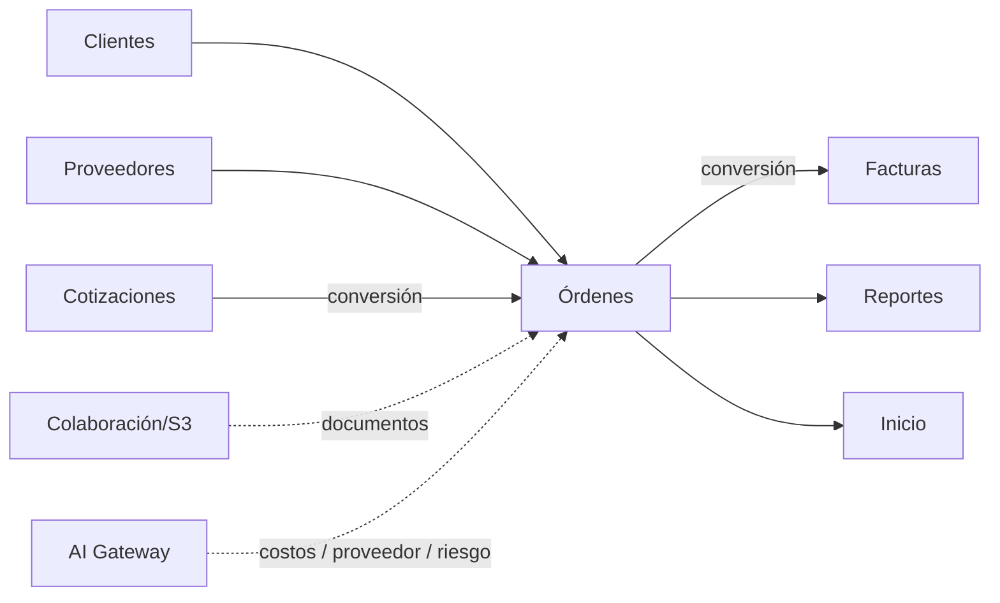

# Módulo Órdenes de Compra

## Objetivo

Preservar el ciclo completo legacy de órdenes: listado, filtros, edición, items, costos, gastos, documentos, estados, entrega, clonación y conversiones; implementándolo con atomicidad y trazabilidad.

## Funcionalidad legacy a conservar

### Listado

- búsqueda por número, factura, cliente, descripción de item y comentario;
- filtros por estado;
- filtro por cliente;
- mínimo/máximo de total;
- paginación;
- acciones desde menú de comportamiento.

### Orden

- crear;
- editar;
- eliminar según política;
- número;
- cliente registrado o manual;
- destino;
- fecha;
- comentarios;
- gastos adicionales;
- clonar;
- marcar entregada;
- número de factura asociado.

### Items

- descripción;
- cantidad;
- precio de venta;
- costo/inversión;
- proveedor;
- estado;
- tracking/comentarios;
- adjuntar/visualizar/descargar/eliminar documento;
- cambiar estado.

### Estados

```text
Orden:
Pendiente
Listo
Entregado
Convertido cuando aplique

Item:
Pendiente
Comprado
```

Regla legacy:

- sin items o con items pendientes -> Pendiente;
- todos comprados -> Listo;
- con número de factura/entrega -> Entregado.

### Acciones

- cotización -> orden;
- orden -> factura;
- clonar;
- marcar entrega.

## Mapping legacy obligatorio

En legacy:

```text
purchase_price = precio de venta unitario
sale_price     = costo/inversión unitario
shipping_cost  = inversión total
shipped_cost   = gastos adicionales
```

El nuevo dominio usa nombres claros:

```text
unit_sale_price
unit_cost
products_investment
additional_expenses
investment_total
```

La migración debe documentar el mapping.

## Cálculos a preservar

```text
subtotal_venta = Σ(cantidad × precio_venta)
inversion_productos = Σ(cantidad × costo)
inversion_total = inversion_productos + gastos_adicionales
ISV = base_gravada × tasa
total_venta = subtotal + impuestos
```

La utilidad debe quedar definida una sola vez y compartida con Reportes, Inicio y Facturas.

## Debilidades legacy a eliminar

- cabecera y detalles sin transacción;
- órdenes vacías accidentales al convertir;
- pérdida de descuentos/ISV 18/trazabilidad;
- `source_quote_id` temporal;
- gastos/comentarios fuera de SQL;
- documentos en filesystem publicable;
- estados por IDs hardcodeados;
- borrados de binarios no reconciliables.

## Modelo objetivo

```text
customer_purchase_orders
customer_purchase_order_items
customer_purchase_order_expenses
customer_purchase_order_status_history
documents
document_links
```

### customer_purchase_orders

```text
id
order_number
customer_id nullable
customer_*_snapshot
destination_id nullable
destination_snapshot
order_date
status
comments
source_quote_id nullable
invoice_id nullable
invoice_number_snapshot nullable
subtotal
tax_total
total
products_investment
additional_expenses
investment_total
profit
created_by
updated_by
created_at
updated_at
deleted_at
```

### customer_purchase_order_items

```text
id
purchase_order_id
description
quantity
unit_sale_price
unit_cost
tax_type
supplier_id nullable
supplier_name_snapshot
status
tracking
comments
created_at
updated_at
```

## Conversión Cotización -> Orden

```http
POST /api/v1/quotes/{quote}/convert-to-purchase-order
```

Debe:

1. validar permisos;
2. comprobar idempotencia;
3. leer la cotización en backend;
4. mapear cliente/items/impuestos;
5. crear orden e items en transacción;
6. guardar `source_quote_id`;
7. cambiar estado y versionar cotización en la misma transacción del propietario;
8. publicar evento.

La unidad vigente exige número explícito y orden íntegra; no crea borradores vacíos. El [contrato de conversión](../contracts/quote-purchase-order-conversion.md) fija aceptación, permisos y atomicidad.

## Conversión Orden -> Factura

```http
POST /api/v1/purchase-orders/{order}/convert-to-invoice
```

Idempotente y con `invoice_id` persistente.

## API objetivo

```http
GET    /api/v1/purchase-orders
POST   /api/v1/purchase-orders
GET    /api/v1/purchase-orders/{id}
PATCH  /api/v1/purchase-orders/{id}
DELETE /api/v1/purchase-orders/{id}

POST   /api/v1/purchase-orders/{id}/clone
PATCH  /api/v1/purchase-orders/{id}/deliver
PATCH  /api/v1/purchase-orders/{id}/status

POST   /api/v1/purchase-orders/{id}/items
PATCH  /api/v1/purchase-orders/{id}/items/{item}
PATCH  /api/v1/purchase-orders/{id}/items/{item}/status

POST   /api/v1/purchase-orders/{id}/documents
GET    /api/v1/purchase-orders/{id}/documents
```

## Documentos

Bytes en S3; metadata en MySQL. Preview/descarga mediante streaming autorizado o URL firmada corta.

## Conexiones



## Seguridad

```text
ordenes.view
ordenes.create
ordenes.update
ordenes.delete
ordenes.deliver
ordenes.convert
```

Entrega, eliminación y conversión requieren auditoría.

## Integración de IA

Tools:

```text
get_order()
get_order_items()
suggest_supplier()
suggest_purchase_cost()
get_supplier_price_history()
calculate_order_margin()
detect_order_risk()
draft_order_comments()
compare_order_with_quote()
```

### Casos de uso

- sugerir proveedor por item;
- recuperar precios históricos autorizados;
- proponer costo de compra con evidencia;
- comparar Orden contra Cotización de origen;
- detectar items sin proveedor/costo/tracking;
- explicar margen o desviaciones;
- preparar comentarios internos;
- priorizar compras pendientes.

### Evidencia de precio

Una sugerencia de costo debe distinguir:

```text
precio histórico interno
precio web observado
cotización de proveedor
estimación IA
```

Nunca deben presentarse como equivalentes.

Cada sugerencia externa conserva fuente, fecha, moneda y supuestos.

### Estados protegidos

La IA no puede cambiar por sí sola:

```text
Pendiente -> Comprado
Listo -> Entregado
```

ni ejecutar:

```text
order.deliver
order.convert-to-invoice
```

sin permiso explícito y, por defecto, aprobación humana.

### Cálculos

La IA no calcula de forma autoritativa subtotal, impuesto, inversión o utilidad. Debe llamar a servicios canónicos de Go:

```text
OrderFinancials
```

El modelo puede explicar el resultado, no redefinirlo.

### Automatización futura

Un evento como:

```text
order.created
```

puede disparar de forma asíncrona:

```text
identify_missing_costs
suggest_suppliers
analyze_margin
```

Los resultados se guardan como recomendaciones, no como cambios silenciosos de la Orden.

## Criterios de aceptación

- No existe orden parcial por fallo entre cabecera/items.
- Conversión conserva trazabilidad.
- No se guarda orden vacía salvo borrador explícito.
- Estados legacy siguen disponibles.
- Clonar reinicia entrega y factura.
- Documentos fuera de webroot.
- Reportes/Inicio usan las mismas fórmulas.
- IA puede sugerir costos/proveedores sin alterar estados automáticamente.
- Todo precio externo sugerido conserva evidencia.
- La Orden sigue operativa si la IA está deshabilitada.


## Alcance adicional conservado

# PurchaseOrders


# 16. Módulo Órdenes de Compra

En el menú inicial significa:

> órdenes de compra emitidas por clientes después de aprobar una cotización.

Entidad conceptual:

`customer_purchase_orders`

Campos:

- cliente;
- número de OC;
- cotización;
- fecha;
- items;
- monto;
- lugar de entrega;
- fecha de entrega;
- documentos;
- estado.

Estados:

```text
Recibida
Confirmada
Comprando
En tránsito
Recibido
Preparando entrega
Entregado
Facturado
Cerrado
```

A futuro debe existir separado:

`supplier_purchase_orders`

para órdenes emitidas por Castillo IT a proveedores.

---


## Presentación del módulo

# purchase-orders


# 16. Módulo Órdenes de Compra

En el menú inicial significa:

> órdenes de compra emitidas por clientes después de aprobar una cotización.

Entidad conceptual:

`customer_purchase_orders`

Campos:

- cliente;
- número de OC;
- cotización;
- fecha;
- items;
- monto;
- lugar de entrega;
- fecha de entrega;
- documentos;
- estado.

Estados:

```text
Recibida
Confirmada
Comprando
En tránsito
Recibido
Preparando entrega
Entregado
Facturado
Cerrado
```

A futuro debe existir separado:

`supplier_purchase_orders`

para órdenes emitidas por Castillo IT a proveedores.

---


## Documentos privados OC e identidad de ítems

Contrato propietario vigente: [documentos privados OC](../contracts/purchase-order-documents.md). Migración 0018 y vínculos durables a IDs de ítem; edición/reordenamiento preserva identidad, papelera no permite eliminar el ítem vinculado.

## Clonación OC

Contrato vigente: [clonación OC](../contracts/purchase-order-cloning.md). Migración 0019 conserva origen/versión, reinicio operacional y relación inmutable sin copiar adjuntos.
