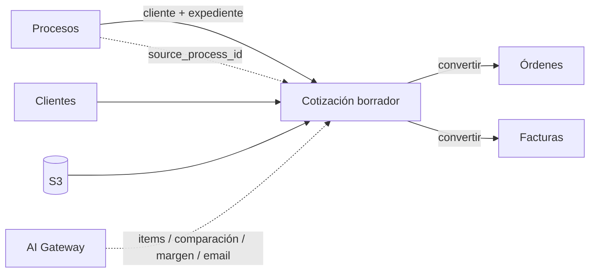

# Módulo Cotizaciones

## Objetivo

Mantener creación, cálculo, listado, búsqueda, estados, PDF, adjuntos, correo, clonación y conversiones, centralizando cálculos en backend y conectando IA de forma segura.

El módulo también debe aceptar la creación de cotizaciones borrador originadas desde Procesos, conservando trazabilidad hacia el expediente público que las originó.

## Funcionalidad legacy a conservar

### Listado
- búsqueda por número, orden, cliente e items/descripciones;
- paginación;
- filtros persistidos en URL;
- selección múltiple;
- acciones bulk;
- estados.

### Documento
- crear/editar;
- número automático `COT-...`;
- cliente registrado o manual;
- proceso/orden de referencia;
- fecha;
- días de validez;
- items;
- notas privadas;
- términos públicos;
- contacto del autor;
- clonar con nuevo correlativo.

### Cálculo
- cantidad;
- precio unitario;
- descuento por item en valor o porcentaje;
- descuento general;
- ISV 15%;
- ISV 18%;
- exento;
- exoneración;
- totales y redondeo.

La semántica legacy del descuento absoluto por item se conserva: **es por unidad**, no por línea.

### Adjuntos
- listar;
- subir;
- preview;
- descargar;
- soft-delete.

### PDF
- plantilla imprimible;
- logo;
- contacto;
- sello;
- total en letras;
- etiquetas de impuesto.

### Correo

Conservar:

```text
to
cc
bcc
subject
message
scheduled_at
PDF
adjuntos
```

Envío inmediato o programado por SMTP Bluehost.

### Conversiones
- cotización -> orden;
- cotización -> factura;
- equivalentes bulk.

## Debilidades legacy a eliminar

- cálculo duplicado backend/frontend;
- conversión a orden en navegador;
- pérdida de descuentos/impuestos;
- hard-delete sin papelera;
- PDF browser/base64 como dependencia;
- jobs JSON sin claim/lock;
- SMTP por sockets propios;
- adjuntos fuera de SQL;
- bulk como requests independientes sin lote trazable;
- referencia al proceso como texto aislado sin relación persistente.

## Cálculo canónico

Crear:

```text
QuoteCalculator
```

Debe resolver:

```text
descuento_unitario
subtotal_linea
descuento_general proporcional
base 15
base 18
exento
exonerado
ISV 15
ISV 18
total
```

Go persiste el resultado. Angular solo hace preview.

## Modelo objetivo

```text
quotes
quote_items
document_counters
email_messages
documents
document_links
```

### Relación con Procesos

`quotes` debe incluir como mínimo:

```text
source_process_id nullable
process_reference_snapshot nullable
```

Además de los campos de snapshot del cliente:

```text
customer_id nullable
customer_name_snapshot
customer_rtn_snapshot nullable
customer_contact_snapshot nullable
customer_email_snapshot nullable
customer_address_snapshot nullable
```

Reglas:

- `source_process_id` referencia el proceso que originó la cotización;
- `process_reference_snapshot` conserva el expediente tal como se utilizó al crear la cotización;
- editar el proceso posteriormente no reescribe el snapshot de la cotización;
- una cotización manual puede tener `source_process_id = null`;
- un proceso puede originar varias cotizaciones;
- eliminar/anular una cotización no elimina ni modifica el proceso de origen.

Cardinalidad:

```text
processes 1 ---- N quotes
```

## Creación desde Procesos

La creación desde Procesos es una acción de integración entre módulos y debe ejecutarse en backend.

Entrada funcional:

```text
Proceso
- cliente / entidad
- expediente
```

Resultado:

```text
Cotización borrador
- cliente heredado/resuelto
- expediente heredado
- source_process_id
- items vacíos
```

No se transfieren automáticamente:

```text
especificaciones
fechas del proceso
documentos
notas personales
marks
score IA
raw crawler
items
precios
cantidades
```

### Resolución del cliente

La creación debe usar el resolver compartido de clientes:

```text
ClientResolver
```

Si existe match exacto/canónico:

```text
customer_id = cliente encontrado
customer_name_snapshot = nombre usado en la cotización
```

Si no existe match:

```text
customer_id = null
customer_name_snapshot = nombre de entidad del proceso
```

La cotización sigue siendo válida como borrador y la UI ofrece después:

```text
Vincular cliente
Crear cliente
```

No se crea automáticamente un cliente maestro desde HonduCompras.

### Action pública del módulo Quotes

El módulo debe exponer una Action/Service reutilizable, por ejemplo:

```text
CreateQuoteFromProcess
```

Esa Action debe ser utilizada por el endpoint del módulo Processes:

```http
POST /api/v1/processes/{process}/create-quote
```

De esta forma Processes solicita la operación, pero Quotes continúa siendo propietario de las reglas de creación de cotizaciones, numeración, snapshots y estado inicial.

### Estado inicial

Una cotización creada desde proceso comienza como:

```text
Borrador
```

No se marca como enviada ni convertida y no contiene items hasta que el usuario o una acción posterior autorizada los agregue.

### Idempotencia

La acción debe aceptar una llave idempotente para evitar duplicados accidentales por doble clic, timeout o retry.

La idempotencia protege una **misma intención**; no impide que un usuario cree deliberadamente otra cotización para el mismo proceso usando una nueva intención/llave.

## Navegación y UX

En el editor/detalle de una cotización originada desde Procesos debe mostrarse:

```text
Proceso de origen
ENEE-CM-GG-10005143-2026
[Ver proceso]
```

El expediente debe ser visible y editable solo según las reglas comerciales aprobadas, pero la relación técnica `source_process_id` no debe perderse por editar el texto visible.

El proceso muestra a su vez todas sus cotizaciones relacionadas.

## Numeración

El correlativo `COT-000001...` sigue siendo server-side con transacción, lock de contador y `UNIQUE quote_number`.

Crear una cotización desde un proceso usa exactamente el mismo mecanismo de numeración que crearla manualmente.

## API objetivo

```http
GET    /api/v1/quotes
POST   /api/v1/quotes
GET    /api/v1/quotes/{id}
PATCH  /api/v1/quotes/{id}
DELETE /api/v1/quotes/{id}

POST   /api/v1/quotes/{id}/clone
PATCH  /api/v1/quotes/{id}/status

POST   /api/v1/quotes/{id}/documents
GET    /api/v1/quotes/{id}/documents

POST   /api/v1/quotes/{id}/send
POST   /api/v1/quotes/{id}/schedule-send

POST   /api/v1/quotes/{id}/convert-to-purchase-order
POST   /api/v1/quotes/{id}/convert-to-invoice
```

Integración desde Procesos:

```http
POST /api/v1/processes/{process}/create-quote
```

Bulk:

```http
POST /api/v1/quotes/bulk/status
POST /api/v1/quotes/bulk/clone
POST /api/v1/quotes/bulk/export
```

Cada lote devuelve `batch_id` y resultado por item.

## Email Bluehost

```text
Quote
 -> snapshot PDF
 -> queued email
 -> servicio de correo Go
 -> Bluehost SMTP
 -> sent/failed ledger
```

No guardar passwords SMTP por usuario en JSON. Programación mediante Scheduler/queue, nunca cron público.

## PDF

Objetivo:

```text
quote -> render -> PDF -> S3 -> document record -> email
```

El PDF enviado es el mismo snapshot registrado para ese envío.

Cuando la cotización tenga proceso de origen, el expediente visible forma parte de la información del documento según la plantilla aprobada, pero no se requiere incluir el identificador interno `source_process_id`.

## Conexiones



## Seguridad

```text
cotizaciones.view
cotizaciones.create
cotizaciones.update
cotizaciones.delete
cotizaciones.send
cotizaciones.convert
```

Crear desde Proceso requiere como mínimo:

```text
procesos.view
cotizaciones.create
```

La Action `CreateQuoteFromProcess` vuelve a aplicar autorización y validación; no confía en que Angular haya ocultado o mostrado correctamente el botón.

## Integración de IA

La creación básica desde un proceso **no depende de IA**. IA entra después como una capa opcional de asistencia.

Tools:

```text
get_quote()
create_quote_draft()
create_quote_draft_from_process()
suggest_quote_items()
compare_quote_with_process()
find_missing_requirements()
get_previous_prices()
calculate_quote_margin()
draft_quote_email()
explain_quote_risk()
```

### Generar items desde Proceso con IA

Acción separada:

```text
Cotización borrador
  -> source_process_id
  -> AI: extract/suggest_quote_items
  -> propuesta estructurada
  -> revisión del usuario
  -> agregar items aprobados
```

La propuesta debe incluir por item, cuando sea posible:

```text
description
quantity nullable
unit nullable
technical_requirements
source_reference
confidence
notes
```

La IA no inserta silenciosamente items definitivos. El usuario puede aceptar, editar o rechazar.

### Comparación contra requisitos

Si existe `source_process_id`, la IA puede comparar:

```text
requisitos del proceso
vs
items de la cotización
```

para identificar:

- requisitos no cubiertos;
- diferencias técnicas;
- items posiblemente faltantes;
- campos ambiguos que requieren revisión.

El resultado es una ayuda de validación, no certificación de cumplimiento.

### Precios y margen

La IA no define los cálculos canónicos. Debe usar:

```text
QuoteCalculator
get_previous_prices()
calculate_quote_margin()
```

Los precios sugeridos deben diferenciar histórico, fuente externa, cotización de proveedor y estimación.

### Email

`draft_quote_email()` puede generar asunto/cuerpo. `send` permanece separado y requiere `cotizaciones.send` más policy/aprobación correspondiente.

### Riesgo y trazabilidad

Toda ejecución relevante guarda `ai_run_id`, `prompt_version`, `input_hash`, provider/model y resultado estructurado.

No se insertan notas privadas en prompts o outputs públicos salvo necesidad explícita y autorización.

## Eventos

Al crear desde proceso:

```text
quote.created
process.quote_created
```

Eventos que pueden disparar IA de forma asíncrona:

```text
quote.created -> analyze_quote_if_requested
quote.updated -> invalidate_stale_ai_analysis
```

La IA no forma parte de la transacción principal.

## Criterios de aceptación

- Tests de regresión para descuentos/impuestos.
- Correlativo único.
- PDF, adjuntos y correo siguen funcionando.
- Programación no duplica envíos.
- Conversiones a orden/factura son server-side, idempotentes y trazables.
- Notas privadas no se imprimen.
- `terms` sigue siendo público.
- Un proceso puede crear una cotización borrador con cliente y expediente en una sola acción.
- Un proceso puede tener varias cotizaciones relacionadas.
- La relación `source_process_id` persiste aunque se edite el expediente visible.
- Cliente desconocido no bloquea la creación y queda como snapshot manual.
- La creación desde proceso no copia items, precios ni especificaciones automáticamente.
- La creación no depende de OpenAI ni de otro proveedor de IA.
- IA puede sugerir items y comparar requisitos, pero el usuario controla qué entra a la cotización.
- Enviar cotización/correo sigue requiriendo autorización independiente de la IA.

## Pipeline IA y revisión del usuario — 2026-10-07

Ver [integración](../architecture/ai-integration.md), [contrato](../contracts/ai-pipeline.md) y [presentación](ai-results.md). Puntuación diaria de pendientes, investigación por ítem, RFQ con Grokbot, precio sugerido con antecedentes S3/MySQL y fichas. Resultados progresivos dentro de Procesos, con fuentes, fecha y cumplimiento por requisito. Estado de investigación separado de revisión humana y presentación de oferta.

La creación básica de cotización sigue operativa sin IA. Acción adicional explícita del usuario incorpora solo alternativas, cantidades, precios y adjuntos seleccionados, mediante Quotes y sin sobrescribir ediciones humanas. No se exportan automáticamente costos, proveedores, márgenes ni notas internas al cliente.


## Estados y datos comerciales conservados

Borrador → Costeo → Revisión → Aprobada internamente → Enviada → Aceptada / Rechazada / Vencida. Las transiciones se implementan con su política y aprobación; no basta aceptar un estado del navegador. Modificar una cotización aprobada/enviada genera revisión e invalida aprobación previa. Costos, margen, flete, proveedores, datasheets y aprobación conservan sus requisitos y privacidad; datos de investigación entran solo por selección autorizada.

## Estado de implementación

La primera unidad implementa borradores, cálculo exacto, snapshots, numeración, edición, clonación, versiones, papelera/restauración, consulta MCP y conversión determinista desde Procesos. [Contrato implementado](../contracts/quotes.md), [OpenAPI](../contracts/quotes-openapi.json) y [runbook](../development/quotes-runbook.md). PDF de borrador y adjuntos implementados en la segunda unidad. Estados preliminares draft/costing/review y revisiones implementados. Correo/programación, aprobación/emisión, bulk, FX e integración con OC/Factura mantienen el alcance objetivo y sus pruebas pendientes. No se declara el módulo completo ni se avanza al siguiente por esta unidad.
