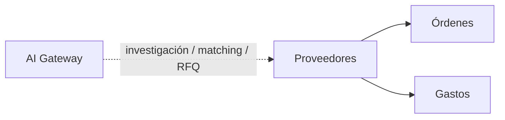

# Módulo Proveedores

## Objetivo

Mantener el catálogo de proveedores y convertirlo en una pieza reutilizable para compras, costos, gastos e investigación asistida por IA.

## Funcionalidad legacy a conservar

- listado;
- creación;
- edición;
- uso como catálogo;
- selección de proveedor en detalles de órdenes;
- compatibilidad con datos históricos donde el proveedor existe solo como texto.

## Debilidades legacy a eliminar

- catálogo demasiado mínimo;
- gastos con proveedor solo texto;
- relaciones sin garantías SQL completas;
- ausencia de trazabilidad de fuentes, contactos y precios investigados.

## Modelo y contrato implementado

Catálogo manual con ficha, contactos, categorías/marcas, productos, condiciones comerciales, evaluación humana, notas, historial, documentos privados y observaciones de precios con evidencia. Tablas/DTO/validadores en [contrato de Proveedores](../contracts/suppliers.md), [OpenAPI](../contracts/suppliers-openapi.json) y migración 0003_suppliers.sql. Sin deleted_at ni borrado: is_active conserva identidad y referencias. Campos opcionales de texto usan cadena vacía; canonical_rtn, equipo, evaluación, respuesta, precio y MOQ pueden ser NULL en SQL según contrato.

Las futuras cotizaciones oficiales de proveedores/RFQ y resultados IA tienen sus propios estados y propietarios; no crear supplier_quotes/supplier_sources como duplicados de las observaciones manuales sin contrato de esa fase.

## Compatibilidad histórica

Cuando se implementen, Órdenes y Gastos conservarán:

```text
supplier_id nullable
supplier_name_snapshot
```

## API objetivo

```http
GET    /api/v1/suppliers
POST   /api/v1/suppliers
GET    /api/v1/suppliers/{id}
PATCH  /api/v1/suppliers/{id}
```

Filtros: `search`, `country`, `is_active`, `page`, `per_page`.

## Conexiones



### Órdenes

Al implementar Órdenes, cada ítem podrá seleccionar proveedor mediante servicio autorizado y conservar snapshot. Hoy existen Snapshot/ResolveExact; no existe aún el propietario de OC.

### Gastos

Al implementar Gastos se agregará supplier_id opcional sin eliminar proveedor libre/snapshot. LegacySnapshot ya conserva texto con ID null sin crear ni fusionar fichas.

## Seguridad

```text
proveedores.view
proveedores.create
proveedores.update
```

## Integración de IA

Tools objetivo; lectura search_suppliers/get_supplier/resolve_supplier_exact/get_supplier_price_history implementada. Herramientas de investigación, candidatos, RFQ y escritura de agentes pendientes de AI/Workflow:

```text
search_suppliers()
get_supplier()
find_supplier_candidates()
get_supplier_price_history()
create_supplier_draft()
draft_supplier_rfq()
record_supplier_research()
```

### Casos de uso

- buscar proveedores existentes;
- encontrar candidatos externos para un item/requisito;
- comparar precio histórico con precio observado;
- proponer proveedor para un item de Orden;
- preparar RFQ;
- resumir historial de relación comercial;
- identificar proveedor potencialmente duplicado.

### Investigación externa

Cada resultado externo debe conservar evidencia suficiente:

```text
source_url
source_type
captured_at
observed_price nullable
currency nullable
availability nullable
supplier_name
part_number nullable
confidence nullable
ai_run_id
```

La IA no puede convertir una búsqueda web en dato maestro sin revisión.

### Proveedores candidatos

Un resultado de investigación debe poder vivir primero como:

```text
supplier_candidate
```

antes de convertirse en `supplier` definitivo.

Crear o promover un proveedor maestro requiere permiso/policy y queda auditado.

### RFQ

Preferir tools limitadas:

```text
draft_supplier_rfq()
send_supplier_rfq()
```

en lugar de correo genérico.

El borrador puede generarse automáticamente. Enviar el RFQ requiere aprobación humana por defecto o una regla de automatización aprobada que limite destinatario, frecuencia, template, item y cooldown.

### Límites

La IA no puede:

- crear proveedores definitivos sin policy;
- sobrescribir datos maestros por investigación web;
- marcar una cotización de proveedor como oficial si solo proviene de una página web;
- enviar RFQ ilimitados;
- revelar credenciales SMTP;
- asumir que un precio observado incluye impuestos, envío o disponibilidad sin evidencia.

## Criterios de aceptación del proyecto completo

La unidad de catálogo cierra las pruebas indicadas en el contrato. Las siguientes conexiones se aceptan junto a sus propietarios futuros; no se declaran probadas por implementar el catálogo:

- CRUD legacy preservado.
- Órdenes siguen seleccionando proveedor.
- Gastos históricos por texto siguen funcionando.
- Toda investigación IA conserva fuente y fecha.
- IA puede proponer candidatos/borradores sin alterar automáticamente el maestro.
- RFQ puede prepararse por IA y enviarse solo bajo policy/aprobación.

## Pipeline IA y revisión del usuario — 2026-10-07

Ver [integración](../architecture/ai-integration.md), [contrato](../contracts/ai-pipeline.md) y [presentación](ai-results.md). Puntuación diaria de pendientes, investigación por ítem, RFQ con Grokbot, precio sugerido con antecedentes S3/MySQL y fichas. Resultados progresivos dentro de Procesos, con fuentes, fecha y cumplimiento por requisito. Estado de investigación separado de revisión humana y presentación de oferta.

Al implementar Quotes, la creación básica de cotización deberá operar sin IA. Acción adicional explícita del usuario incorpora solo alternativas, cantidades, precios y adjuntos seleccionados, mediante Quotes y sin sobrescribir ediciones humanas. No se exportan automáticamente costos, proveedores, márgenes ni notas internas al cliente.


## Presentación y alcance conservado

Empresa, país, contactos/emails, categorías/marcas, productos, precios con fuentes, lead times, MOQ, términos de pago, documentos, historial, evaluación/confiabilidad y respuesta. RFQ, cotizaciones recibidas oficiales y tiempos de respuesta calculados se integrarán mediante AI/Workflow y los propietarios comerciales; la ficha actual registra condiciones/evaluaciones manuales sin inventar esos resultados.
